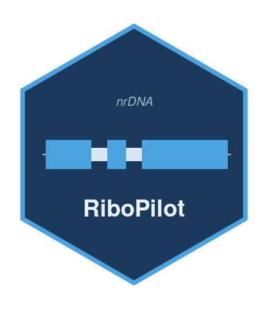
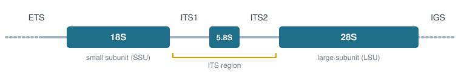

<!-- README.md is generated from README.Rmd. Please edit that file -->

# RiboPilot <a href="https://nmnh-oceandna.github.io/RiboPilot/"></a>

<!-- badges: start -->

[](https://lifecycle.r-lib.org/articles/stages.html#experimental)
<!-- badges: end -->

Please see the [documentation
website](https://nmnh-oceandna.github.io/RiboPilot/) for more details.

RiboPilot is a product of the [NMNH Ocean DNA
initiative](https://naturalhistory.si.edu/initiatives/oceans/ocean-science-center/ocean-dna)
and does not represent an official Smithsonian Institution position or
product.

RiboPilot assembles and annotates the **nuclear ribosomal DNA repeat
(rDNA)** from genome skimming data, then helps you check and clean up
the result and package it for submission to GenBank. If you already have
an assembly, RiboPilot can [start from that instead of
reads](https://nmnh-oceandna.github.io/RiboPilot/articles/Your-Own-Project.html#already-have-an-assembly).
RiboPilot is a companion to
[MitoPilot](https://github.com/NMNH-OceanDNA/MitoPilot), which does the
same process for the mitochondrial genome. You can run both tools on the
same samples and get both marker sets from one sequencing run.

Most of your work happens in a **point-and-click Shiny app** that runs
in your web browser. The step-by-step [Get started
guide](https://nmnh-oceandna.github.io/RiboPilot/articles/RiboPilot.html)
walks through a complete project from start to finish.

# The nuclear ribosomal DNA unit

Every cell carries the ribosomal RNA genes in a repeated unit that is
copied hundreds to thousands of times in a row. Because there are so
many copies, even a shallow, inexpensive "genome skim" sequences this
region very deeply. From it you get some widely used nuclear markers for
phylogenetics and DNA barcoding: **18S**, **28S**, **ITS1**, **ITS2**,
and the full **ITS** region.



The core rDNA unit is typically highly conserved, but with hundreds of
copies arranged in a tandem repeat. The three ribosomal genes (18S,
5.8S, 28S) are highly conserved and act as anchors. The two spacers
(ITS1, ITS2) sit between them, evolve quickly, and are the regions that
distinguish closely related species.

Between the 28S of one copy and the 18S of the next lies the intergenic
spacer (IGS): the 3' external transcribed spacer (ETS), a
non-transcribed spacer (NTS), and the 5' ETS of the next copy ([Hwang
and Kim 1999](https://pmc.ncbi.nlm.nih.gov/articles/PMC2733198/)).

However, the structure of the nuclear rDNA repeat varies across the tree
of life. The IGS can range from a few hundred base pairs to tens of
kilobases and often holds subrepeats. Repeat blocks of the rDNA unit can
be located at one or several places in the genome. See ([Wang et
al. 2023](https://www.nature.com/articles/s41437-023-00634-5) for a
review.

# What RiboPilot does for you

The app walks each project through five steps, in order:

1.  **Taxonomy.** RiboPilot matches the `Taxon` you provide for each
    sample to the [NCBI
    taxonomy](https://www.ncbi.nlm.nih.gov/datasets/taxonomy/). Samples
    must be reviewed and locked here before they move on to assembly,
    since the taxonomic ID of your samples guides scoring and curation.
2.  **Reference.** RiboPilot groups related samples and builds a
    reference database of known rDNA sequences for each group, from
    GenBank.
3.  **Assemble.** One run cleans the reads, assembles the ribosomal
    repeat for each sample, picks the best assembly path, finds the five
    features (18S, ITS1, 5.8S, ITS2, 28S), and checks each result for
    problems such as a missing gene, an unusual length, a possible
    contaminant, or a chimera. You choose which contigs to keep or drop
    for the next step.
4.  **Annotation Review.** You check the annotated features and quality
    flags of each kept contig, adjusting boundaries if needed.
5.  **Export.** RiboPilot writes a tidy, GenBank-ready submission
    package, and warns you about any flagged record first.

Behind the scenes RiboPilot uses established bioinformatics tools
([fastp](https://github.com/OpenGene/fastp),
[GetOrganelle](https://github.com/Kinggerm/GetOrganelle),
[barrnap](https://github.com/tseemann/barrnap) /
[pybarrnap](https://github.com/moshi4/pybarrnap),
[ITSx](https://microbiology.se/software/itsx/),
[BLAST](https://blast.ncbi.nlm.nih.gov/Blast.cgi), and others) and
stitches them together for you. You do not need to learn or run any of
them yourself. However, advanced users can adjust the parameters for
each tool within RiboPilot.

# Taxonomic Scope

Each group of samples needs a reference database of known rDNA
sequences. You build it once per group in the app, from GenBank. See the
[reference database
guide](https://nmnh-oceandna.github.io/RiboPilot/articles/Reference-Databases.html).

RiboPilot also runs automatic quality checks tuned for a taxonomic
group. Five settings ship, picked from each sample's lineage: a generic
animal setting, and settings for ray-finned fishes, sea stars, true
jellyfish, and octocorals; see the [curation
guide](https://nmnh-oceandna.github.io/RiboPilot/articles/Curation-Flags.html).
These settings are still in development and likely need fine tuning.

# Installation

RiboPilot requires Docker (or Singularity on a cluster), Java, Nextflow,
and R. The [Installation
guide](https://nmnh-oceandna.github.io/RiboPilot/articles/Installation.html)
lists versions and checks. Then, in R:

``` r
install.packages("remotes")
remotes::install_github("NMNH-OceanDNA/RiboPilot")
```

# Getting started

The best way to learn RiboPilot is to run the built-in test project. The
first command downloads the test samples and sets everything up; the
second opens the app:

``` r
RiboPilot::new_test_project(path = "~/ribopilot_test")
RiboPilot::RiboPilot("~/ribopilot_test")
```

By default this fetches small rDNA-filtered read subsets published with
the RiboPilot releases, so setup takes under a minute. Pass `full_size =
TRUE` to download the complete read sets from ENA/SRA instead (several
GB). The first run also downloads the container image once (about 2.6
GB).

Follow the [Get started
guide](https://nmnh-oceandna.github.io/RiboPilot/articles/RiboPilot.html)
to walk through project initialization and the five steps in the app.

# Citing RiboPilot

Run `citation("RiboPilot")` in R.

# Getting help

  - Full documentation: <https://nmnh-oceandna.github.io/RiboPilot/>
  - When something goes wrong: the [Troubleshooting
    guide](https://nmnh-oceandna.github.io/RiboPilot/articles/Troubleshooting.html).
  - Questions or problems: please open an
    [issue](https://github.com/NMNH-OceanDNA/RiboPilot/issues).
