# RiboPilot usability review

Date: 2026-09-23. Code under test: `main` at 3362308 (version 0.0.0.9018), read on branch `review/2026-09-full-review` and loaded with `pkgload::load_all()`. Pipeline image `macguigand/ribopilot:0.0.0.9018`; RiboPilot pinned Nextflow to 25.10.6.

Eight people used RiboPilot hands-on. Three operators ran real projects from start to finish: the practice project, a new gastropod SRA project, and a sweep of common user mistakes. Five persona reviewers then worked in copies of those projects: a first-time field biologist, a MitoPilot veteran, a core-facility power user, a UI and accessibility specialist, and a GenBank curator. Every pipeline run was started from the app's Update and Run from App buttons. None were scripted.

Reviewers wrote 194 findings (operators 34, 15, and 29; personas 21, 22, 23, 30, and 20). Duplicates are merged here into 87 items, UX-01 to UX-87: **3 blockers, 30 major, 44 minor, and 10 polish**. A verifier checked every finding: 192 were confirmed and 2 were refuted (see Appendix A). None are disputed, uncertain, or unverified-low, so every item below is **Confirmed**.

How severity is set: each item takes the highest verified severity among the findings merged into it. Each id is listed with its own verified severity. Where a verifier changed the reporter's rating, the item says so.

Severity scale: **blocker** = the user cannot finish, or gets a wrong result without warning. **Major** = serious friction or a likely error. **Minor** = friction the user can recover from. **Polish** = cosmetic.

## The short version

1. **RiboPilot can write wrong GenBank records without any warning.**
   - A whelk sample whose rDNA is really a sea anemone was exported under the whelk's name, with a green "nothing flagged" message (UX-31).
   - Truncated 18S and 28S pieces are exported as "complete sequence", with no partial markers (UX-32).
   - Source modifiers are weak: the template refuses any isolate, and two pieces of one fish become two "isolates" (UX-36). Adjacent features leave 1 to 4 bp gaps that table2asn flags on almost every record (UX-84).
   - The app's screen caught the anemone and the fungal chimera. It just never acts on them: the Assemble table shows both with a green check, and nothing asks before lock or export (UX-14, UX-31).
2. **A new user cannot finish the Get started guide as written.**
   - The first command fails outside RStudio (UX-01).
   - The built-in fish reference returns 404 while the repo is private, so the practice project's first run aborts (UX-11).
   - The guide describes a three-tab app driven from the R console. The real app has five steps and runs everything itself (UX-49).
3. **The app says a run went well when it did not.**
   - Every run ends with a green "Done", including aborted, failed, and empty runs (UX-42).
   - Failed samples get no plain reason and no next step (UX-15).
   - The rescue assembler is hard to find (UX-16), and a rescue can leave the sample stuck "In progress" (UX-17).
4. **Locks and bulk buttons do not always do what the user meant.**
   - Locked annotation units can still be edited, and an unlocked assembly stays exportable (UX-20).
   - "Problematic" silently drops a unit from export (UX-33).
   - Bulk actions reach rows hidden by search (UX-58).
5. **Runs are tied to the browser tab.** Reloading or closing the page kills the pipeline, and nothing says so afterwards (UX-43). Stop leaves containers running (UX-44).

The SUS-style average across the five personas is **54 out of 100** (range 45 to 62), below the usual benchmark of 68.

There is also plenty to keep. Reviewers praised the evidence views (the coverage plot with feature bands, the GenBank evidence panel, and the chimera plot), the Reference tab's database build, the Export window, the speed at 504 samples, and how familiar the app feels to MitoPilot users. See [Things that work well and should be kept](#things-that-work-well-and-should-be-kept).

## What was run

| Who | Project and data | Runs (all from the app) | Reviewer time |
|---|---|---|---|
| op-practice: first-time user following the guide | `new_test_project(executor = "docker")`: 12 samples. 10 are fish SRA read subsets: SRR14433899 (*Brosme brosme*), SRR14433901 (*Forcipiger flavissimus*), SRR14163830 (*Canthigaster amboinensis*), SRR33849683 (*Ancylopsetta cycloidea*), SRR25465041 (*Gonostoma elongatum*), SRR14433895 (*Tylosurus crocodilus*), SRR14433900 (*Myripristis vittata*), SRR14433904 (*Gymnothorax fimbriatus*), SRR22396758 (*Upeneus parvus*), and SRR22396893 (*Sagamichthys abei*). The other 2 are the synthetic CHIM00 (clean control) and CHIM01 (fish 18S joined to a *Penicillium* 28S). | Taxonomy with the 72 MB taxdump download, a few minutes. First run aborted after about 1 min (fish reference 404). Second run about 16 min (169 tasks): 11 succeeded, SRR22396893 failed. Rescue with baited SPAdes 1 min 14 s, then a second Update of about 50 s. Two export groups at about 25 s each. `export_project()` 28 s. | about 150 min, over two sessions |
| op-novel: grad student on a non-fish group | PRJEB115569 North Sea genome skims, first 3 M read pairs of each run: ERR17620304 *Euspira nitida* (Littorinimorpha) and ERR17620292 *Tritia reticulata* (Neogastropoda). Two order-level reference databases built from GenBank in the app. | Taxonomy about 1 min. Reference build 1 min 20 s. First assembly about 3 min (Enit_01 failed). Enit rescue 1 min 51 s. Tret rescue 57 s. Export about 1 min. | about 130 min, over three sessions |
| op-edge: support engineer reproducing user mistakes | Bundled CHIM00/CHIM01 reads. About 60 hand-made mapping files (headers, delimiters, IDs, paths, CRLF, BOM, xlsx, empty). Synthetic assemblies (rDNA in a scaffold, a no-rRNA FASTA, CRLF, gz, and a FASTQ named as an assembly). Projects with spaces in the path, a bad container tag, and the conda default. | Several short runs of 16 s to a few minutes: R1 equal to R2, two browser sessions at once, a reload mid-run, paths with spaces, a bad tag, conda, mixed gz, and assembly-only. | about 30 min in the last session, plus earlier attempts |
| ux-novice: field biologist, first time | Copy of the practice project right after assembly. | Rescue of SRR22396893: about 1 min, then a second Update. Two exports. | not recorded |
| ux-mitopilot: MitoPilot veteran (about 200 samples) | Copy of the practice project right after assembly. | One-unit re-annotation, about 10 s. One run with nothing queued. Export about 25 s. | not recorded |
| ux-power: core facility, 500 samples per batch | Copy of the practice project, plus an inflated 504-sample copy for timing. | Three small runs (1 or 2 samples each), including the min-length rescue. Stop and resume, reload, and tab-close tests. | not recorded |
| ux-design: UI and accessibility (WCAG 2.2 AA) | Copy of the practice project right after assembly. | One run with 0 samples queued. One export of 10 units. | not recorded |
| ux-curator: GenBank curator | Copies of the practice project and the gastropod project. | No pipeline runs. Three exports (a hurried path, a careful path, and the gastropods), checked with NCBI table2asn 1.29. | not recorded |

## Task success by persona

S = success, P = partial (finished with friction, a workaround, or a flawed result), F = failed, - = not attempted (most personas started from an existing project copy).

| Task | op-practice | op-novel | op-edge | novice | mitopilot | power | design | curator |
|---|---|---|---|---|---|---|---|---|
| Create a project with the guide's command | P (only with `Rproj = FALSE`) | P (3 tries) | P (Rproj fails; clear messages for some mistakes, R internals for others) | - | - | - | - | - |
| Assign and lock taxonomy | S | S | P (unresolved counted as assigned) | - | - | - | - | - |
| Set up reference databases | P (fish default 404; used a local copy) | S | P (empty database pre-selected) | - | - | - | - | - |
| Run the pipeline from the app | P (first run aborted but said Done) | S | F (every failed run said Done) | P (rescue needed 2 runs) | P (Update only on Assemble) | P (Stop and reload lose the run) | P (0-sample run said Done) | - |
| Spot problem samples in Assemble | P (CHIM01 green) | P (Tret_01 green) | - | P | P | P (blank pages at 504) | - | P |
| Understand why a sample failed | P (Why column empty) | P (cause only in the work folder) | P (FASTQ assembly silent) | P | - | P | - | P |
| Rescue a failed sample in the app | P (2 Updates) | P (Save bug) | - | P (2 runs) | - | F (stuck In progress) | - | - |
| Lock assemblies | S (no warning) | S (no warning) | P (stale second session re-locked) | S | S | P (hidden rows locked) | P (mixed selection unlocks) | P (bad samples locked, no checks) |
| Review, flag, and lock annotations | S | S | - | P | S | P (header checkbox under filters) | P | P |
| Change options on a locked sample | - | - | - | - | F (options loop) | - | - | - |
| Unlock and rework after export | - | - | - | - | P (still counted ready) | - | - | - |
| Export a group | S (CHIM01 left out silently) | P (contaminant exported) | - | P (space in name broke ITSx) | P (slash in name broke export) | S (group assigned) | S | F (bad records exported) |
| Check exported files against GenBank rules | P (fragments called complete) | P (anemone exported, gaps) | - | - | - | - | - | P (table2asn warnings) |
| Find help in the app or docs | P | P | - | P | P | - | - | - |
| Work at 500 samples | - | - | - | - | - | S | - | - |
| Keep a run going through a reload or tab close | - | - | F | - | - | F | - | - |
| Keyboard only / screen reader | - | - | - | - | - | - | P / F | - |

Each persona's own task list, counted:

| Persona | Tasks | S | P | F |
|---|---|---|---|---|
| ux-novice | 6 | 1 | 5 | 0 |
| ux-mitopilot | 8 | 3 | 4 | 1 |
| ux-power | 11 | 3 | 6 | 2 |
| ux-design | 9 | 1 | 7 | 1 |
| ux-curator | 12 | 1 | 8 | 3 |

All three operators reached a finished export (op-practice and op-novel) or a full error sweep (op-edge), but each needed workarounds that a real user would not know.

## SUS-style estimates

These are the reviewers' own estimates on the 0 to 100 System Usability Scale, not questionnaire scores. The operators were not asked for one.

| Persona | Score | Main reason |
|---|---|---|
| ux-novice (field biologist) | 45 | Several screens are excellent, but "green" does not mean "good", the export has quiet traps, and the docs describe a different app. Not safe to use alone yet. |
| ux-curator (GenBank curator) | 52 | The evidence is there, but nothing turns it into a decision gate before lock or export. |
| ux-power (500 samples per batch) | 55 | Fast at scale, but bulk actions reach hidden rows, filters page badly, and runs die with the browser tab. |
| ux-design (WCAG 2.2 AA) | 55 | Solid for a careful mouse user. Keyboard, screen reader, and contrast gaps. |
| ux-mitopilot (MitoPilot veteran) | 62 | Feels like home, but the lock rules and the split between tabs cost trust. |
| **Average** | **54** | Below the usual SUS benchmark of 68. |

## Top issues, ranked

Ranking rule: severity first, then whether the issue gives a wrong or lost result, then how many of the 8 reviewers hit it. "Seen by" counts distinct reviewers.

| Rank | Item | Severity | Seen by | Wrong or lost result? |
|---|---|---|---|---|
| 1 | [UX-31](#ux-31) Contaminant exported under the sample's species name, with a green all-clear | blocker | 2 (op-novel, curator) | yes |
| 2 | [UX-32](#ux-32) Truncated 18S and 28S pieces exported as "complete sequence" | blocker | 2 (op-practice, curator) | yes |
| 3 | [UX-01](#ux-01) The guide's first command fails outside RStudio | blocker | 3 (all operators) | no, but blocks the start |
| 4 | [UX-42](#ux-42) Every run ends with a green "Done", even aborted or failed runs | major | 5 | no, but hides failures |
| 5 | [UX-49](#ux-49) The Get started guide describes a different app | major | 6 | no |
| 6 | [UX-14](#ux-14) The Assemble table hides screen and chimera verdicts | major | 4 (op-novel saw it too) | yes (leads to UX-31) |
| 7 | [UX-15](#ux-15) Failed samples give no plain reason and no next step | major | 5 | no |
| 8 | [UX-33](#ux-33) "Problematic" silently drops a unit from export | major | 5 | yes (record lost) |
| 9 | [UX-17](#ux-17) A rescue run skips its own scaffolds; sample stuck "In progress" | major | 3 | yes (partly annotated) |
| 10 | [UX-11](#ux-11) Built-in fish reference unreachable; practice project's first run aborts | major | 3 | no |
| 11 | [UX-82](#ux-82) False chimera calls from tied windows (a flounder called fish plus dog) | major | 2 | yes (pushes user to drop a good record) |
| 12 | [UX-36](#ux-36) Isolate blocked in the template; one fish becomes two isolates | major | 2 | yes |
| 13 | [UX-84](#ux-84) Adjacent features do not touch; gaps never flagged | major | 2 | yes (GenBank warnings) |
| 14 | [UX-85](#ux-85) The variant check runs before annotation, so it is usually blank | major | 1 | yes (missing result) |
| 15 | [UX-20](#ux-20) Locks do not protect: locked units editable, unlocked samples still exportable | major | 2 | yes |
| 16 | [UX-35](#ux-35) Spaces or slashes in names and paths break runs and export | major | 3 | no |
| 17 | [UX-34](#ux-34) The Export complete dialog does not name the flagged record | major | 4 | yes (chimera suspect shipped) |
| 18 | [UX-43](#ux-43) Reloading or closing the tab silently kills a run | major | 2 | yes (lost run) |
| 19 | [UX-16](#ux-16) The rescue assembler is hidden and not documented for the app | major | 3 | no |
| 20 | [UX-58](#ux-58) and [UX-57](#ux-57) Bulk actions reach hidden rows; filters show blank pages at scale | major | 1 | yes |

Next in line, all major: UX-22 (Annotation Review hides the red flags), UX-09 (Update runs samples whose taxonomy is not locked), UX-18 (Save points samples at a set that was never written), UX-21 (options loop), UX-44 (Stop leaves containers running), and the setup items UX-02 to UX-05 and UX-55.

## Issues by area

Each item gives its id(s), severity, status, location, the problem, why it matters, and a suggested fix. "ids" lists every source finding merged into the item, with each finding's verified severity.

### Setup (new_project, new_test_project, mapping file)

**UX-01. The guide's first command fails outside RStudio.** Blocker. Confirmed. ids: O-practice-1 (blocker), O-edge-1 (blocker), O-novel-2 (major). Seen by 3 (all operators).
- Where: `R/init_project.R:98`, used by `new_project()` and `new_test_project()`; vignette Step 1; README Getting started; the `new_test_project()` help says Rproj has "no effect outside RStudio".
- Problem: in a terminal, `Rscript`, VS Code, or HPC session, the call stops with "Error: RStudio not running". For the test project this happens after all reads have downloaded. Only mapping.csv (and data/) is left. The check `!isFALSE(Sys.getenv("RSTUDIO", FALSE))` is always TRUE, because `Sys.getenv()` returns the string "FALSE". It fails whenever rstudioapi is installed, which is common. The same line is in MitoPilot.
- Why it matters: terminal and HPC users, the main audience for genome skims, fail at step one. The workaround (`Rproj = FALSE`) is not documented.
- Fix: `if (Rproj && requireNamespace("rstudioapi", quietly = TRUE) && rstudioapi::isAvailable())`. Fix the help text. Until then, mention `Rproj = FALSE` in the guide.
- Status: fixed on `review/2026-09-full-review`. See [Fixed on this branch](REVIEW_SUMMARY.md#fixed-on-this-branch-after-the-review).

**UX-02. A failed setup leaves a half-made project, and running it again quietly does nothing.** Major. Confirmed. ids: O-edge-5 (major), O-edge-6 (major). Seen by 1 (op-edge). Screenshot: [ux_20](screenshots/ux_20_no_config_wrong_advice.png).
- Where: `R/init_project.R`: `new_db()` runs before `resolve_config` and the placeholder check; the mapping is copied (line 86) before the existing-database check (line 108), which only calls `message()`. App Update modal.
- Problem:
  - An executor typo ("dokcer", "Docker"), a bare "slurm", "singularity", or a missing Taxon column errors after the .sqlite exists (sometimes 0 bytes).
  - Running again prints "Database already exists. Use force = TRUE to overwrite (old data will be lost)." and returns.
  - With `force = FALSE` and a different mapping file, mapping.csv is overwritten while the database keeps the old samples.
  - In the app, a project with no .config shows "No rawDir set in .../.config ... Set params.rawDir in the project config." for a file that does not exist, and Run from App crashes the session. A 0-byte .sqlite gives a blank page and the grey disconnect screen.
- Why it matters: one typo leaves the user stuck, and the two copies of the sample list can silently disagree.
- Fix: validate everything before writing anything, and remove partial files on error (`on.exit`). Make the existing-project case a `stop()` that changes nothing. In the app, disable Run from App when the preview shows an error.

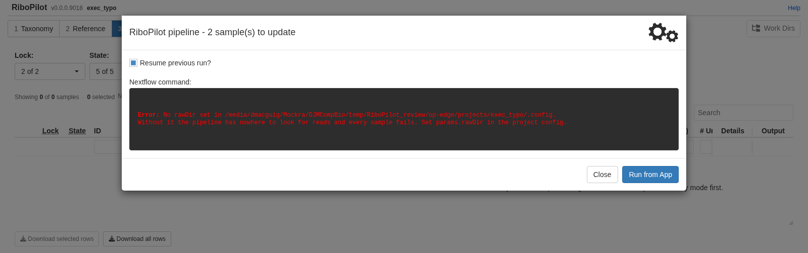

**UX-03. The mapping file is accepted or changed silently.** Major. Confirmed. ids: O-edge-12 (major), O-edge-13 (major), O-edge-3 (major), O-edge-28 (minor). Seen by 1 (op-edge).
- Where: `R/init_project.R` and `R/init_db.R` mapping read (`read.csv` with no `colClasses`) and `check_mapping_reads`.
- Problem:
  - IDs 001 and 002 are stored as 1 and 2 with no message. "001" plus "1" gives a duplicate error naming "1". An ID of "NA" gives "missing value where TRUE/FALSE needed".
  - Without `data_path`, setup says "Project initialized successfully." and skips the read check. The app then shows "No rawDir set", and Run from App crashes.
  - R1 equal to R2 is accepted. In the app run, preprocess fails with "input file name collision", the whole run aborts (stopping the good sample too), and the app shows a green Done.
  - IDs that differ only by case (CHIM00, chim00) are accepted, and their folders would clash on macOS and Windows.
- Why it matters: sample IDs end up in GenBank, and a silent rename or a bad read pair is hard to spot later.
- Fix: `read.csv(colClasses = "character", na.strings = "")`. Require `data_path` when any sample lists reads. Add an R1 == R2 check next to the missing-file check. Use `duplicated(tolower(ID))`.

**UX-04. The default executor is conda, which the docs call unsupported.** Major. Confirmed. ids: O-edge-8 (major). Seen by 1 (op-edge).
- Where: `executor = "conda"` default in `new_project()` and `new_test_project()`; `inst/config.conda:4` ("HPC/container configs come later").
- Problem: no warning at setup. From the app, preprocess exits 127 ("fastp: command not found", visible only in the work folder), the progress text says "Error is ignored", the alert is a green Done, and samples stay "Ready to run" with no note.
- Why it matters: a user who takes the default gets a silent failure.
- Fix: default to "docker", or warn at setup that conda is unsupported. Remove the stale config comment.
- Status: fixed on `review/2026-09-full-review`: docker is the default, and conda warns at setup. See [Fixed on this branch](REVIEW_SUMMARY.md#fixed-on-this-branch-after-the-review).

**UX-05. A gzipped assembly mixed with plain ones aborts the run; a FASTQ given as an assembly fails silently.** Major. Confirmed. ids: O-edge-15 (major), O-edge-25 (minor). Seen by 1 (op-edge).
- Where: the pipeline's splitFasta over user assemblies; `find_rrna.nf` (`errorStrategy 'ignore'`).
- Problem: with a real .gz assembly next to plain ones, the splitter reuses its gzip reader, and the whole run aborts with "ERROR ~ Not in GZIP format" and a green Done. A FASTQ named as the assembly fails with an ignored Biopython error, and the sample stays "Ready to run" with an empty Notes cell after every run. The docs never say whether .gz assemblies are supported.
- Why it matters: gzipped genome downloads (.fna.gz) are common, and the user is never told why a sample did nothing.
- Fix: gunzip in a small staging step (or refuse .gz at setup). At setup, check that each assembly starts with ">". Write a sample note when find_rrna_scan fails.

**UX-06. The mapping-file rules are not written down, and assembly-only samples need R1/R2 columns anyway.** Minor. Confirmed. ids: O-novel-8 (minor), O-edge-26 (minor). Seen by 2 (op-novel, op-edge).
- Where: `vignettes/RiboPilot.Rmd` line 182 and "Already have an assembly?" (line 228); `check_mapping_reads`.
- Problem: the docs call R1 and R2 "the two file names", but they are paths relative to `data_path`, and subfolders (the usual fasterq-dump layout) work. The docs say to "leave their R1 and R2 blank" for assembly samples, but a file with no R1/R2 columns is refused with a message about paired reads. A lowercase "assembly" header gives "these have neither: A_GOOD" with no hint about the column name.
- Why it matters: users guess, and several wrong guesses produce raw R errors (UX-55).
- Fix: add a "Mapping file rules" box (case-sensitive headers, comma-separated, ID characters and 18-character limit, paths relative to `data_path`). Treat missing R1/R2 columns as blank when an Assembly column exists.

**UX-07. `new_project()` ignores `NCBI_API_KEY` in the environment.** Minor. Confirmed. ids: O-practice-21 (minor). Seen by 1 (op-practice).
- Where: `R/init_project.R:181` (`ncbi_api_key` defaults to NULL and is written as `''`).
- Problem: the guide says you paste the key when creating a project, but the Step 1 command has no key argument, and the environment variable was not used. The reference code and the app's modals do read it.
- Fix: default `ncbi_api_key` to `Sys.getenv("NCBI_API_KEY")`.

### Taxonomy

**UX-08. Assign Taxonomy counts unresolved samples as assigned, and sends an ambiguous genus to a plant.** Major. Confirmed. ids: O-edge-16 (major), O-edge-17 (minor). Seen by 1 (op-edge). Screenshot: [ux_19](screenshots/ux_19_taxonomy_unresolved_counted.png).
- Where: Taxonomy step; `resolve_samples_taxonomy` returns `nrow(rows)`; Reference Propose groups.
- Problem: the alert says "Auto-assigned taxonomy for 11 sample(s). Review and lock." when 4 are unresolved (a typo, "goatfish", a blank, and a numeric taxid). Locking unresolved samples raises no warning, and Propose groups quietly leaves them out. "Morus" (a gannet genus, and also a plant genus) was marked "ambiguous" but assigned to the plant (3497) and sent to a Moraceae reference group.
- Why it matters: a bird sample can be assembled against a plant reference without anyone noticing.
- Fix: report counts by confidence ("7 assigned, 4 unresolved"). Do not auto-assign ambiguous names. Warn before locking unresolved or ambiguous samples, and list samples that Propose groups left out.

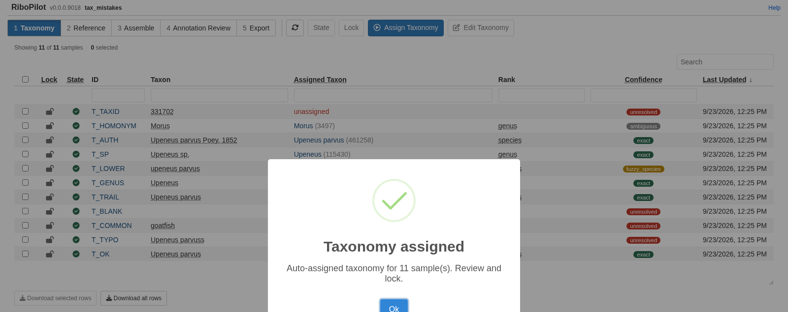

**UX-09. Update runs samples whose taxonomy is not locked.** Major. Confirmed. ids: O-edge-11 (major), O-practice-7 (minor), plus the gate part of O-practice-6 (major). Seen by 2 (op-edge, op-practice).
- Where: `R/nf_command.R:163-176` (`nf_pending_count`) and `inst/nextflow/modules/pipeline_r.nf:21-40` (`query_samples`) do not filter on `taxonomy_lock`; the Assemble table does (`R/app_server.R:174`); `R/init_db.R:243` starts new samples at `assemble_switch = 1`.
- Problem: the Assemble tab says "No taxonomy-locked samples. Assign and lock taxonomy in Taxonomy mode first." and shows 0 rows, yet Update offers "2 sample(s) to update", and Run from App assembles them against the default fish database. Following the guide's `run_assembly()` does the same for every sample.
- Why it matters: the taxonomy review, which the README says must come first, can be skipped by accident.
- Fix: require `taxonomy_lock = 1` in `query_samples` and `nf_pending_count`, and disable Update when nothing qualifies.

**UX-10. A step that has not run yet is shown in error red.** Minor. Confirmed. ids: U-design-20 (minor). Seen by 1 (design).
- Where: taxonomy columns on a fresh project.
- Problem: before Assign Taxonomy runs, every row shows a red "unassigned" and a red "unresolved" badge.
- Why it matters: the first screen a new user sees looks like 12 errors.
- Fix: show a neutral grey "not run yet" state; keep red for real failures.

### Reference

**UX-11. The built-in fish reference is unreachable, so the practice project's first run aborts.** Major. Confirmed. ids: O-practice-2 (major; reported blocker), O-edge-14 (major), O-novel-7 (minor), O-practice-22 (minor), O-practice-23 (minor). Seen by 3 (all operators).
- Where: `R/constants.R:24-29` and `R/init_db.R:51-52` (raw.githubusercontent URLs on `main`); `reference_db_ok()` in `R/reference_build.R:430-433`; the `new_project()` reachability warning.
- Problem:
  - The default seeds and labels are fetched from `raw.githubusercontent.com/.../main/ref_dbs/...`, which returns 404 while the repo is private. Nextflow aborts the whole session. The Reference tab's "Leave these samples on the built-in fish database" fails the same way. `ref_dbs/` is not in the package or the Docker image, so a user has no local copy.
  - The pre-run check accepts any URL without trying it (deliberately "taken on trust"), so the run starts and then aborts.
  - If a user skips the database step for a non-fish group, the score step fails with "Error is ignored", and samples stay "In progress" with no note.
  - Every `new_project()` prints two long 404 warnings. They do point to the app's reference step first, but then suggest `build_reference_db('"Asteroidea"[Organism]', 'asteroidea')`, a starfish example on the unsupported console route, even for a snail project.
- Why it matters: the guide says fish projects "can skip" reference setup, but the practice project cannot run. This goes away when the repo is public, but the file would still be unpinned to the version.
- Fix: ship the fish seeds and labels in the package or the image, or fetch them as a versioned release asset through the reference store. HEAD-check URL databases before launch. Write a failed state and a note when score fails. Collapse the two warnings into one short line that points to the Reference tab and names no unrelated clade.

**UX-12. Fish users are told to skip the Reference step, but Propose groups offers an over-limit clade.** Minor. Confirmed. ids: O-practice-8 (minor; reported major), O-practice-29 (minor). Seen by 1 (op-practice).
- Where: vignette Step 2; Reference tab Propose groups.
- Problem: skipping Step 2, as the guide says, leads to the 404 abort (UX-11). Propose groups then offers Actinopteri for 8 samples with red text "holds 42,697 records, above the maximum of 25,000", and Apply is still enabled.
- Why it matters: a first-timer has to work out the Reference tab alone, and the default suggestion looks like an error.
- Fix: fall back to order or family when a clade is over the limit, or explain what to do. Document the Reference tab in the Get started guide.

**UX-13. The existing-database picker pre-selects an empty database.** Minor. Confirmed. ids: O-edge-18 (minor). Seen by 1 (op-edge).
- Where: "Use a database I already have" modal (`prettyRadioButtons` with no `selected`; listing reads the manifest only).
- Problem: the first row, "actinopterygii [superclass] - 11,762 records", is pre-selected though its FASTA files are 0 bytes. Applying it gives "Reference file is empty or not a FASTA". (The verifier notes these empty files may be leftovers, but the missing size check is real.)
- Fix: check file sizes when listing, show broken entries as "(empty, rebuild)", and do not pre-select a row.

### Assemble

**UX-14. The Assemble table hides screen and chimera verdicts, so contaminated samples look clean.** Major. Confirmed. ids: U-novice-1 (major), U-mitopilot-7 (major), U-curator-8 (major), O-practice-12 (minor; reported major), U-novice-13 (minor), U-curator-19 (minor). Seen by 4 (op-practice, novice, mitopilot, curator); op-novel saw the same for Tret_01. Screenshots: [ux_03](screenshots/ux_03_assemble_table_contaminant_green.png), [ux_04](screenshots/ux_04_chim01_off_target_only_in_details.png), [ux_05](screenshots/ux_05_tret01_off_target_details.png).
- Where: Assemble table columns (no Screen, Chimera, or Top hit column); "# Kept" counts `ignore = 0`.
- Problem:
  - CHIM01 (100% *Penicillium*, off_target, chimera suspect, ITS1, 5.8S, and ITS2 missing) and Tret_01 (all sea anemone) show the same green check as clean samples, with "# Kept 1". The only hint is an amber ITSx badge off to the right. The verdicts appear only inside each sample's details window.
  - Undecided scaffolds count as kept, although the tooltip says "Scaffolds kept after triage". The triage preview says "0 dropped, 11 kept, 3 undecided" while the table shows every sample as kept.
  - Dropping a sample's only scaffold leaves the green check; the only cue is a red "0" in # Kept.
- Why it matters: a user reads green as "good" and locks it. This is the first link in the chain that ends in UX-31.
- Fix: add Screen, Chimera, and Top hit columns next to the ID, or an amber "needs a look" state icon. Hide the five Options columns by default (UX-61). Count undecided scaffolds apart from kept ones. Show a note when nothing is kept.

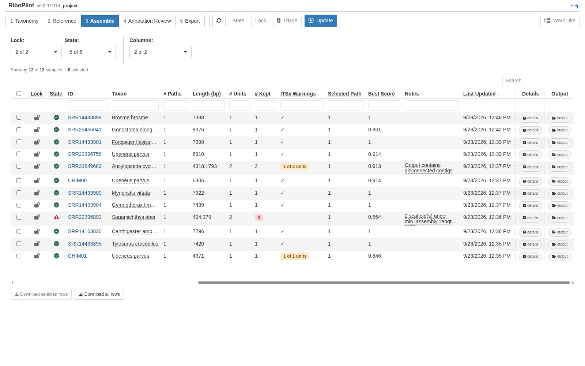

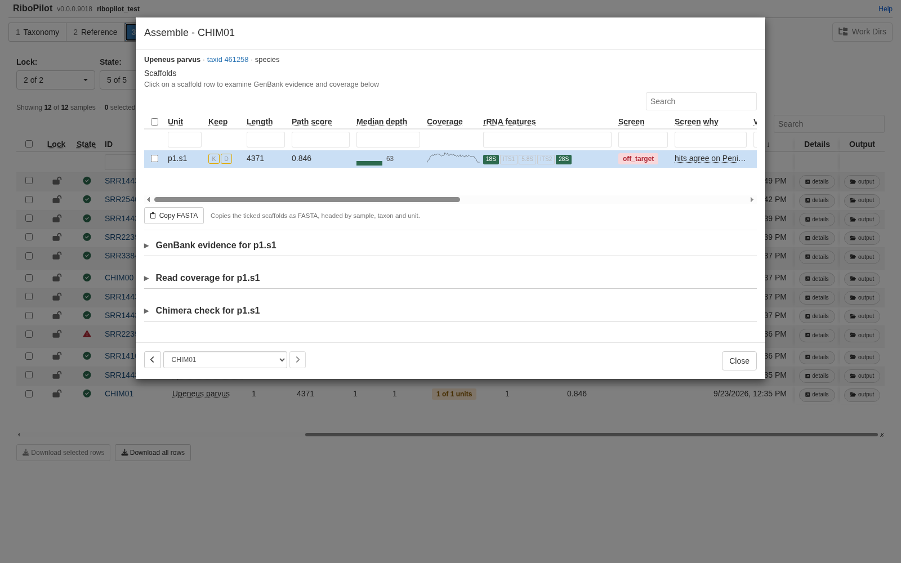

**UX-15. Failed samples give no plain reason and no next step.** Major. Confirmed. ids: O-novel-4 (major), U-novice-5 (major), O-practice-11 (minor; reported major), U-power-8 (minor), U-curator-14 (minor). Seen by 5 (op-practice, op-novel, novice, power, curator). Screenshot: [ux_18](screenshots/ux_18_failed_sample_no_reason.png).
- Where: Notes column (`pipeline_steps.R` writes "failed assembly"); state tooltip "Stopped with an error - see Notes." (`constants.R:209`); details window (`app_server.R:1484`, `app_modals.R:748`); Work Dirs.
- Problem:
  - The reason, when there is one, sits in the Notes column, which is off screen, and is written as a parameter name ("2 scaffold(s) under min_assembly_length (500 bp)").
  - Enit_01 shows only "failed assembly". The real cause is in the work folder: GetOrganelle warned "too few data" (about 10x), then SPAdes crashed at K115 ("Invalid kmer coverage histogram", return code 21).
  - The details window says "No assembled scaffolds for this sample yet." under the empty headings "GenBank evidence for", "Read coverage for", and "Chimera check for". For SRR22396893 it says "The remote BLAST is still running, or it did not return" after the run ended, lists both scaffolds as "no reference" with an empty Why column, and says "run the pipeline from Assemble > Update".
  - Work Dirs shows every task green, because the failure is a post-processing gate.
- Why it matters: the user cannot tell whether to wait, re-run, change settings, or give up.
- Fix: add a one-line banner at the top of the details window, for example "Assembly found only 2 short pieces (494 and 379 bp), under the 500 bp minimum. Try the baited SPAdes assembler in Assembly Options." Save the GetOrganelle and SPAdes error lines and the coverage estimate into the note. Fill the Why column for gate failures. Drop "still running" once no run is active. Hide empty sections.

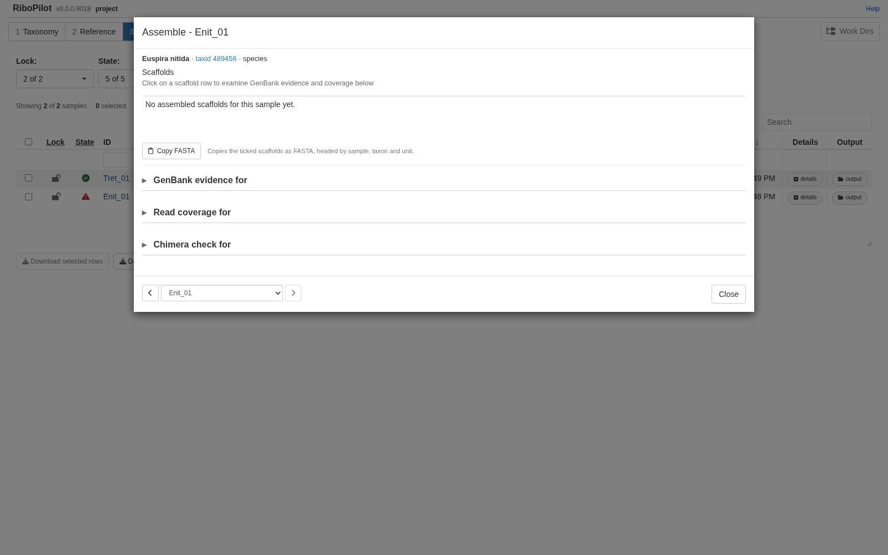

**UX-16. The rescue assembler is hidden and not documented for the app.** Major. Confirmed. ids: O-practice-10 (major), U-power-14 (minor), U-novice-12 (polish; reported minor), plus the discoverability part of U-novice-6 (major). Seen by 3 (op-practice, novice, power); op-novel took the same route.
- Where: the Assembly Options cell and window (`app_opts.R`); vignette Step 5.
- Problem: to rescue a sample, the user must know that the blue clade name in the Assembly Options cell is a button, tick Edit, and pick "SPAdes, baited to the seed DB". If the set is shared with locked samples, Save shows a red "Error" (its text does say to type a new set name). The guide shows only `run_fallback()` from R, and a failed row gives no hint. Clicking an option link inside a selected row applies it to the whole selection, which is not shown anywhere.
- Why it matters: every operator had at least one failed sample, and the fix is buried.
- Fix: add a "Try fallback assembler" action for selected failed samples that creates or reuses a baited set. Offer "Save as new set" instead of a red error. Add an Options button to the toolbar. Add a "Rescue a failed sample in the app" walkthrough to Step 5.

**UX-17. A rescue run skips its own new scaffolds and leaves the sample "In progress".** Major. Confirmed. ids: O-practice-9 (major), U-novice-6 (major), U-power-1 (major; reported blocker). Seen by 3 (op-practice, novice, power). Screenshot: [ux_17](screenshots/ux_17_rescue_annotation_not_run.png).
- Where: `R/pipeline_steps.R:381-395` (`load_assemblies` carries ignore flags by path and scaffold number) and `gate_failed()` at lines 200-206; `R/app_opts.R:589`; `tests/testthat/test-load-assemblies.R:209`.
- Problem:
  - After switching SRR22396893 to baited SPAdes, the new p1.s1 (1286 bp) and p1.s2 (944 bp) inherited the "too short" drop flags from the old, unrelated GetOrganelle scaffolds. BLAST and annotation skipped them, and the sample stayed "In progress" after a green Done. A second Update fixed it.
  - Lowering the minimum length to 300 bp, the fix the options window suggests, did not work either. Option-set Save sets `assemble_switch = 1`, but `gate_failed()` only recognizes a gate while the state is still 3 (and its note pattern matches only `max_paths|max_scaffolds`). Both scaffolds stayed ignored, "# Kept 0", stuck "In progress". A scratch-database run showed the same for `max_scaffolds`. The unit test passes only because it skips the re-queue step.
  - The verifier lowered U-power-1 from blocker because pressing Keep by hand works around it.
- Why it matters: the documented recovery does not recover, and the run says it finished.
- Fix: carry over only curator decisions, and skip the carry-over when the assembler changes. Store the gate result in its own column instead of blanket ignore flags. Add the re-queue step to the test, and call `refresh_sample_state()` when a sample ends with no pending units.

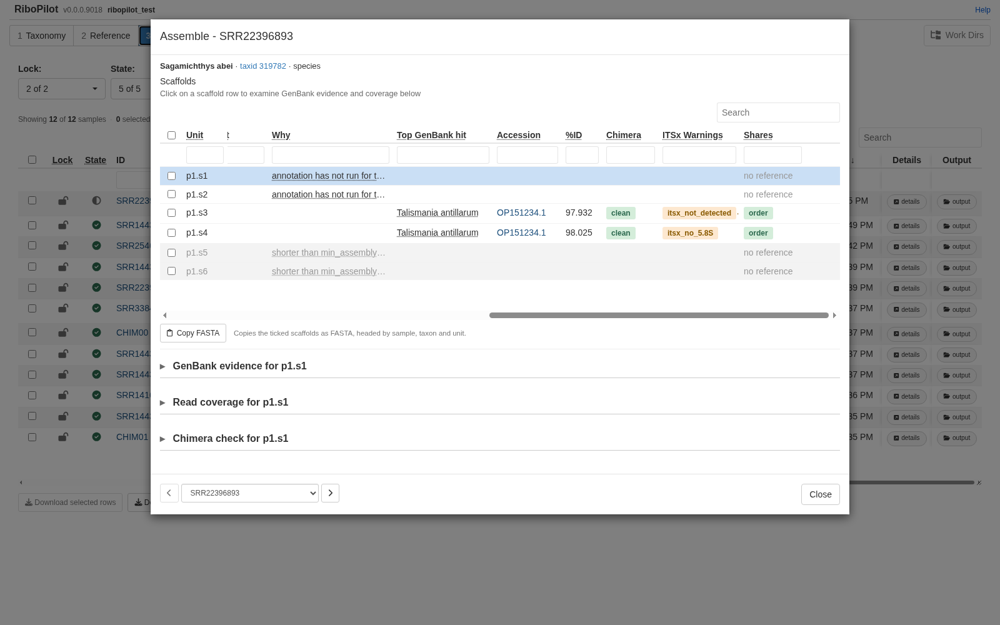

**UX-18. Save can point samples at a parameter set that was never written.** Major. Confirmed. ids: O-novel-3 (major). Seen by 1 (op-novel).
- Where: `R/app_opts.R` `opts_apply()` (upserts only when Edit is on; `opts_edit_check` returns ok when Edit is off).
- Problem: typing a new set name ticks Edit automatically. A user who then clicks Edit, as the help text suggests, unticks it. Save reports "1 sample switched to littorinimorpha_bait and set to Ready to run" but writes no set. Reopening shows "default" with the unreachable fish database URLs.
- Why it matters: the user thinks the rescue is queued, but the next run uses the wrong settings.
- Fix: when the typed name does not exist, create it from the current values, or refuse with a clear message. Never point samples at a missing set.

**UX-19. The Length column sorts as text.** Minor. Confirmed. ids: U-power-7 (minor; reported major). Seen by 1 (power).
- Where: Assemble table; length is stored as a ";"-joined string (`length_str`).
- Problem: an ascending sort gave 4318;1793, 4371, 494;379, 6306, so the 494 bp failure sits in the middle.
- Why it matters: at 500 samples, sorting by length is the quickest way to find broken assemblies.
- Fix: sort on a numeric key (longest or total length) and keep the string for display.

### Annotation Review

**UX-20. Locks do not protect what they lock.** Major. Confirmed. ids: U-mitopilot-1 (major), U-mitopilot-3 (major), U-curator-10 (major). Seen by 2 (mitopilot, curator). Screenshot: [ux_11](screenshots/ux_11_locked_unit_edit_saved.png).
- Where: `app_server.R` `feat_edit`, `nudge_boundary`, `save_edits`, `trim_btn`, and `restore_btn` (about lines 2089-2239) have no `annotate_lock` check; Export table, `export_units_df()`, and `export_bundle()` filter on `annotate_lock` only; `classify_drop`.
- Problem:
  - On SRR14433899 (annotation locked, grouped, already exported), a reviewer moved the 18S start from 203 to 204 and saved it ("Boundary edits saved."). Trim and Restore also work on locked units, and the window still offers "Lock & Close" with no lock banner.
  - Unlocking an assembly leaves its annotation in the Export table and in "10 units locked & ready", even though it has left Annotation Review.
  - Meanwhile the window's Reviewed, Problematic, and Partial buttons are disabled on locked units with no reason given, while the toolbar versions work.
  - Pressing D on a locked sample gives a red "Error: Scaffold 1.1 is annotation-locked".
- Why it matters: a signed-off record can change without being unlocked, and a sample under rework can ship.
- Fix: one rule, as in MitoPilot (`lock_blocked()` and a Close-only footer): a locked unit is read only and shows a lock banner. Require both locks for export. Give disabled buttons a tooltip ("Unlock to change"), and show lock guards as information, not errors.

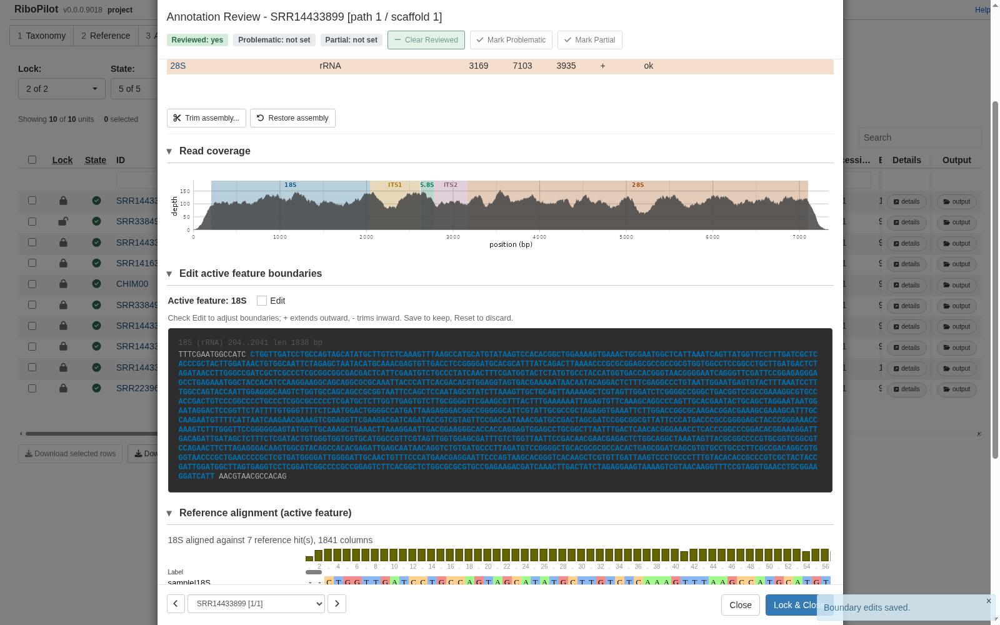

**UX-21. The annotation options guard sends the user round in a loop.** Major. Confirmed. ids: U-mitopilot-2 (major). Seen by 1 (mitopilot). Screenshot: [ux_12](screenshots/ux_12_options_guard_wrong_lock.png).
- Where: `R/app_opts.R:333-337` and `419-423`; `need_unlocked` message.
- Problem: the Annotate and Curate Options cells live only on the Assemble table and are greyed by the assembly lock, but the server guard checks the annotation lock. After unlocking the assembly, a click says "Locked samples cannot be edited. Select these samples and press Lock to unlock them first". Pressing Lock re-locks the assembly. The annotation lock can only be cleared in Annotation Review, which hides samples whose assembly is unlocked. The way out takes 5 steps across 2 tabs.
- Why it matters: the reviewer escaped only by reading the code.
- Fix: show the Annotate and Curate options columns on Annotation Review (as MitoPilot does). At minimum, name the right lock and tab: "This unit's annotation is locked. Unlock it in Annotation Review first."

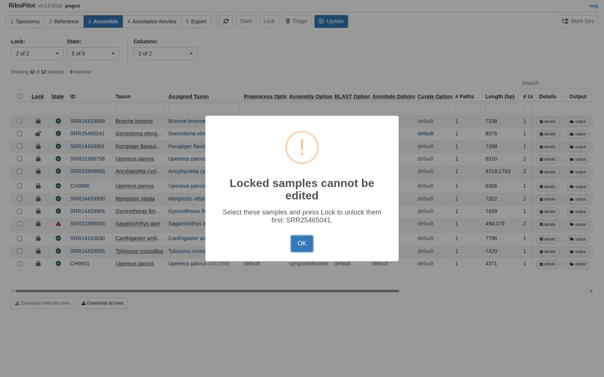

**UX-22. Annotation Review hides the contamination and chimera flags.** Major. Confirmed. ids: U-design-2 (major), U-curator-9 (major), U-curator-12 (minor). Seen by 2 (design, curator). Screenshots: [ux_22](screenshots/ux_22_review_signals_offscreen_1920.png), [ux_06](screenshots/ux_06_tret01_annotation_all_ok.png).
- Where: Annotate table column order (26 columns); unit window header pills and the "Curation warnings" and "Chimera check" panels (`open = FALSE`); `curate_notes` counts only sample-level flags.
- Problem:
  - Warnings, ITSx Warnings, Screen, Chimera, and Problematic are columns 17 to 23 of 26, off screen at 1024, 1366, 1600, and even 1920 px. (The BLAST species and "Missing 5.8S,ITS1,ITS2" do show on the first screen at 1920.)
  - The Tret_01 window opens with all five features "ok". "contaminant" sits in the collapsed Curation warnings panel, and the chimera panel is collapsed too. The sticky header shows only Reviewed, Problematic, and Partial.
  - CHIM00, with an overlapping ITS1 and a truncated 28S, shows a check mark and "No curation warnings for this sample" above a table that lists them.
- Why it matters: the reviewer is shown a clean record while the app holds evidence that it is not.
- Fix: add one "Checks" summary column right after ID, and hide the duplicate Taxon column. Put Screen, Chimera, and ITSx pills in the window header. Open Curation warnings when it has content, and count feature warnings in the summary.

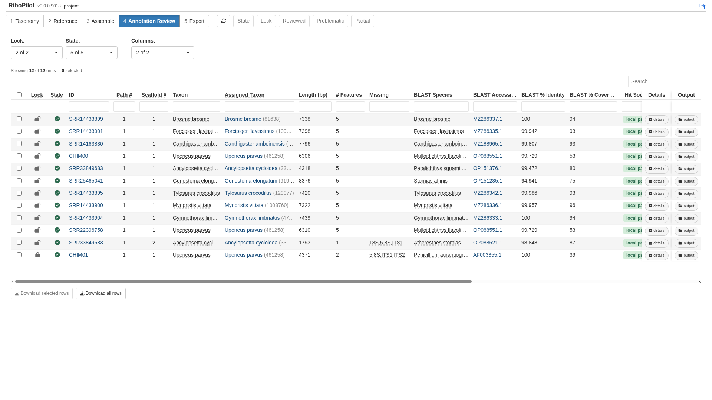

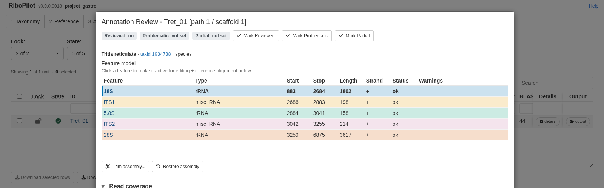

**UX-23. Toolbar toggles and Lock flip the whole selection and never show which way.** Minor. Confirmed. ids: U-design-1 (minor; reported major), U-power-11 (minor), U-novice-14 (minor). Seen by 3 (novice, power, design). Screenshot: [ux_13](screenshots/ux_13_toolbar_toggle_cleared_both.png).
- Where: `toolbar_flag()` uses `mp_flag_next` (`R/app_alerts.R:67`: any "yes" clears all); lock handler; static toolbar labels in `app_ui.R`.
- Problem:
  - Selecting one unflagged and one Problematic unit and pressing "Problematic" cleared both ("2 units cleared problematic").
  - A selection with any locked row turns Lock into "Unlock 11 samples ?", with keyboard focus on the red Unlock button. To lock the rest, the user must first filter to Unlocked.
  - The toolbar labels never change. The `app_alerts.R` comment that says `mp_flag_next` drives the toolbar label is stale; only the window toggles relabel.
  - This is by design, and the toast does state the result, so the verifier rated it minor. (MitoPilot's toolbar labels are static too; see U-mitopilot-9 in Appendix A.)
- Why it matters: the user's intent to mark is reversed, and one Enter press unlocks many samples.
- Fix: relabel live ("Mark problematic (1)" / "Clear problematic (1)"), or split into Mark and Clear. On a mixed selection, offer "Lock 6 unlocked" as the default. Put default focus on Cancel in destructive confirms.

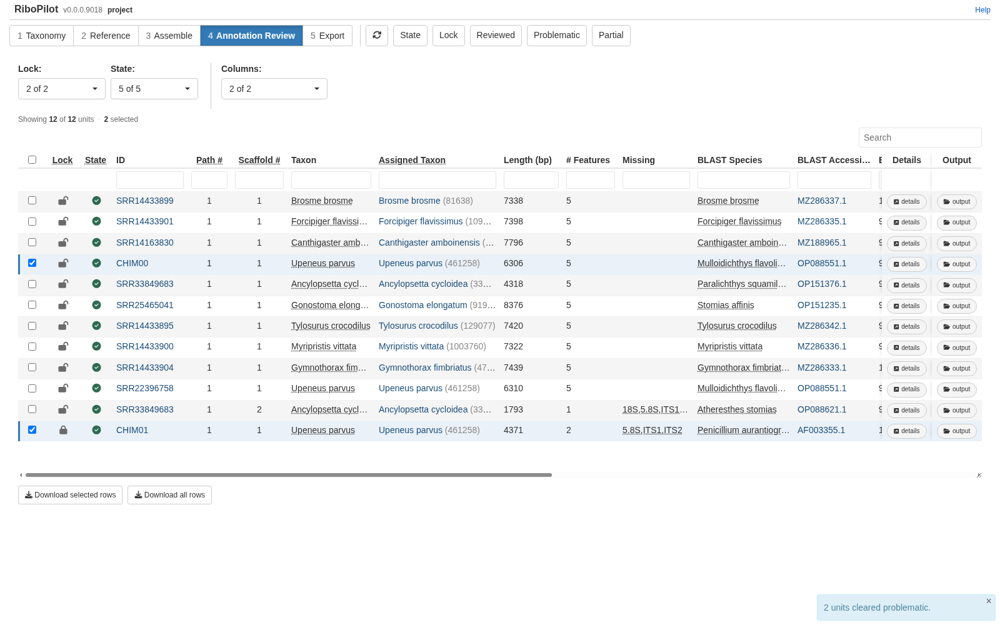

**UX-24. Annotation Review has no Update button, and the run window does not say what will run.** Minor. Confirmed. ids: U-mitopilot-6 (minor; reported major). Seen by 1 (mitopilot).
- Where: `app_ui.R` toolbar (deliberately no Update); `run_modal` title.
- Problem: the State dialog says "Processed by the next Update", but Update exists only on Assemble. The run window then says "1 sample(s) to update" for a one-unit re-annotation, because `nf_pending_count` adds units to samples.
- Why it matters: the user cannot tell whether the assembly will be redone. (It was not.)
- Fix: add the same Update button to Annotation Review. Title the run window with counts per stage: "1 unit to re-annotate, 0 samples to assemble".

**UX-25. Lock & Close marks Reviewed, but toolbar Lock does not.** Minor. Confirmed. ids: U-mitopilot-8 (minor). Seen by 1 (mitopilot).
- Where: `app_server.R:2352` (`SET annotate_lock = 1, reviewed = 'yes'`) vs the toolbar lock.
- Problem: units locked from the toolbar show "reviewed: no" in the export summary and report, though the reviewer reviewed them. MitoPilot's Lock & Close locks only.
- Fix: keep lock and reviewed separate, or make both lock paths do the same.

**UX-26. The notes box has no label, and deleting its text does not delete the note.** Minor. Confirmed. ids: U-design-21 (minor), U-mitopilot-16 (polish; reported minor). Seen by 2 (mitopilot, design).
- Where: `app_modals.R:402-407` (`textAreaInput(label = NULL)`); notes observer (`app_server.R:2271`).
- Problem: the only name is the placeholder. The hint says "Deleting the text does not clear the stored note; use Clear notes." The guard exists on purpose, against a render race.
- Fix: add a visible label. Ignore only the first empty value after the window opens; after that, an empty box clears the note.

**UX-27. The boundary editor lacks context, and there is no sequence viewer.** Minor. Confirmed. ids: U-curator-13 (minor), U-mitopilot-17 (minor). Seen by 2 (mitopilot, curator).
- Where: `nudge_seq` (`flank <- 15`); reference alignment; compare MitoPilot `R/app_annotate_seqview.R` and `inst/app/www/seqviewer.js`.
- Problem: only 15 bp of flank is shown. The alignment opens at column 1 of 1862, so checking a 3' end means a long scroll. The neighbouring feature does not move, and only it gets the overlap flag. There is no Go to position, Fit gene, or zoom as in MitoPilot, so a reviewer counted bases by eye.
- Why it matters: boundary edits are slow, and they create gaps (UX-84).
- Fix: scroll the alignment to the edited end, show more flank, move shared boundaries together, and port MitoPilot's sequence viewer (or at least Go to position).

**UX-28. The reference alignment panel wrongly advises running Update again.** Minor. Confirmed. ids: O-practice-18 (minor), U-curator-17 (minor). Seen by 2 (op-practice, curator).
- Where: fixed text at `app_server.R:1986`.
- Problem: "No reference alignment for this feature. Needs GenBank BLAST hits + reference fetch from the pipeline run; if those ran, run Update again." appears for CHIM01 and Tret_01 although both steps ran (Tret_01 has 50 BLAST hits and 47 reference candidates, but only for 28S).
- Why it matters: the user runs the pipeline again for nothing.
- Fix: tell "not run" apart from "ran, but no reference covers this feature (the top hits are off target)".

**UX-29. Lock & Close does not move on to the next unit.** Polish. Confirmed. ids: U-power-16 (polish; reported minor). Seen by 1 (power).
- Where: unit window footer.
- Problem: reviewing 500 units costs an extra click and a 1 s reopen each. The footer's previous and next arrows and bulk Lock soften this.
- Fix: add "Lock & Next".

**UX-30. Small cosmetic issues in the review windows.** Polish. Confirmed. ids: U-curator-20 (polish). Seen by 1 (curator).
- Where: Trim window, drop guard, coverage plot, Last Updated column, chimera labels.
- Problem: the Trim window's "suggested junctions" line overlaps the help text. The coverage plot has no junction lines to compare with the chimera plot. Last Updated does not change on flag edits. Species labels come from record titles ("EST0103 Atlantic"). (The red drop error and the headless message are covered in UX-20 and UX-79.)
- Fix: fix each small item.

### Export

**UX-31. Contaminant records export under the sample's species name with no gate, and can get a green all-clear.** Blocker. Confirmed. ids: U-curator-1 (blocker), O-novel-1 (major; reported blocker), U-curator-7 (major). Seen by 2 (op-novel, curator). Screenshots: [ux_05](screenshots/ux_05_tret01_off_target_details.png), [ux_07](screenshots/ux_07_export_modal_no_contaminant_warning.png), [ux_08](screenshots/ux_08_anemone_export_green_all_clear.png).
- Where: Assemble and Annotation Review Lock; Export window; `risk_flags()` and `submission_risk` in `R/export.R`; `export_check_summary_ui` in `R/app_modals.R`.
- Problem:
  - Tret_01 (*Tritia reticulata*) is sea anemone rDNA: 99.6% to *Sagartia troglodytes*, screen off_target, curation warning "contaminant". 11,113 of 3 M reads map to the anemone and 0 to *Tritia* 18S or 28S.
  - Assemble Lock, Annotation Lock, and the Export window ("6 units in group") all accepted it with no prompt.
  - The FASTA reads ">Tret_01 [organism=Tritia reticulata] ... Tritia reticulata 18S ribosomal RNA gene, complete sequence". `submission_risk` is empty, because `risk_flags()` never looks at the screen verdict. The summary CSV and HTML report have no screen or contaminant column. The dialog says "Final ITSx check: nothing flagged on 1 record(s)" in green.
  - A hurried select-all path (Lock, Lock, Assign Group, Export) also shipped CHIM01. There the chimera did reach `submission_risk`, and the dialog showed amber lines, so the gap is mainly the screen and contaminant flags. The Export tab table does show Screen and Chimera badges, but nothing stops or asks.
- Why it matters: this is the most direct route to a wrong public record, and the app already knows the answer.
- Fix: before lock and export, list units that are off_target, contaminant, or chimera suspect or likely and not yet marked Reviewed, and ask the user to confirm or exclude each one (exclude by default). Add the screen verdict and contaminant flag to `submission_risk`, the summary CSV, and the report. Never show a green all-clear while such a flag is open.
- Status: fixed for export on `review/2026-09-full-review`. `submission_risk` carries `off_target(<taxon>)` and `contaminant`, and the Export window lists flagged units not marked Reviewed, with "Leave them out" as the default ([screenshot](screenshots/fix_01_contamination_prompt.png)). Still open: the same prompt at Lock, and chimera units in the prompt. See [Fixed on this branch](REVIEW_SUMMARY.md#fixed-on-this-branch-after-the-review).

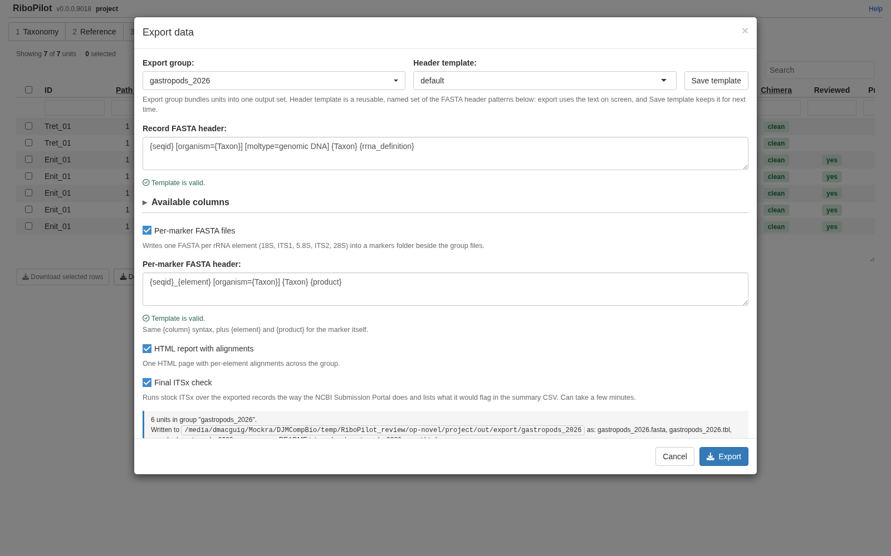

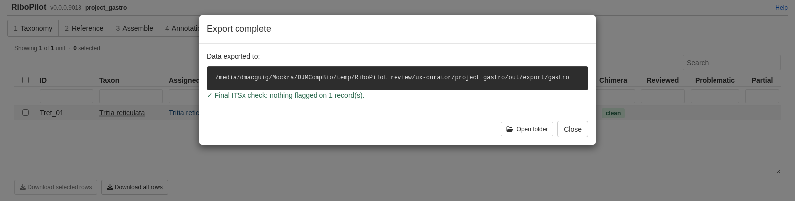

**UX-32. Truncated 18S and 28S pieces are exported as "complete sequence".** Blocker. Confirmed. ids: U-curator-2 (blocker), O-practice-3 (major; reported blocker). Seen by 2 (op-practice, curator).
- Where: `export_header_data` (`R/export_opts.R:135-141`) and `feature_table_text_con` (`R/export.R:144-149`); Mark Partial button.
- Problem: partial markers come only from scaffold ends or a manual Mark Partial, and the curation `truncated` flag is ignored, although a `curate_rrna.R` comment says truncated features are not exported as complete. SRR22396893_p1_s1 (28S 38..1206 on a 1286 bp scaffold, 40% model coverage) and SRR33849683_p1_s2 (28S 155..1488, 46%) were written as "28S ribosomal RNA gene, complete sequence." with no `<` or `>`. CHIM01's 18S (27%) and 28S (59%) became "... complete sequence." table2asn flags SHORT_RRNA on three records. Mark Partial gives the correct `<155 >1488` and "partial sequence", but only after unlocking, and its tooltip says only "Flag this annotation as incomplete". One verifier rated this major because the manual route exists.
- Why it matters: these are wrong GenBank annotations; a fish 28S is about 4 kb.
- Fix: set partial ends and the "partial sequence" wording from the truncated flag or model coverage by default, and warn at export. Point the truncated tooltip at Mark Partial. Add `truncated` to the Curation-Flags table.
- Status: fixed on `review/2026-09-full-review`. Truncated features now export as partial at both ends, with "partial sequence" wording. The tooltip and the Curation-Flags table are still open. See [Fixed on this branch](REVIEW_SUMMARY.md#fixed-on-this-branch-after-the-review).

**UX-33. "Problematic" silently drops a unit from export.** Major. Confirmed. ids: U-novice-3 (major), U-mitopilot-4 (major), U-design-14 (minor), plus the label part of U-curator-10 (major) and O-practice-17 (minor). Seen by 5 (op-practice, novice, mitopilot, design, curator). Screenshot: [ux_10](screenshots/ux_10_problematic_silently_excluded.png).
- Where: Problematic tooltip "Flag this annotation for another look" (`app_server.R:1931`); `export.R:542-549` and `export_units_df()` filter `problematic != 'yes'`, but the Export table query does not.
- Problem: a reviewer assigned 5 units to a group and 4 were exported, with no word about the fifth. The Export tab shows 10 rows next to "9 units locked & ready", or "Showing 11 of 11 units" next to "10 units locked & ready". The export window says "4 units in group". The practice export said "15 units locked & ready" and quietly left out CHIM01. No vignette or man page mentions this rule. MitoPilot treats Problematic as a note only.
- Why it matters: users who mark a unit "for another look" lose it from the submission without knowing.
- Fix: rename the button "Exclude from export" (or say so in its tooltip). Grey out Problematic rows in the Export table. Say "1 unit left out: SRR33849683 p1.s2 is marked Problematic" in the export window and the Done dialog. Document the rule.

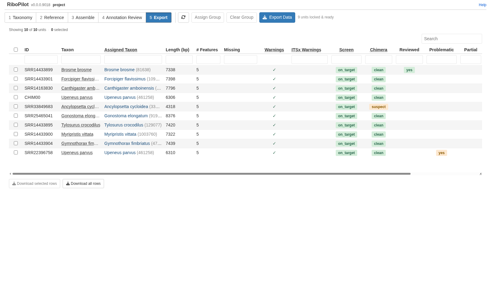

**UX-34. The Export complete dialog does not name the flagged records, so a suspected chimera ships.** Major. Confirmed. ids: U-novice-4 (major), U-design-10 (major), U-mitopilot-21 (polish), plus the dialog part of U-curator-18 (minor). Seen by 4 (novice, mitopilot, design, curator).
- Where: `export_check_summary_ui()` (`R/app_modals.R:676-679`); chimera panel text.
- Problem: SRR33849683 scaffold 1 (chimera suspect, a "PREDICTED: Canis" 100% window at 751-2000) was marked Reviewed and exported. The final window showed a green "Final ITSx check: nothing flagged on 10 record(s)" above one amber line, "Submission-risk flags on 1 record(s) (submission_risk column)." The record name and the reason are only in the summary CSV and the R console. The ITSx line in the same dialog does list seqids. The chimera panel says it "never blocks export" and gives no help on judging a 100% distant-taxon window inside conserved 18S or 28S.
- Why it matters: the user has to open the CSV to find out which record is at risk.
- Fix: list flagged records with a plain reason ("SRR33849683 p1.s1: may be chimeric, dog-like piece at 751-2000 bp") above the success line. Add one sentence to the chimera panel and the docs on telling a conserved-region hit from real contamination (see also UX-82).

**UX-35. Spaces or slashes in names and paths break runs and export.** Major. Confirmed. ids: U-novice-2 (major), U-mitopilot-5 (major), O-edge-7 (major). Seen by 3 (op-edge, novice, mitopilot). Screenshots: [ux_09](screenshots/ux_09_group_name_space_itsx_docker_error.png), [ux_01](screenshots/ux_01_green_done_after_failed_run.png).
- Where: `R/itsx_check.R:65` (unquoted `-v wd:wd -w wd`); config `docker.runOptions` mounts built with `paste0('-v ', dirs, ':', dirs)`; `group_modal` (a bare text box) and `assign_group_go` (checks only `nzchar`).
- Problem:
  - The group name "Fish voucher batch 1" was accepted. The final ITSx check then failed with "docker: Error response from daemon: pull access denied for voucher". Every itsx_check cell in the summary CSV holds the raw error, and the promised `_itsx_check.csv` was not written.
  - The name "fish panel/2026" was accepted. Export then failed with "cannot open the connection" and left a half-written folder.
  - A data_path or project folder with a space is accepted by `new_project()`. Every task then fails with "Unable to find image 'with:latest' locally", and the app says Done.
- Why it matters: spaces are normal in folder names on laptops and shared drives, and every one of these errors blames Docker.
- Fix: quote the mount paths. Use MitoPilot's group picker (selectize with `createFilter '^[A-Za-z0-9._-]+$'`) and validate on the server too. Clean up the partial folder when export fails.

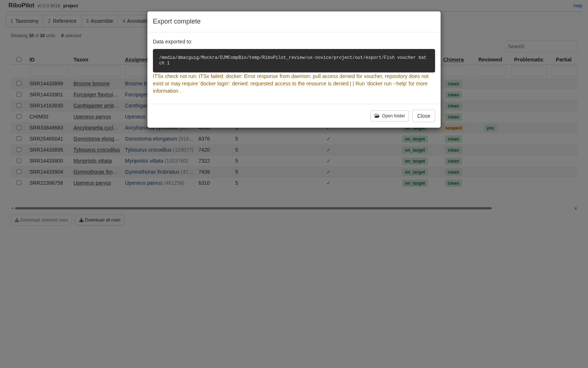

**UX-36. The header template blocks any isolate, and pieces of one specimen get made-up isolates.** Major. Confirmed. ids: U-curator-4 (major), O-practice-15 (minor; reported major). Seen by 2 (op-practice, curator). Screenshot: [ux_14](screenshots/ux_14_isolate_template_blocked.png).
- Where: `validate_fasta_header` and `render_fasta_headers` (`R/export_opts.R:226-254`); Export data window.
- Problem: the template rejects any text containing "isolate" ("Do not put isolate in the template: RiboPilot fills [isolate=ID_pX_sX] itself..."), even `[isolate={ID}]`. So 10 of 12 fish records have no isolate (table2asn warns). The two SRR33849683 units got `[isolate=SRR33849683_p1_s1]` and `[isolate=SRR33849683_p1_s2]`, which tells GenBank they are two isolates when both came from one fish. The appending is deliberate (to tell records apart), but the guide says "The template is the whole defline".
- Why it matters: thin or wrong source modifiers are a common reason GenBank asks for changes.
- Fix: allow a curator-set isolate or specimen_voucher per sample. For multi-unit samples, keep the specimen's isolate and tell records apart with a note or clone modifier. Document the rule in the guide.

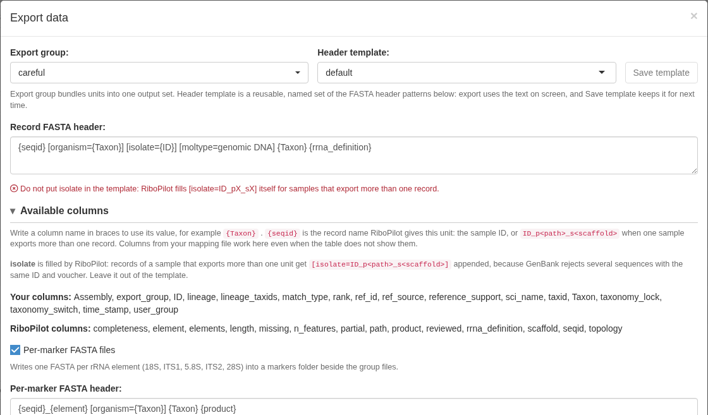

**UX-37. `export_project()` errors unless groups were set in the app.** Major. Confirmed. ids: O-practice-14 (major). Seen by 1 (op-practice).
- Where: `R/export.R:746`; vignette Step 9 ("or export everything from R").
- Problem: on a project with no groups it stops with "No export groups assigned. Assign samples to a group first." and does not say how. The guide implies no groups are needed.
- Why it matters: a guide-follower hits an error at the last step.
- Fix: point the guide at the Export tab (Assign Group, then Export Data), or give `export_project()` a default group of all locked units, and add a hint to the error.

**UX-38. The export layout in the guide and the bundle README is out of date.** Minor. Confirmed. ids: O-practice-26 (minor), O-practice-27 (polish; reported minor), O-practice-33 (polish). Seen by 1 (op-practice).
- Where: vignette Step 9 layout block; the bundle README.txt "WHAT IS IN THIS FOLDER".
- Problem: the markers folder is "58S", not "5.8S". `export_project()` writes .zip files (`zip = TRUE`, `export.R:748`) and the app does not (`zip = FALSE`, `app_server.R:1260`). The README list omits `_itsx_check.csv` and `itsx_check/`.
- Fix: update the layout block, make both routes write the same files, and build the README list from the files actually written.

**UX-39. The summary CSV and HTML report are hard to read and partly wrong.** Minor. Confirmed. ids: U-curator-18 (minor), O-practice-25 (minor), O-practice-32 (polish), U-novice-20 (polish). Seen by 3 (op-practice, novice, curator).
- Where: `<group>_summary.csv`, `<group>_report.html`, README.txt.
- Problem: the partial column reads NA for every row, including CHIM00, whose 28S was written as `>6306`. The variant_class, variant_group, variant_identity, and n_variants columns are explained nowhere (and are mostly blank, see UX-85). The report uses raw column names and NA cells, its summary table runs past the page edge and cuts off submission_risk, long risk text makes very tall rows, alignment panels leave large gaps, and labels lose their underscores ("SRR33849683 p1 s1").
- Why it matters: the report is what a PI or collaborator will read.
- Fix: report the partial state that was actually written, add a column glossary to README.txt and the guide, use readable headers and blanks for NA, wrap the risk text, size alignment panels to their content, and keep exact labels.

**UX-40. The header template's column list shows internal fields and has no preview.** Minor. Confirmed. ids: U-novice-15 (minor), plus the column-list part of U-curator-4 (major). Seen by 2 (novice, curator).
- Where: Export window, "Available columns".
- Problem: "Your columns" lists 17 names, including taxonomy_switch, taxonomy_lock, time_stamp, lineage_taxids, user_group, and ref_source, while the mapping file has only ID, Taxon, R1, and R2. There is no preview of a finished header.
- Fix: show mapping-file columns apart from RiboPilot fields, and preview one header built from the first selected record.

**UX-41. The Assign Group dialog is awkward from the keyboard.** Polish. Confirmed. ids: U-design-28 (polish). Seen by 1 (design).
- Where: `group_modal()`.
- Problem: focus does not start in the only field, Enter does not submit, and the dialog does not say how many units it will assign.
- Fix: autofocus the field, bind Enter to Assign, and title it "Assign 10 units to a group".

### Run modal (Update, Run from App, progress)

**UX-42. Every run ends with a green "Done", even when it aborted or failed.** Major. Confirmed. ids: O-edge-2 (major), U-power-6 (major), U-design-9 (major), O-practice-4 (minor; reported major), O-novel-5 (minor). Seen by 5 (all operators, power, design). Screenshots: [ux_01](screenshots/ux_01_green_done_after_failed_run.png), [ux_02](screenshots/ux_02_error_only_in_progress_text.png).
- Where: `R/app_server.R:1009-1018` (`rp_alert("Workflow run finished.", type = "message")` with no exit-status check).
- Problem:
  - These runs all ended in the same green "Done. Workflow run finished." popup as a good run:
    - the aborted practice run (reference 404)
    - R1 equal to R2 ("input file name collision")
    - runs with spaces in a path
    - a missing container tag
    - the conda executor (exit 127)
    - mixed gz assemblies
    - a run with "Failed: 10"
    - a run where one sample failed
    - a run with 0 samples queued (see UX-45)
  - The only clue is Nextflow text at the bottom of the progress box. Samples are left "Ready to run" or "In progress" with no note. (The verifier found no raw ANSI codes in the progress box beyond the one in UX-48.)
- Why it matters: users trust the popup and move on. This was the most repeated complaint.
- Fix: check `p$get_exit_status()` and the failed and ignored counts. On failure, show an error alert with the first "Caused by" line and the log path. On success, give per-sample counts ("11 succeeded, 1 failed: SRR22396893").

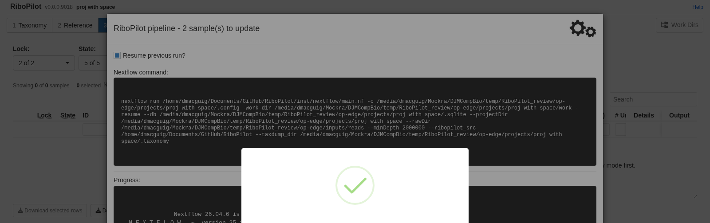

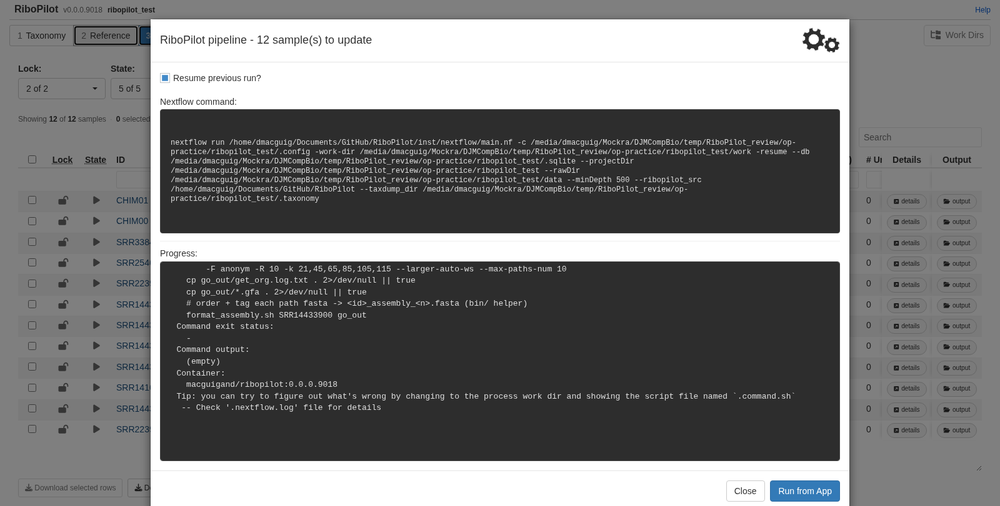

**UX-43. Reloading or closing the tab silently kills a running pipeline.** Major. Confirmed. ids: O-edge-10 (major), U-power-4 (major). Seen by 2 (op-edge, power). Screenshot: [ux_23](screenshots/ux_23_reload_left_in_progress.png).
- Where: `session$onSessionEnded` kills the Nextflow process (`app_server.R` about line 1029); `nf_close` (about 1043); the lifecycle guard.
- Problem: a reload during GetOrganelle killed Nextflow at once. The reloaded page says nothing, and the samples show "Ready to run" or "In progress". Closing the only tab stops both the app and the run. The run window cannot be closed without stopping the run, so the user cannot review other samples during a long batch. Only the Close button warns. `-resume` softens the loss.
- Why it matters: a 16-minute run, or a 500-sample batch, is lost to one accidental F5.
- Fix: launch Nextflow detached from the Shiny session. On load, re-attach to a running job and show a "Run in progress" banner. At minimum, add a `beforeunload` warning while a run is active, and an "interrupted run" notice after reload.

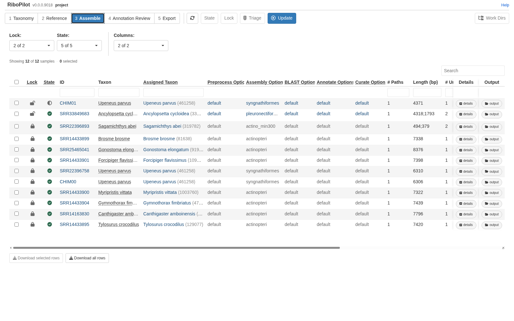

**UX-44. Stop leaves task containers running and gives no feedback.** Major. Confirmed. ids: U-power-5 (major). Seen by 1 (power).
- Where: `kill_nf()` calls `p$kill()` (SIGKILL) on the exec'd Java process.
- Problem: after Stop, the GetOrganelle container kept running for about 25 s, and two more task containers (annotate_tools, and screen, which writes to the project database) started about 10 s later. The progress board froze, with no "stopped" message. Resume later reused the cache correctly.
- Why it matters: runaway containers on a shared machine, and no way to tell what state the samples are in.
- Fix: send SIGTERM so Nextflow can clean up (or kill the process tree and its containers), wait for exit, then show "Run stopped" with the samples left unfinished.

**UX-45. The run window does not list what will run, and runs with nothing queued.** Minor. Confirmed. ids: U-power-10 (minor), U-mitopilot-10 (minor). Seen by 2 (mitopilot, power).
- Where: `run_modal(nf_pending_count())`; the Update handler has no zero-count guard.
- Problem: the title shows only "N sample(s) to update", summing samples and annotation units. With "0 sample(s) to update", Run from App stays enabled, runs a no-op, and reports Done.
- Why it matters: a batch user cannot check the queue before a long run.
- Fix: list the queued IDs (collapsible), split samples from units, and refuse to start with "Nothing to update" and the reason, as MitoPilot does.

**UX-46. Two browser sessions can run at once and overwrite each other's locks.** Minor. Confirmed. ids: O-edge-9 (minor; reported major). Seen by 1 (op-edge).
- Where: `nf_start` (the process handle is per session, with no project-level run lock); lock handlers.
- Problem: session B, on a stale view, re-locked a sample that A had just unlocked, and nobody was warned. B started a second Nextflow run while A's was still going. Both ended with a green Done, though A crashed and B reported "Failed: 10". The verifier rated it minor because two sessions on one project is uncommon.
- Fix: write a project-level run lock and check it in `nf_start` ("A run is already in progress for this project"). Refresh or warn when the data changed underneath.

**UX-47. The NCBI API key is shown in plain text and saved with the project.** Minor. Confirmed. ids: O-novel-11 (minor), U-power-18 (minor). Seen by 2 (op-novel, power).
- Where: `ref_api_key` is a `textInput` (`app_modals.R:523`); `nf_command.R:58` passes `--ncbi_api_key` on the command line; the project .config.
- Problem: the key is visible in the Reference and Update windows and in the displayed Nextflow command, so it leaks into screenshots and screen shares. The command line is saved in `.nextflow/history`, which travels with a shared project, and is visible in `ps` on shared nodes. The key also sits in plain text in the .config.
- Fix: use a password-type input, show `--ncbi_api_key <hidden>` in the preview, and pass the key through the `NCBI_API_KEY` environment variable.

**UX-48. The progress box starts with a Nextflow update nag and a stray escape fragment.** Polish. Confirmed. ids: O-practice-31 (polish), U-novice-21 (polish), U-mitopilot-19 (polish), plus part of U-power-21 (polish). Seen by 4 (op-practice, novice, mitopilot, power).
- Where: run progress output; `NXF_DISABLE_CHECK_LATEST` is not set.
- Problem: "Nextflow 26.04.6 is available - Please consider updating your version to it" followed by a leftover "(B".
- Why it matters: RiboPilot pins the Nextflow version, so the nag invites users to break it.
- Fix: set `NXF_DISABLE_CHECK_LATEST=true` for app runs, or filter the line out. Do not set `NXF_ANSI_LOG=false`: the progress parser needs the ANSI log.

### Navigation, help, and docs

**UX-49. The Get started guide describes a different app.** Major. Confirmed. ids: O-practice-5 (major), O-practice-6 (major), O-novel-6 (major), O-edge-27 (major), U-novice-7 (major), U-mitopilot-13 (major; raised from minor), U-power-17 (minor). Seen by 6 (all operators, novice, mitopilot, power).
- Where: `vignettes/RiboPilot.Rmd` Steps 4 to 9 (lines 254, 279, 295, 324, 346, 389-393) and "The whole workflow at a glance"; `vignettes/Curation-Flags.Rmd`.
- Problem:
  - The guide tells users to run `run_assembly()`, `run_fallback()`, and `export_project()` from R, before the app is opened. Line 295 describes "three tabs ... Assemble, Annotate, and Export".
  - The app has five numbered steps (Taxonomy, Reference, Assemble, Annotation Review, Export) and runs every workflow from its Update and Run from App buttons. Taxonomy is never mentioned in the walkthrough, although nothing should assemble until it is locked (UX-09).
  - Endpoint adjustment is placed on Assemble; it is on Annotation Review.
  - Nothing covers bulk work, filters, CSV downloads, Work Dirs, Stop and resume, failure recovery, or the fact that closing the tab stops a run. There is no troubleshooting section.
- Why it matters: every operator and most personas hit this, and it goes against the author's own goal of an app-first guide.
- Fix: rewrite Steps 4 to 9 around the app's five steps and buttons, one screenshot per step (the operator reports list good candidates). Move the console commands to an HPC or scripting appendix. Add a "Reviewing a sample" page on Keep/Drop, Screen values, Chimera, Reviewed, Problematic, and Partial, and what each does to the export. Add a short "Working with many samples" section and a "Common errors" table (see the error table below).

**UX-50. Smaller mismatches between the guides and the app.** Minor. Confirmed. ids: O-practice-16 (minor), O-practice-19 (minor), O-practice-20 (polish; reported minor), O-novel-10 (polish). Seen by 2 (op-practice, op-novel).
- Where: `vignettes/RiboPilot.Rmd` Steps 1, 2, 7, and 8; `vignettes/Reference-Databases.Rmd:55`.
- Problem:
  - The guide says "Annotate tab" and "Curation flags"; the app says "Annotation Review" and "Curation warnings" (collapsed by default).
  - After Step 1, practice users are told to "practice on using the steps below", but Step 3 creates a new project and every later command uses `~/my_project`.
  - Step 2 leads with the unsupported `conda_env` console build and gives the Reference tab only as a trailing note. (Step 0 does name Step 2 as its exception, so this is about order, not a contradiction.)
  - The Reference guide promises "four choices"; the dialog for two new groups shows three.
- Fix: use the app's labels, add one line after Step 1 saying what practice users run next (`RiboPilot("~/ribopilot_test")`), lead Step 2 with the Reference tab, and say "up to four choices".

**UX-51. Several flags, rulesets, review marks, and shortcuts are not documented.** Minor. Confirmed. ids: O-novel-9 (minor), U-curator-15 (minor), O-practice-17 (minor), U-power-20 (polish). Seen by 4 (op-practice, op-novel, power, curator).
- Where: `vignettes/Curation-Flags.Rmd` (lines 175-181) and flag table; README line 92; `R/params_rrna.R`; `R/curate_rrna.R:265`; `inst/app/www/custom.js`.
- Problem:
  - `no_clade_ruleset` (on every gastropod unit) and `truncated` are not in the flag table.
  - The docs say two rulesets ship, but the code also has octocorallia, scyphozoa, and asteroidea.
  - Reviewed, Problematic, and Partial are never explained, so after a toolbar lock every exported record says reviewed = no, and the Problematic export rule is unknown (UX-33).
  - "Screen why" shows raw weights ("support 1.00 w 0.30 ...").
  - Shift-click range selection works well but is mentioned nowhere.
- Why it matters: users cannot tell which flags matter or what a mark does.
- Fix: document every flag, ruleset, and mark (with its effect at export), show plain reasons in "Screen why", and add a tip on shift-click to the table help.

**UX-52. The Help link opens the private GitHub repo, not the docs.** Minor. Confirmed. ids: O-practice-24 (minor), U-novice-8 (minor), U-mitopilot-12 (minor), U-design-24 (minor). Seen by 4 (op-practice, novice, mitopilot, design).
- Where: `R/app_server.R:84-85`.
- Problem: Help opens https://github.com/dmacguigan/RiboPilot, a 404 for anyone without access today, and the code front page anyway. It opens a new tab with no cue. MitoPilot's Help opens its docs site.
- Why it matters: the one help entry point in the app is a dead end.
- Fix: point Help at the Get started article (`_pkgdown.yml` already names https://dmacguigan.github.io/RiboPilot/), add a new-tab cue, and consider small help links on section headers.

**UX-53. The app always opens on step 1, with no "what next" hint.** Minor. Confirmed. ids: U-novice-9 (minor), U-mitopilot-11 (minor), U-design-23 (minor). Seen by 3 (novice, mitopilot, design).
- Where: `app_ui.R` (`selected = "Taxonomy"`); Assign Taxonomy stays primary blue when nothing is queued.
- Problem: a returning user lands on Taxonomy even when everything there is locked, and its main button leads to "Heads up: No unlocked samples are queued".
- Fix: open on the first step with unlocked work, and show a one-line status such as "Assemble: 11 finished, 1 failed, 0 locked. Next: review and lock."

**UX-54. The "output" button opens Nextflow work folders, with no log viewer.** Minor. Confirmed. ids: U-mitopilot-15 (minor), U-power-9 (minor). Seen by 2 (mitopilot, power).
- Where: `show_workdirs` / `find_workdirs` (parses `.nextflow.log*`).
- Problem: in MitoPilot, Output opens the sample's output folder. Here it lists task work folders, with paths cut off at the hash and no copy button. There is no view of `.command.log` or `.command.err`, and older runs drop off as logs rotate. In a copied project every row points at the original project's folders and says "On disk: yes".
- Why it matters: power users need a failed task's error log in one click.
- Fix: open out/<ID> first and put work folders in a second section. Add a log tail viewer and a copy button, and show paths relative to the project.

### Errors (messages at setup and launch)

The full message-by-message table is in [Error messages from the user-mistake sweep](#error-messages-from-the-user-mistake-sweep).

**UX-55. Common mapping-file mistakes give R internals instead of plain messages.** Major. Confirmed. ids: O-edge-4 (major), O-edge-19 (minor), O-edge-20 (minor), O-edge-21 (minor), O-edge-22 (minor). Seen by 1 (op-edge).
- Where: `R/init_db.R:71` (`mapping[['ID']]` with no column check) and the `new_project()` mapping read and file checks.
- Problem: all of these give raw R errors that name neither the problem nor the fix:
  - a missing ID column, lowercase headers, a semicolon or tab delimiter, or a wrong `mapping_id`: "replacement has 0 rows, data has 2"
  - a missing or lowercase Taxon column: a dplyr trace, "Column `Taxon` not found in `.data`"
  - a header-only file: "replacement has 1 row, data has 0"; an empty file: "no lines available in input"
  - an .xlsx file: embedded-nul warnings, then "invalid multibyte string"
  - invisible spaces around an ID or file name, and "problematic IDs:" followed by nothing for a blank Excel row
  - absolute paths in R1/R2: a doubled path ("reads//media/...")
  - a missing data_path: a raw `normalizePath` warning; an unwritable target: "cannot open the connection"; a missing mapping file: "A mapping file is required..." (and the folder is created anyway)
- Why it matters: these are the first mistakes a spreadsheet user makes.
- Fix: one up-front column check that names the missing columns, lists the columns found, and hints at case and delimiter. Refuse .xlsx by extension. Trim spaces (`strip.white = TRUE`) and drop blank rows. Detect absolute paths. Check `dir.exists(data_path)`, write access, and the mapping file before creating anything.

**UX-56. Some hints are aimed at developers or blame the wrong cause.** Minor. Confirmed. ids: O-edge-24 (minor), O-edge-23 (polish; reported minor). Seen by 1 (op-edge).
- Where: `new_test_project()` download; `check_container_image()`.
- Problem: without GITHUB_PAT, `new_test_project()` first says "downloaded length 0 != reported length 9. A slow or interrupted connection is the usual cause", and only then gives the token hint, leaving an empty data/ folder. A bad container tag gives a good early warning, but its fix says "Build and push it with docker/deploy-dockerhub.sh" (it does also mention `container =`).
- Fix: check the HTTP status first and lead with "Set GITHUB_PAT". Word the tag hint for users: "Leave container unset to use the image that matches your RiboPilot version."

### Performance and working at scale

Timings at 504 samples were good (see [Things that work well](#things-that-work-well-and-should-be-kept)). The problems are about what bulk actions touch.

**UX-57. Lock and State filters hide rows with CSS, so pages come up blank at scale.** Major. Confirmed. ids: U-power-3 (major). Seen by 1 (power). Screenshot: [ux_16](screenshots/ux_16_failed_filter_blank_page.png).
- Where: `output$filter_css` (`display:none` rows) while reactable still pages every row.
- Problem: with 504 samples and State = Failed, the status line says "Showing 42 of 504", but pages 1 to 6 are empty; the 42 rows are on pages 7 and 8. The footer still says "1-50 of 504 rows" and 11 pages.
- Why it matters: "show me the failures" looks like "there are none".
- Fix: filter the data itself (server side or with reactable's filter API). As a stopgap, switch to page size All, or jump to the first page with a match, while a filter is on.

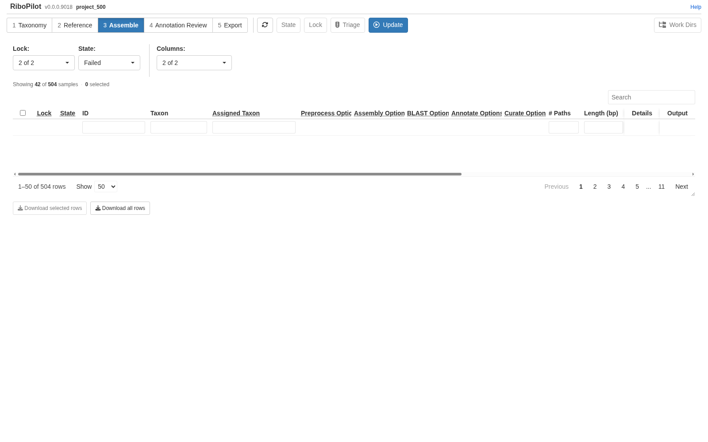

**UX-58. Bulk actions include rows hidden by search or column filters.** Major. Confirmed. ids: U-power-2 (major), U-power-13 (minor). Seen by 1 (power). Screenshot: [ux_15](screenshots/ux_15_hidden_rows_locked.png).
- Where: `R/app_server.R:565-575` (`selected_rows()` intersects only with the Lock and State mask); header checkbox.
- Problem: with 5 rows selected under one search, the user changed the search, ticked 1 visible row, and pressed Lock: "6 samples locked". In Annotation Review with column filters showing 9 of 14, the header checkbox toggled between 5 selected (all hidden) and 14. "Download selected rows" includes hidden rows too. Under a Lock or State filter the header checkbox stays unchecked when every visible row is selected, and there is no "Clear selection".
- Why it matters: bulk Lock, State, Reviewed, and group changes reach rows the user cannot see.
- Fix: intersect the selection with the visible rows (the client already computes them), or clear it when the search or a filter changes. Show "N selected (M hidden)" with a "Clear selection" link, and make the header checkbox reflect the visible rows.

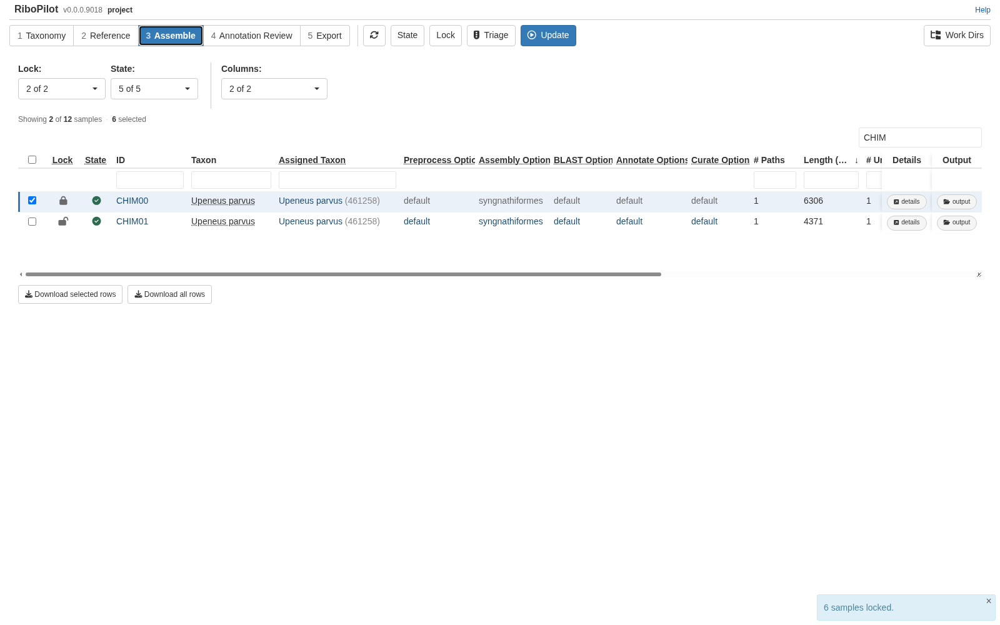

**UX-59. The browser stays busy while the page is idle.** Minor. Confirmed. ids: U-power-15 (minor). Seen by 1 (power).
- Where: `inst/app/www/custom.js` lines 7-36 (`rpVisibleRows` probe and the body MutationObserver).
- Problem: the probe is appended inside `#tbl`, which fires the observer, which queues the probe again after 50 ms, forever. The main thread was 11 to 16 percent busy at 504 rows on 50 per page and 62 to 77 percent with page size All; under 1 percent with the probe stubbed.
- Why it matters: laptop fans and battery, and slower typing in the search box.
- Fix: put the probe outside `#tbl`, or ignore mutations caused by the probe.

**UX-60. CSV downloads are raw database dumps.** Minor. Confirmed. ids: U-power-12 (minor). Seen by 1 (power).
- Where: `table_csv_handler`.
- Problem: headers use database names (assemble_lock, assemble_switch, sci_name, pre_opts), states are numbers, times are Unix seconds, rows are in database order, and "all rows" ignores the filters.
- Why it matters: core facilities send these files to clients.
- Fix: export what the table shows: display names, state labels, ISO times, table order, and a "visible rows" option.

### Visual design and layout

**UX-61. Result columns sit off screen, behind five option columns, and headers are clipped.** Minor. Confirmed. ids: U-novice-10 (minor), U-mitopilot-18 (polish), U-design-26 (polish). Seen by 3 (novice, mitopilot, design).
- Where: Assemble table default columns and widths.
- Problem: five "... Options" columns that all read "default" or a set name come first. ITSx Warnings, Best Score, and Notes need a sideways scroll at 1600 px; at 1280x720 no result column shows. Headers are cut mid-word ("Preprocess Optic", "# Ur"), "# Units" sits under the sticky Details column, and row buttons read "details" and "output" in lowercase.
- Fix: hide the Options columns by default (the Columns picker exists), move Notes and warnings next to the ID, let headers wrap, and use "Details" and "Output".

**UX-62. Layout problems at 1024x768 and 320 px, and Save below the fold.** Minor. Confirmed. ids: U-design-18 (minor), U-design-19 (minor). Seen by 1 (design).
- Where: toolbar, CSV row, sticky action columns; `opts_modal_shell` (`app_opts.R:39`, no `mp-modal-form`).
- Problem: at 1024 px Work Dirs wraps alone onto a second row and the table shows about 6 of 20 columns. At 320 px the page scrolls sideways, sticky Details/Output columns cover the ID, and the annotation window's sticky header and footer leave a third of the height for content (these 320 px claims come from screenshots and were not re-measured). The Assembly Options window runs past a 768 px screen, so Save needs a page scroll.
- Fix: let the CSV row wrap, drop the sticky action columns at narrow widths, reduce sticky modal chrome on small screens, and add `mp-modal-form` to the options window.

**UX-63. Empty tables show a misleading filter message, and the real reason is clipped.** Minor. Confirmed. ids: U-design-13 (minor), U-novice-16 (polish; reported minor). Seen by 2 (novice, design).
- Where: status line ("No rows match the current filters."); table no-data message.
- Problem: the status line blames filters when none are set. The table body does have a step-specific reason ("No assembly-locked samples. Review and lock assemblies in Assemble mode..."), but it is centered in the scrolled table and cut off at the right.
- Fix: suppress the filter message when the table itself is empty, and show the reason left-aligned above the table.

**UX-64. Button order and control styles are inconsistent.** Polish. Confirmed. ids: U-design-27 (polish), U-power-23 (polish). Seen by 2 (power, design).
- Where: Triage footer (`mp_footer(danger = Apply)`); `ref_view` switch; run and export checkboxes; Assign Group width.
- Problem: Triage puts a red Apply left of Cancel, and Apply stays enabled when the preview says "Apply would change nothing". The Samples/Groups switch is smaller than other toolbar buttons. The run checkbox is a filled square while Export checkboxes use check marks. The one-field Assign Group dialog is about 800 px wide though `size = 's'`. Note: the danger-left order is the shared `mp_footer` convention copied from MitoPilot, and other destructive dialogs follow it (U-mitopilot-22 was refuted on that point). If the author keeps that convention, the rest still applies.
- Fix: disable a no-op Apply, use one checkbox style, size `ref_view` like the toolbar, and make small dialogs small.

### Accessibility

Reviewed against WCAG 2.2 AA. The good news first: every `--mp-*` color token pair passes contrast, and the app has a skip link, a page title per step, labelled state glyphs that differ by shape, an aria-live row count, and dialogs that trap focus. The verifier lowered UX-65 to UX-70 from major to minor. They still block a keyboard-only or screen reader user from getting through the app end to end.

**UX-65. Focus drops to the top of the page when any dialog closes.** Minor. Confirmed. ids: U-design-3 (minor; reported major). Seen by 1 (design).
- Where: all Shiny `modalDialog` windows; `custom.js` hooks `shown.bs.modal` only for alignment layout.
- Problem: after Escape, Close, or Lock & Close, focus is on BODY. It took about 51 Tab presses to get back to the first row's details button (count not re-measured by the verifier).
- Why it matters: keyboard users lose their place after every review (WCAG 2.4.3).
- Fix: store the trigger element on `show.bs.modal` and focus it again on `hidden.bs.modal`.

**UX-66. The step switcher shows no keyboard focus.** Minor. Confirmed. ids: U-design-4 (minor; reported major). Seen by 1 (design).
- Where: `radioGroupButtons` "mode"; `custom.css` `:focus-visible` rules do not reach these buttons.
- Problem: the focused active step looks unchanged; an inactive one gets only a faint grey fill (about 1.3:1). The hidden radio input takes its own Tab stop.
- Fix: `.radio-group-buttons .btn:focus-visible { outline: 2px solid var(--mp-primary); outline-offset: 2px; }`, and take the hidden radio out of the tab order.

**UX-67. Some radios and checkboxes have no accessible name.** Minor. Confirmed. ids: U-design-5 (minor; reported major). Seen by 1 (design).
- Where: Set state dialog radios (`prettyRadioButtons`); "Resume previous run?" (`nf_resume`, `app_modals.R:465`); Samples/Groups radios (`ref_view`).
- Problem: the labels are not linked to their inputs, so a screen reader announces only "radio button, 1 of 5" (WCAG 4.1.2).
- Fix: reuse the existing `mp_checkbox()` aria-label pattern.

**UX-68. Toasts are not announced and can cover the main button.** Minor. Confirmed. ids: U-design-6 (minor; reported major). Seen by 1 (design).
- Where: `#shiny-notification-panel` (no role or aria-live; the close control is a div).
- Problem: status messages are silent to screen readers (WCAG 4.1.3). "Toggled problematic." covered "Lock & Close" for 6 s (2.4.11).
- Fix: add `role=status`, move toasts away from open dialog footers, and word them by outcome.

**UX-69. Text on the dark sequence and evidence boxes has low contrast.** Minor. Confirmed. ids: U-design-7 (minor; reported major). Seen by 1 (design). Screenshot: [ux_24](screenshots/ux_24_low_contrast_sequence.png).
- Where: `R/app_server.R:1959-1962` and 1496 inline colors on `.code-block` (#2d2d2d).
- Problem: caption #555 is 1.85:1, feature sequence #0072B2 is 2.66:1, hit description #666 is 2.40:1, and the accession link #337ab7 is 3.02:1 (4.5:1 is required).
- Fix: use `--mp-on-dark` for text on dark boxes, a light blue (about #8cc4ff) for the active feature, and #9a9a9a or lighter for flanks and captions.

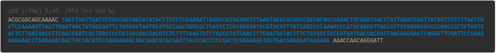

**UX-70. Keep/Drop controls are tiny letters, with state shown by fill only.** Minor. Confirmed. ids: U-design-8 (minor; reported major). Seen by 1 (design).
- Where: `R/utils_reactable.R` about lines 295-312.
- Problem: two 20 px links, "K" and "D", at 10.5 px. The inactive one is #999 (2.85:1). There is no aria-pressed, and the accessible names are "K" and "D" (the tooltip does explain them).
- Why it matters: this is the main keep or drop decision (WCAG 2.5.8, 1.4.1, 4.1.2).
- Fix: real buttons labelled Keep and Drop, at least 24 px, with aria-pressed and a check mark on the active one.

**UX-71. Tables need many Tab presses per row.** Minor. Confirmed. ids: U-design-11 (minor). Seen by 1 (design).
- Where: reactable tables.
- Problem: about 79 tab stops for 12 rows, up to 11 per row (count not re-measured). A 96-sample plate needs hundreds of Tab presses.
- Fix: one tab stop per row with arrow keys inside it, or a "skip past table" link.

**UX-72. Tooltip-only text is not reachable by keyboard.** Minor. Confirmed. ids: U-design-12 (minor). Seen by 1 (design).
- Where: truncated cells and dotted-underline headers (title attribute only).
- Problem: a focused, truncated taxon shows a focus ring but not the text. Many dotted underlines look like links.
- Fix: show a real tooltip on focus, or wrap key cells instead of truncating them.

**UX-73. Dialogs lack dialog semantics, and Escape and the close X vary.** Minor. Confirmed. ids: U-design-15 (minor), U-design-16 (minor). Seen by 1 (design).
- Where: `#shiny-modal`; `easyClose` settings; sweet-alert confirms.
- Problem: no `role=dialog`, `aria-modal`, or `aria-labelledby`. Escape closes details, State, Triage, and Work Dirs, but not Edit Taxonomy, Update, options, Reference settings, Export, or the confirms. Only State, options, and Export have an X.
- Fix: add the dialog attributes, and give every dialog an X and Escape-to-close (except while a run is active).

**UX-74. Plots have the alt text "Plot object".** Minor. Confirmed. ids: U-design-17 (minor). Seen by 1 (design).
- Where: `renderPlot` for the coverage and chimera plots.
- Fix: pass `alt =` with a short summary, or point to the table below the plot.

**UX-75. Hard-coded grey text and badges fall below 4.5:1.** Minor. Confirmed. ids: U-design-22 (minor). Seen by 1 (design).
- Where: inline #999 and #888; fuzzy badge #b8860b (`utils_reactable.R:550`); active step number at 0.7 opacity; `btn-success` Save (`app_modals.R:384`).
- Problem: #999 is 2.85:1, #888 is 3.54:1, white on #b8860b is 3.25:1, the active step number is 3.08:1, and white on #5cb85c is 2.48:1.
- Fix: map these to `--mp-text-muted` and the passing pill tokens, and use `btn-primary` or a darker green for Save.

### Terminology and wording

**UX-76. Internal codes and jargon are shown to users.** Minor. Confirmed. ids: U-novice-11 (minor), U-design-29 (polish), plus the jargon part of U-curator-15 (minor). Seen by 3 (novice, design, curator).
- Where: Assemble details, Annotation Review, run window, Triage window.
- Problem: on_target, off_target, no_reference, itsx_not_detected, missing_5.8S, "Path score", "p1.s1", "units", "support 0.30 w 0.30 ... -> confidence 0.66", "core_nt", "k-mer collapse", "Resume previous run?", "sample(s)", and a full raw Nextflow command. ("Rank dist" does have a header tooltip.)
- Why it matters: the target users are biologists, not pipeline developers.
- Fix: map codes to plain phrases ("Matches this species' group", "Matches a different organism", "No reference to compare"). Put the Nextflow command and the scoring math behind "Show technical details". Use proper plurals.

**UX-77. One scaffold has several different names.** Minor. Confirmed. ids: U-mitopilot-14 (minor), U-novice-19 (polish). Seen by 2 (novice, mitopilot).
- Where: tables, window titles, the picker (`app_server.R:497`), toasts, the State dialog, and export.
- Problem: "p1.s1", "[path 1 / scaffold 2]", "[1/2]" (reads as "1 of 2"), "Scaffold 1.1", and "ID_p1_s1". The State dialog says "1 unit" and lists a sample that has two units.
- Fix: pick one form (for example "SRR33849683 p1.s2") and use it everywhere.

**UX-78. The Reference tab's Samples view says "groups".** Polish. Confirmed. ids: O-novel-14 (polish), U-novice-17 (polish), U-power-19 (polish), U-design-25 (polish). Seen by 4 (op-novel, novice, power, design).
- Where: `MP_UNIT[["reference"]] = "group"` used by the status line in both views.
- Problem: "Showing 12 of 12 groups" (or 504 of 504) while listing samples.
- Fix: take the noun from the view switch.

**UX-79. The console says "RiboPilot is headless" when it is not, and other launcher wording slips.** Polish. Confirmed. ids: O-novel-15 (polish), O-edge-29 (polish), U-mitopilot-20 (polish), U-power-22 (polish), U-design-30 (polish). Seen by 5 (op-novel, op-edge, mitopilot, power, design); the curator saw it too.
- Where: `R/app_run.R:194` (keyed on `launch.browser` and port, not `headless`); launcher and `new_test_project()` messages.
- Problem: with `headless = FALSE` and `launch.browser = FALSE` it prints "RiboPilot is headless. Tunnel it from your machine...". O-edge-29 adds: "No RiboPilot project (.sqlite) found" does not suggest `new_project()`, and `new_test_project(n = 0)` says "Fetching ... from the RiboPilot release" while only copying bundled files. (Its empty "for" titles are covered in UX-15.)
- Fix: print the tunnel hint only when headless; otherwise "Open http://127.0.0.1:PORT in your browser." Add a `new_project()` hint, and reword the fetch message.

**UX-80. Toasts and confirms use programmer wording.** Polish. Confirmed. ids: U-novice-18 (polish), U-power-21 (polish). Seen by 2 (novice, power).
- Where: `app_server.R:2320` (`paste0('Toggled ', label, '.')`); the unlock confirm (`paste('Unlock', mp_n(...), '?')`); the State toast.
- Problem: "Toggled problematic.", "Scaffold 1.1 marked drop.", "Unlock 12 samples ?" (stray space), and "2 samples updated." A toast also covered Lock & Close (UX-68).
- Fix: "Marked problematic (left out of export).", "Unlock 12 samples?", and "2 samples set to Ready to run."

**UX-81. Small text glitches in a dialog and the config file.** Polish. Confirmed. ids: O-practice-30 (polish), O-practice-34 (polish). Seen by 1 (op-practice).
- Where: Mixed assemblers dialog; `inst/config.docker:11` and `fill_config`.
- Problem: the Mixed assemblers dialog says "4 from bait and 12 from getorganelle", counting units and using internal names. A .config comment has the mount string pasted into it ("into the  -v /path/data:/path/data slot"), because the placeholder is also replaced inside comments.
- Fix: say "units" (or count samples) and use plain assembler names ("SPAdes (baited)"). Use a placeholder token that does not appear in comments.

### Science display

**UX-82. The chimera check breaks bitscore ties arbitrarily, giving false calls.** Major. Confirmed. ids: O-practice-13 (major), U-curator-6 (major). Seen by 2 (op-practice, curator); the novice also saw the Canis window. Screenshot: [ux_21](screenshots/ux_21_false_chimera_canis.png).
- Where: `chimera_window_hits` and segment labelling in `R/chimera.R` (keeps the first hit after ordering by bitscore; rank distance is computed but unused); export `submission_risk`.
- Problem:
  - The flounder SRR33849683 is flagged chimeric because windows 751 to 2000 (18S) and 251 to 1250 (28S) best-hit "PREDICTED: Canis" records (XR_013375787.1, XR_013375790.1) at 100%. They score 924 bits, exactly the same as the *Paralichthys* hits, because these regions are nearly identical across vertebrates.
  - The flag goes into `submission_risk` as "chimeric", and the bundle README warns that NCBI may silently remove chimeric sequences.
  - SRR14433901 (*Forcipiger*) has its whole segment labelled "Chromis insolata" from one window.
- Why it matters: it pushes the user to drop a good record, and it teaches users to ignore the chimera flag.
- Fix: break ties by rank distance to the sample, or label by majority, and show how many hits tie. Down-weight XM_/XR_ PREDICTED records and windows in the conserved 18S and 5.8S cores. Call a class switch only when on-lineage hits are clearly worse.

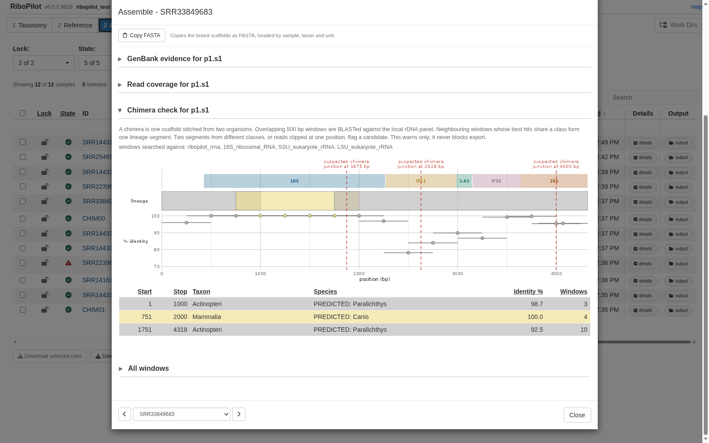

**UX-83. Read and depth signals alone raise chimera flags, including at scaffold ends.** Minor. Confirmed. ids: O-practice-28 (minor), U-curator-11 (minor). Seen by 2 (op-practice, curator).
- Where: `chimera_depth_steps` in `R/chimera.R` (skips feature edges but not scaffold ends).
- Problem: the thin rescued sample SRR22396893_p1_s1 got "chimeric(1-1286 Actinopteri ..., junction near 500 (reads), depth step at 500)" with only one lineage segment, at window depths of 4 to 12. On the clean flounder p1.s1, the normal end taper (median depth 24, then 8 in the last bin) became "depth step at 4000", a third junction line and part of a "suspect" call. A depth step alone scores 0.4, enough for "suspect". (The vignette's "depth never decides" line refers to triage, so the verifier called the contradiction arguable.)
- Fix: skip bins near scaffold ends, require a minimum depth for the read and depth channels, and require a lineage switch before writing "chimeric" to `submission_risk`. Draw junctions on the coverage plot too.

**UX-84. Adjacent features do not touch, and the gaps are never flagged.** Major. Confirmed. ids: U-curator-3 (major), O-novel-12 (minor). Seen by 2 (op-novel, curator).
- Where: `reconcile_features` in `R/annotate.R` (its docs promise a gap-free model, but it only clips overlaps); `curate_rrna` has no gap flag.
- Problem: nearly every record leaves a 1 bp gap between 18S and ITS1 and a 4 bp gap between ITS2 and 28S (CHIM00: 18S 2149-3989, ITS1 3991-4540; ITS2 ends 5168, 28S starts 5173; the canonical 18S 3' end ...GATCATTA sits at 3990). The gastropod export shows the same pattern. table2asn gives 19 ITSdoesNotAbutRRNA warnings. A hand-made 11 bp gap still showed every feature as "ok". The likely cause is barrnap and ITSx disagreeing on the boundary, not an arithmetic error.
- Why it matters: GenBank validation warnings on almost every record.
- Fix: after clipping overlaps, extend each spacer to its flanking genes (or snap to shared boundaries). Add a gap flag, and move the shared boundary when either side is nudged.

**UX-85. The variant check runs before annotation finishes, so its result depends on timing and is usually blank.** Major. Confirmed. ids: U-curator-5 (major). Seen by 1 (curator).
- Where: `inst/nextflow/main.nf` runs `screen(blast_genbank.out)` in parallel with annotation; `R/screen_variants.R` reads the annotations table.
- Problem: only 2 of 9 on-target single-unit fish samples got "singleton"; the other 7 are blank, because their screen rows were stamped before their annotation rows (SRR22396758: screen 12:39:36, annotation 12:40:50). Re-running the check on a copy of the finished database gives "singleton". For SRR33849683, the one sample with two on-target units (non-overlapping 28S pieces), the Variant cell is empty, although the Curation-Flags vignette promises "reported as not comparable" and that the anchor identity "is always shown".
- Why it matters: the check meant to say whether two units are the same molecule is silent exactly where it is needed, and export then makes them two records (UX-36).
- Fix: run the variant check after annotation (for example alongside triage), and show "not comparable" with the reason.

**UX-86. "on_target" is green even when hits agree only at class or phylum.** Minor. Confirmed. ids: U-curator-16 (minor). Seen by 1 (curator).
- Where: screen verdict badge.
- Problem: SRR33849683 is on_target through agreement at phylum Chordata, and CHIM00 at class Actinopteri, so a contaminant from the same class would read green. The vignette admits the phylum-level limit, but the badge does not show the rank.
- Fix: show the agreement rank in the badge, and use a neutral color above family level.

**UX-87. ITSx origin calls on tiny fragments are noise.** Polish. Confirmed. ids: O-novel-13 (polish). Seen by 1 (op-novel).
- Where: Annotation Review ITSx flags; export `itsx_check.csv`.
- Problem: a 57 bp snail ITS1 edge piece (Enit_01 s4) was called Chlorophyta, and the anemone piece Fungi.
- Fix: skip or label as "low confidence" the `itsx_origin` call when the ITS region is partial or shorter than about 100 bp.

## Error messages from the user-mistake sweep

From op-edge's sweep of about 60 setup mistakes plus app and run-time cases, with messages the other reviewers met added at the end. "When" is early (under a second, before any work), late (only once a run starts), app (in the app), or never.

Verdicts: **Good** = names the problem and the fix. **Unclear** = true, but in R or Docker terms. **Misleading** = points at the wrong cause or the wrong fix. **Silent** = nothing is said.

### Setup (new_project, new_test_project)

| Case | Message seen | When | Verdict | Suggested wording |
|---|---|---|---|---|
| Default `Rproj = TRUE` outside RStudio (UX-01) | "RStudio not running" (only mapping.csv, or data/, left) | early | Misleading (names neither cause nor fix) | Skip the RStudio step quietly. If kept: "Not in RStudio, so no .Rproj was made." |
| No ID column; lowercase headers; semicolon or tab delimiter; wrong `mapping_id` | `replacement has 0 rows, data has 2` | early | Unclear | "The mapping file has no 'ID' column. Columns found: id; taxon; r1; r2. Column names are case-sensitive (ID, Taxon, R1, R2), and the file must be comma-separated." |
| No Taxon column, or "taxon" in lowercase | dplyr trace: "Column `Taxon` not found in `.data`", and a 0-byte .sqlite is left | early | Unclear, and leaves a broken project | "The mapping file has no 'Taxon' column (names are case-sensitive). Nothing was created." |
| Only "r1, r2" in lowercase | "Mapping file must have R1 and R2 columns naming the paired read files" | early | Good (does not mention case) | Add: "Column names are case-sensitive." |
| No R1/R2 columns at all | Same message | early | Good | Keep. |
| Assembly-only mapping without R1/R2 columns | Same message, about reads only | early | Misleading | Accept missing columns, or: "Keep the R1 and R2 columns and leave them blank for samples that use an assembly." |
| "assembly" header in lowercase | "Every sample needs either paired reads or an assembly, but these have neither: A_GOOD" | early | Unclear | "No 'Assembly' column found (column names are case-sensitive)." |
| Header-only file | `replacement has 1 row, data has 0` | early | Unclear | "The mapping file has no samples." |
| Empty file | `no lines available in input` | early | Unclear | "The mapping file is empty." |
| Trailing blank Excel row (",,,") | "problematic IDs:" followed by nothing, then the ID-characters error | early | Misleading | Drop fully blank rows without comment. |
| .xlsx given as the mapping file | embedded-nul warnings, then `invalid multibyte string at '<d1><a8>...'` | early | Unclear | "The mapping file must be a CSV. In Excel, use Save As > CSV UTF-8 (Comma delimited)." |
| Mapping file path does not exist | "A mapping file is required to initialize a new project" (the project folder is created anyway) | early | Misleading | "Mapping file not found: <path>. Nothing was created." |
| Spaces around an ID (" CHIM00 ") | "problematic IDs: CHIM00 ... IDs must contain only alphanumeric characters..." (the space is invisible) | early | Unclear | Trim spaces. If kept: "ID ' CHIM00 ' has a leading or trailing space." |
| Trailing space after a read file name | "Read files ... were not found: .../CHIM00_R1.fastq.gz " (invisible space) | early | Unclear | Trim spaces, or quote the name in the message. |
| Duplicate IDs | "problematic IDs: CHIM00 / Duplicate IDs found in mapping file" | early | Good | Keep. |
| IDs that differ only by case (CHIM00, chim00) | accepted | never | Silent | "IDs CHIM00 and chim00 differ only by case. They would clash on macOS and Windows." |
| Bad ID characters; ID over 18 characters | shows the bad ID and the allowed characters; "IDs must be no more than 18 characters" | early | Good | Keep. |
| IDs with leading zeros (001, 002) | accepted, silently stored as 1 and 2 | never | Silent (data changed) | Keep IDs exactly as typed (read them as text). |
| IDs "001" and "1" | "Duplicate IDs found", showing "1" | early | Misleading | Fixed by reading IDs as text. |
| ID "NA" | "missing value where TRUE/FALSE needed" | early | Unclear | Fixed by reading as text, or "ID 'NA' is not allowed." |
| Misspelled Taxon, common name, or blank Taxon | accepted; shows up later as "unresolved" | app | Good enough (caught in the app) | Keep, but fix the Taxonomy alert (below). |
| R1 or R2 file missing | "Read files named in the mapping file were not found in <data_path>: CHIM00: <path>" | early | Good | Keep. |
| R2 blank | "Every sample with reads needs both an R1 and an R2 file ... Single-end reads are not supported" | early | Good | Keep. |
| R1 equal to R2 | accepted; the app run then aborts in preprocess with "input file name collision", stopping every sample, and shows a green Done | late | Silent, then misleading | At setup: "CHIM00: R1 and R2 name the same file." |
| Full paths in R1/R2 with a data_path | not-found error with a doubled path (`reads//media/...`) | early | Unclear | "R1, R2, and Assembly take file names (or subfolder/file) relative to data_path, not full paths." |
| Reads listed but no data_path | "Project initialized successfully." Later the app says "No rawDir set", and Run from App crashes | late | Silent, then misleading | "Samples list read files, but no data_path was given." |
| data_path does not exist, or is a file | raw `normalizePath` warning (`path[1]="..."`), then every read listed as not found | early | Unclear | "data_path does not exist or is not a folder: <path>." |
| data_path or project folder with a space | accepted; later every task fails with "Unable to find image 'with:latest' locally", then a green Done | late | Silent, then misleading | Quote the mounts. Until then: "Paths with spaces are not supported yet: <path>." |
| Target folder or its parent not writable | "cannot create file ... 'Permission denied'", then `cannot open the connection` | early | Unclear | "Cannot write to <path>: permission denied." |
| Executor typo ("dokcer", "Docker"), "singularity", or bare "slurm" | "No config found for executor 'dokcer'. Available: awsbatch, conda, docker, local, lsf, NMNH_Hydra, NOAA_SEDNA, pbs, sge, slurm" (slurm gets a clear `generate_config()` hint), but the .sqlite is already written | early | Good message, broken aftermath | Keep the message; check the executor before writing anything. |
| Rerun after a failed setup | "Database already exists. Use force = TRUE to overwrite (old data will be lost)." as a message; nothing happens | early | Misleading | Nothing should be left to trip over. If a project really exists: stop with an error. |
| Existing project, `force = FALSE`, different mapping | same message, but mapping.csv is overwritten | early | Misleading (files now disagree) | "A project already exists here. Nothing was changed. Use force = TRUE to replace it (old data will be lost)." |
| Default executor (conda) | no warning | never at setup | Silent | "executor = 'conda' is not supported. Use 'docker' or a cluster profile." |
| Container tag that does not exist | "Container image ... is not published on Docker Hub ... Build and push it with docker/deploy-dockerhub.sh" | early | Good warning, developer fix | "Leave container unset to use the image that matches your RiboPilot version." |
| `new_test_project()` without GITHUB_PAT | "downloaded length 0 != reported length 9. A slow or interrupted connection is the usual cause; try again." then the token hint | early | Misleading (wrong cause first) | "The test reads are a private release asset. Set GITHUB_PAT and try again." |
| Any `new_project()` today | two long warnings that the fish seeds and labels return HTTP 404/403, pointing to the app's reference step and then to an Asteroidea console build | early | Partly misleading for non-fish users | "Note: the built-in fish reference is not available yet. Set up a reference for your samples in the app's Reference tab." |

### Opening the app and working in it

| Case | Message seen | When | Verdict | Suggested wording |
|---|---|---|---|---|
| `RiboPilot()` on an empty folder | "No RiboPilot project (.sqlite) found in: <path>" | early | Good, no next step | Add: "Create one with new_project()." |
| `RiboPilot()` on a missing folder | `path[1]="...": No such file or directory` | early | Unclear | "Folder not found: <path>." |
| App on the 0-byte .sqlite left by a failed setup | blank page, then the grey disconnect screen ("no such table: samples" only in the console) | early | Silent crash | "This project database is empty or damaged: <path>. Run new_project() again with force = TRUE." |
| Project with no .config (executor typo) | Update window: "No rawDir set in .../.config ... Set params.rawDir in the project config." Run from App then crashes the session. | app | Misleading (the file does not exist) and a crash | "This project has no .config file, so setup did not finish. Run new_project() again." Disable Run from App. |
| Assign Taxonomy with 4 unresolved of 11 | "Auto-assigned taxonomy for 11 sample(s). Review and lock." | app | Misleading | "Assigned 7 of 11 samples. 4 unresolved and 1 ambiguous need a look: use Edit Taxonomy." |
| Locking unresolved samples | no warning | app | Silent | "4 selected samples have no taxon yet. Lock anyway?" |
| Nothing taxonomy-locked, then Update | table: "No taxonomy-locked samples..."; Update: "2 sample(s) to update", and the run goes ahead | app | Contradictory | Disable Update: "No samples are ready to assemble. Lock taxonomy first." |
| Choosing an empty existing database (pre-selected) | "Reference file is empty or not a FASTA" | app | Late | Hide it, or list it as "(empty, rebuild)", and pre-select nothing. |

### During and after runs

| Case | Message seen | When | Verdict | Suggested wording |
|---|---|---|---|---|
| Any failed or aborted run | green "Done. Workflow run finished." | end of run | Misleading | "The run stopped with an error: <first 'Caused by' line>. Full log: <project>/.nextflow.log." For partial success: "Run finished: 11 succeeded, 1 failed (SRR22396893)." |
| Path with spaces | progress: "Unable to find image 'with:latest' locally ... pull access denied for with" | late | Unclear | See the setup row for spaces. |
| Container tag that does not exist | progress: "manifest for macguigand/ribopilot:9.9.9 not found", after 3 retries per task | late | Unclear | "The pipeline image macguigand/ribopilot:9.9.9 could not be downloaded. Leave container unset to use the matching version." |
| conda executor, tools not installed | progress: "terminated with an error exit status (127) -- Error is ignored"; samples stay "Ready to run" | late | Unclear, then silent | "fastp was not found. The conda executor is not supported; use docker." |
| gz assembly mixed with plain ones | "ERROR ~ Not in GZIP format" (whole run aborts) | late | Unclear | "Assembly files must be all plain FASTA or all gzipped for now." (better: support both) |
| FASTQ given as an assembly | nothing; the sample stays "Ready to run" with no note | never | Silent | "A_FASTQ: the assembly file is not FASTA (the first line does not start with '>')." |
| No reference database for a group | score step "Error is ignored"; samples "In progress" with no note | late | Silent | "SRR...: no reference database for its group. Set one up in the Reference tab." |
| Page reloaded or tab closed mid-run | nothing; samples back to "Ready to run" or "In progress" | never | Silent | "A run was stopped because the page was closed or reloaded. Press Update to resume." |
| Stop pressed | progress board freezes; no message | end of run | Silent | "Run stopped. 3 samples were left unfinished: ..." |
| Second window starts a run | nothing | never | Silent | "A run is already in progress for this project (started in another window)." |
| Run with nothing queued | "0 sample(s) to update", then a green Done | app | Misleading | "Nothing to update: no samples or units are Ready to run." |

### Other messages the reviewers met

| Case | Message seen | Verdict | Suggested wording |
|---|---|---|---|
| Export group name with spaces | "ITSx check not run: ITSx failed: docker: Error response from daemon: pull access denied for voucher ..." | Misleading | Check names at assignment: "Group names can use letters, numbers, dot, dash, and underscore." |
| Export group name with a slash | "Export failed: cannot open the connection" | Unclear | Same as above. |
| Export Data with no group | "Export writes one group at a time. Select rows ..., press Assign Group, then press Export Data." | Good | Keep. |
| Anemone record exported | green "Final ITSx check: nothing flagged on 1 record(s)." | Misleading | "ITSx: nothing flagged. But 1 record failed the contamination screen: Tret_01 (hits Actiniaria). Check it before submitting." |
| Submission risk on export | "Submission-risk flags on 1 record(s) (submission_risk column)." | Unclear | "1 record may be rejected: SRR33849683_p1_s1 (possible chimera). See submission_risk in the summary CSV." |
| `[isolate={ID}]` in the header template | "Do not put isolate in the template: RiboPilot fills [isolate=ID_pX_sX] itself..." | Good text, wrong rule (UX-36) | Allow a specimen isolate or voucher. |
| Editing a shared option set | red "Error": used by locked sample(s) ... Type a new set name | Good text, alarming form | Info dialog with a "Save as new set" button. |
| Annotate Options on a sample whose annotation is locked | "Locked samples cannot be edited. Select these samples and press Lock to unlock them first" | Misleading (wrong lock, wrong tab) | "This unit's annotation is locked. Unlock it in Annotation Review first." |
| Saving a new set name with Edit unticked | "1 sample switched to littorinimorpha_bait and set to Ready to run." (no set was written) | Misleading | Create the set, or: "littorinimorpha_bait does not exist yet. Tick Edit to create it." |
| Drop on an annotation-locked scaffold | red "Error: Scaffold 1.1 is annotation-locked" | Unclear | Info: "p1.s1 is locked in Annotation Review. Unlock it there to change Keep or Drop." |
| Details of a gate-failed sample | "The remote BLAST is still running, or it did not return"; "no_reference / no GenBank hits are stored" | Misleading after the run | "No GenBank search was run for this scaffold, because it is shorter than the 500 bp minimum." |
| Details of a sample whose assembly crashed | "No assembled scaffolds for this sample yet." with empty section titles | Misleading | "Assembly failed: SPAdes stopped at k=115 (coverage about 10x). Try the baited SPAdes assembler in Assembly Options." |
| Reference alignment missing | "... if those ran, run Update again." | Misleading | "No GenBank reference covers this feature (the top hits are off target), so there is nothing to align." |
| Mixed selection, Lock pressed | "Unlock 11 samples ?" with focus on Unlock | Misleading | Lock the unlocked rows by default, or ask: "Lock 10 and leave 1 as is?" |
| Toolbar Problematic toggle | "2 units cleared problematic."; in the window, "Toggled problematic." | Unclear | "Marked 1 unit problematic (left out of export)." |
| App started with `headless = FALSE` | "RiboPilot is headless. Tunnel it from your machine ..." | Misleading | "Open http://127.0.0.1:PORT in your browser." |

## Things that work well and should be kept

- **The evidence views.**
  - The read-coverage plot with colored 18S, ITS1, 5.8S, ITS2, and 28S bands was the single most useful view for the biologist persona.
  - The GenBank evidence panel labels its searches honestly ("Best match anywhere in core_nt, NOT restricted to nuclear rDNA").
  - The chimera plot, with its gene track, lineage track, identity dots, and red junction line, caught CHIM01 at 2625 bp and named the *Penicillium* segment. CHIM00 reads clean. See [ux_25](screenshots/ux_25_chimera_plot_works_well.png).
- **The off-target screen itself.** It caught both real problems in this data (the fish plus *Penicillium* chimera, and the anemone rDNA in a whelk sample), with a clear reason. The fixes above are about acting on it, not about the screen.
- **The Reference tab.** Propose groups moved up to order level when families were too small, and the gastropod user built two GenBank databases in 1 min 20 s with no errors and no R code.
- **The scaffold table and Triage window.** Plain tooltips on every column, one-click Keep/Drop, a "Why" column, and a live rule-by-rule preview before Apply. The MitoPilot reviewer rated the export window, the triage dialog, and the scaffold table better than MitoPilot's.
- **The Export window and bundle.**
  - The window lists the destination and files before export, checks header templates as you type, and warns before overwriting.
  - It ends with a plain ITSx verdict, and the "no export group" message says exactly what to do.
  - The mixed-assembler split prompt is a good idea.
  - The bundle README explains in plain words how the NCBI portal handles rRNA-ITS records.
  - Mark Partial writes correct `<` and `>` once used, and table2asn accepted the files.
- **MitoPilot familiarity.** The toolbar, Lock and State, the filter pickers, detail windows with previous and next arrows, Lock & Close, and Assign Group then Export Data all carry over.
- **Speed at scale.** At 504 samples, every tab switch and window opened in 1.5 s or less. A bulk Lock of 504 took well under a second, a CSV of all rows 0.02 s, and resume reused cached preprocess and assembly tasks after Stop.
- **Guards and confirmations.** The guard against editing an option set that locked samples depend on. Unlock confirmations that say which rows will leave. The State window lists the IDs before acting. "Showing X of Y, N selected" and count toasts make bulk work easy to check. Shift-click range select works well.
- **Setup checks that are already good.** Duplicate IDs, bad ID characters, missing read files, half a read pair, missing assembly files, an assembly column without `assembly_path`, a no-rRNA assembly ("no rRNA genes found in the supplied assembly"), and a clear executor-typo message. CRLF, BOM, relative `data_path`, trailing-slash paths, and spaces in header names all just work.
- **Accessibility groundwork.** Careful color tokens (every `--mp-*` pair passes), a skip link, a page title per step, labelled state glyphs that differ in shape as well as color, an aria-live row count, focus traps in dialogs, and sticky dialog headers and footers.

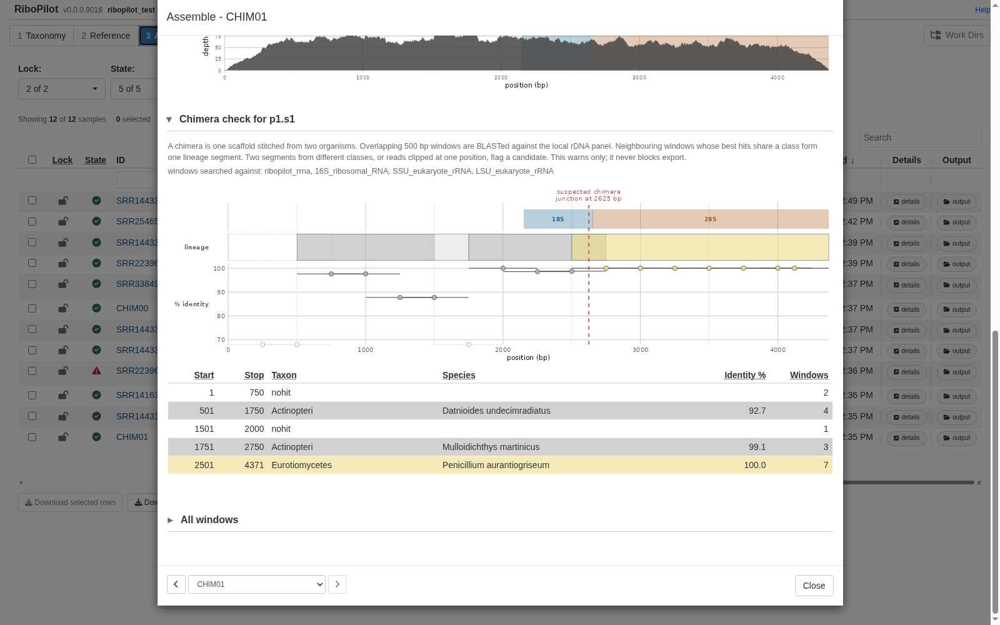

## Appendix A: refuted findings

- U-mitopilot-9: "Toolbar flag buttons do not say what they will do (MitoPilot relabels them)". Refuted: MitoPilot's toolbar labels are static too, and "Toggled reviewed." comes from the details window, not the toolbar. The related direction problem is kept as UX-23.
- U-mitopilot-22: "Triage dialog puts Apply left of Cancel, unlike other dialogs". Refuted: the shared `mp_footer` (copied from MitoPilot) always puts a danger action left of Cancel, and the other destructive dialogs do the same. The remaining style points are kept as UX-64.

## Appendix B: where each source finding went

| Source ids | Item |
|---|---|
| O-practice-1 | UX-01 |
| O-practice-2 | UX-11 |
| O-practice-3 | UX-32 |
| O-practice-4 | UX-42 |
| O-practice-5 | UX-49 |
| O-practice-6 | UX-49 (also UX-09) |
| O-practice-7 | UX-09 |
| O-practice-8 | UX-12 |
| O-practice-9 | UX-17 |
| O-practice-10 | UX-16 |
| O-practice-11 | UX-15 |
| O-practice-12 | UX-14 |
| O-practice-13 | UX-82 |
| O-practice-14 | UX-37 |
| O-practice-15 | UX-36 |
| O-practice-16 | UX-50 |
| O-practice-17 | UX-51 (also UX-33) |
| O-practice-18 | UX-28 |
| O-practice-19, O-practice-20 | UX-50 |
| O-practice-21 | UX-07 |
| O-practice-22, O-practice-23 | UX-11 |
| O-practice-24 | UX-52 |
| O-practice-25 | UX-39 (also UX-85) |
| O-practice-26, O-practice-27 | UX-38 |
| O-practice-28 | UX-83 |
| O-practice-29 | UX-12 |
| O-practice-30 | UX-81 |
| O-practice-31 | UX-48 |
| O-practice-32 | UX-39 |
| O-practice-33 | UX-38 |
| O-practice-34 | UX-81 |
| O-novel-1 | UX-31 |
| O-novel-2 | UX-01 |
| O-novel-3 | UX-18 |
| O-novel-4 | UX-15 |
| O-novel-5 | UX-42 |
| O-novel-6 | UX-49 |
| O-novel-7 | UX-11 |
| O-novel-8 | UX-06 |
| O-novel-9 | UX-51 |
| O-novel-10 | UX-50 |
| O-novel-11 | UX-47 |
| O-novel-12 | UX-84 |
| O-novel-13 | UX-87 |
| O-novel-14 | UX-78 |
| O-novel-15 | UX-79 |
| O-edge-1 | UX-01 |
| O-edge-2 | UX-42 |
| O-edge-3 | UX-03 |
| O-edge-4 | UX-55 |
| O-edge-5, O-edge-6 | UX-02 |
| O-edge-7 | UX-35 |
| O-edge-8 | UX-04 |
| O-edge-9 | UX-46 |
| O-edge-10 | UX-43 |
| O-edge-11 | UX-09 |
| O-edge-12, O-edge-13 | UX-03 |
| O-edge-14 | UX-11 |
| O-edge-15 | UX-05 |
| O-edge-16, O-edge-17 | UX-08 |
| O-edge-18 | UX-13 |
| O-edge-19, O-edge-20, O-edge-21, O-edge-22 | UX-55 |
| O-edge-23, O-edge-24 | UX-56 |
| O-edge-25 | UX-05 |
| O-edge-26 | UX-06 |
| O-edge-27 | UX-49 |
| O-edge-28 | UX-03 |
| O-edge-29 | UX-79 |
| U-novice-1 | UX-14 |
| U-novice-2 | UX-35 |
| U-novice-3 | UX-33 |
| U-novice-4 | UX-34 |
| U-novice-5 | UX-15 |
| U-novice-6 | UX-17 (also UX-16) |
| U-novice-7 | UX-49 |
| U-novice-8 | UX-52 |
| U-novice-9 | UX-53 |
| U-novice-10 | UX-61 |
| U-novice-11 | UX-76 |
| U-novice-12 | UX-16 |
| U-novice-13 | UX-14 |
| U-novice-14 | UX-23 |
| U-novice-15 | UX-40 |
| U-novice-16 | UX-63 |
| U-novice-17 | UX-78 |
| U-novice-18 | UX-80 |
| U-novice-19 | UX-77 |
| U-novice-20 | UX-39 |
| U-novice-21 | UX-48 |
| U-mitopilot-1 | UX-20 |
| U-mitopilot-2 | UX-21 |
| U-mitopilot-3 | UX-20 |
| U-mitopilot-4 | UX-33 |
| U-mitopilot-5 | UX-35 |
| U-mitopilot-6 | UX-24 |
| U-mitopilot-7 | UX-14 |
| U-mitopilot-8 | UX-25 |
| U-mitopilot-9 | refuted (Appendix A) |
| U-mitopilot-10 | UX-45 |
| U-mitopilot-11 | UX-53 |
| U-mitopilot-12 | UX-52 |
| U-mitopilot-13 | UX-49 |
| U-mitopilot-14 | UX-77 |
| U-mitopilot-15 | UX-54 |
| U-mitopilot-16 | UX-26 |
| U-mitopilot-17 | UX-27 |
| U-mitopilot-18 | UX-61 |
| U-mitopilot-19 | UX-48 |
| U-mitopilot-20 | UX-79 |
| U-mitopilot-21 | UX-34 |
| U-mitopilot-22 | refuted (Appendix A) |
| U-power-1 | UX-17 |
| U-power-2 | UX-58 |
| U-power-3 | UX-57 |
| U-power-4 | UX-43 |
| U-power-5 | UX-44 |
| U-power-6 | UX-42 |
| U-power-7 | UX-19 |
| U-power-8 | UX-15 |
| U-power-9 | UX-54 |
| U-power-10 | UX-45 |
| U-power-11 | UX-23 |
| U-power-12 | UX-60 |
| U-power-13 | UX-58 |
| U-power-14 | UX-16 |
| U-power-15 | UX-59 |
| U-power-16 | UX-29 |
| U-power-17 | UX-49 |
| U-power-18 | UX-47 |
| U-power-19 | UX-78 |
| U-power-20 | UX-51 |
| U-power-21 | UX-80 (also UX-48) |
| U-power-22 | UX-79 |
| U-power-23 | UX-64 |
| U-design-1 | UX-23 |
| U-design-2 | UX-22 |
| U-design-3 | UX-65 |
| U-design-4 | UX-66 |
| U-design-5 | UX-67 |
| U-design-6 | UX-68 |
| U-design-7 | UX-69 |
| U-design-8 | UX-70 |
| U-design-9 | UX-42 |
| U-design-10 | UX-34 |
| U-design-11 | UX-71 |
| U-design-12 | UX-72 |
| U-design-13 | UX-63 |
| U-design-14 | UX-33 |
| U-design-15, U-design-16 | UX-73 |
| U-design-17 | UX-74 |
| U-design-18, U-design-19 | UX-62 |
| U-design-20 | UX-10 |
| U-design-21 | UX-26 |
| U-design-22 | UX-75 |
| U-design-23 | UX-53 |
| U-design-24 | UX-52 |
| U-design-25 | UX-78 |
| U-design-26 | UX-61 |
| U-design-27 | UX-64 |
| U-design-28 | UX-41 |
| U-design-29 | UX-76 |
| U-design-30 | UX-79 |
| U-curator-1 | UX-31 |
| U-curator-2 | UX-32 |
| U-curator-3 | UX-84 |
| U-curator-4 | UX-36 (also UX-40) |
| U-curator-5 | UX-85 |
| U-curator-6 | UX-82 |
| U-curator-7 | UX-31 |
| U-curator-8 | UX-14 |
| U-curator-9 | UX-22 |
| U-curator-10 | UX-20 (also UX-33) |
| U-curator-11 | UX-83 |
| U-curator-12 | UX-22 |
| U-curator-13 | UX-27 |
| U-curator-14 | UX-15 |
| U-curator-15 | UX-51 (also UX-76) |
| U-curator-16 | UX-86 |
| U-curator-17 | UX-28 |
| U-curator-18 | UX-39 (also UX-34) |
| U-curator-19 | UX-14 |
| U-curator-20 | UX-30 |

## Appendix C: source reports and evidence

The full journey reports are in the review workspace, which will be deleted after the review: `reports/op-practice.md`, `op-novel.md`, `op-edge.md`, `ux-novice.md`, `ux-mitopilot.md`, `ux-power.md`, `ux-design.md`, and `ux-curator.md`. The 25 screenshots in `screenshots/ux_*.png` are copies. Their originals, by number:

1. op-edge 35_proj_spaces_e_final
2. op-practice 13_run_log_bottom_error
3. ux-novice 03_assemble_scrolled_right
4. op-practice 29_details_CHIM01
5. ux-curator 41_gastro_asm_Tret01_01
6. ux-curator 43_gastro_ann_Tret01_01
7. op-novel 57_export_modal
8. ux-curator 44_gastro_export_complete
9. ux-novice 34_export_done
10. ux-mitopilot 55_export_with_problematic
11. ux-mitopilot 64_locked_unit_edit_saved
12. ux-mitopilot 58_annotate_opts_modal
13. ux-design 29_problematic_mixed_toast
14. ux-curator 50_export_isolate_blocked
15. ux-power 19a_lock_with_hidden_selection
16. ux-power 34a_scale_failed_page1
17. op-practice 41_SRR22396893_rescued_a_scaffolds_right
18. op-novel 21_enit_details
19. op-edge 10_taxonomy_result_alert
20. op-edge 04_no_config_update_modal
21. op-practice 32_SRR33849683_b_chimera
22. ux-design 31_vp1920_Annotate
23. ux-power 55a_after_reload_during_run
24. ux-design 22c_sequence_block_crop
25. op-practice 30_CHIM01_3_chimera_check

No screenshot with the NCBI API key visible was copied. Some operator screenshots of the Reference build and Update windows (op-novel 11, 12, and 16) show the key and should be deleted with the workspace.
