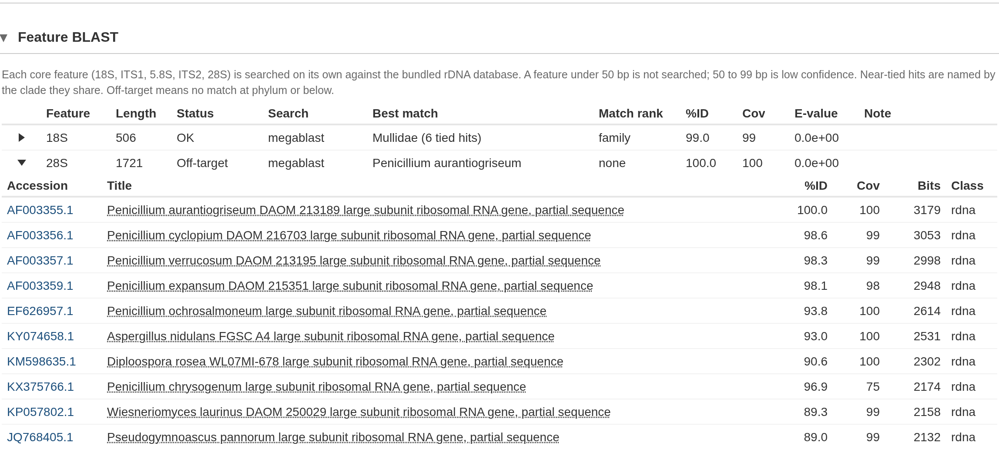

After RiboPilot annotates a contig (see
[Get started](RiboPilot.html#samples-contigs-and-records)), it runs a
set of automatic quality checks and raises a **curation warning** for anything
that looks unusual. Warnings never change your assemblies or annotations. They
flag something that may need your attention.

You can find the results in three places:

- the **Checks** column of the Assemble and Annotation Review tables, which summarizes every check
- the **Warnings** column of Annotation Review, which counts the warnings on the
  contig as a whole
- the **Curation warnings** panel in the Annotation Review contig details window, lists the contig's warnings and each feature that has a warning

Below is a list of all the checks and warnings columns you will see in the app:

| Column | Where | What it holds | Explained in |
|---|---|---|---|
| **Checks** | Assemble table (per sample); Annotation Review table (per contig) | Every check (per sample or per contig) on one line, worst first, colored by the worst finding. | [The Checks column](#the-checks-column) |
| **Warnings** | Annotation Review table | How many curation warnings the contig has. | [Curation warnings](#curation-warnings) |
| **Screen** | Assemble details window (contig table); Annotation Review table | The BLAST screen verdict: on target, off target, or too little evidence to say. The **Screen why** column next to it on Assemble gives the reason. | [The BLAST screen](#the-blast-screen-and-auto-triage) |
| **Chimera** | Assemble details window (contig table); Annotation Review table | The chimera check level: severe, minor, or clean. | [Chimeric contigs](#chimeric-contigs) |
| **ITSx Warnings** | Assemble details window (contig table); Annotation Review table | What the standard ITSx check finds for the contig, for example `itsx_chimeric`, `itsx_no_5.8S`, or `itsx_boundary_shift(...)`. Gray "not run" means ITSx gave no answer; gray "not checked" means no ITSx check is stored yet. Checks lists both as "ITSx not checked". | [GenBank submission](GenBank-Submission.html#check-before-you-submit) |
| **Feature BLAST warnings** | Annotation Review table | Warnings about weak or off-target BLAST hits for each feature. | [Feature BLAST](#feature-blast-each-feature-searched-on-its-own) |

This page explains the Checks column first, then each family of checks in turn,
and ends with the per-group length and identity tables.

# The Checks column

The Checks column puts every check on one line, worst first, in a color that
matches the worst finding. On the Assemble table it summarizes all of the sample's kept
contigs.

| Checks says | Color | What happens |
|---|---|---|
| off target, contaminant, severe chimera, or ITSx chimeric | red | Lock and the Export window ask first, until the contig is marked Reviewed. |
| minor chimera, uncertain screen, ITSx, ITSx not checked, warnings, or feature flags | amber | Worth a look, but nothing asks when you Lock or Export. |
| ok | green | The best BLAST matches are in your sample's phylum, and nothing is flagged. |
| no reference | gray | Nothing is flagged, but the BLAST screen had no usable match to judge by. |

A red finding does not stop you, but locking or exporting that sample will ask you to confirm.
Setting a problematic sample as **Mark Reviewed** will override those prompts on lock or export (see
[Annotation Review](Test-Project-Annotate.html)).

# Curation warnings

In the Annotation Review module, these are the warning codes counted by the `Warnings` column and reported in the `Curation warnings` panel when you examine a contig in detail. 

| Warning | Level | What it means | What to do |
|---|---|---|---|
| `missing_18S`, `missing_5.8S`, `missing_28S` | contig | One of the three rRNA genes was not found. | Expected when the contig contains only part of the nuclear rDNA complex. Otherwise look at **Coverage and windowed BLAST** for a break. |
| `missing_ITS1`, `missing_ITS2` | contig | A spacer was not found between its two genes. | Usually follows a missing gene. If both genes are there, check the boundaries in **Edit active feature boundaries**. |
| `out_of_order` | contig | The features are not in the order 18S, ITS1, 5.8S, ITS2, 28S. | Possible assembly error. Export marks it `misassembly`. Check the feature map and read coverage before you submit it. |
| `overlap` | both | A feature overlaps the one before it. | Move the boundary in **Edit active feature boundaries**. Export marks it `misassembly`. |
| `gap` | both | Unannotated sequence between two features, more than 5 bases long. | Check the boundaries, and extend the gene or spacer if the gap is part of it. |
| `wrong_strand` | both | A feature lies on the opposite strand from the rest. | Likely a misassembly or a wrong call. Check the feature model. |
| `length` | feature | The feature is shorter or longer than its group's expected range (see [per-group tables](#how-the-checks-are-tuned-per-group)). | Common for the spacers, and often fine. Check that the boundaries look right. |
| `truncated` | feature | Less than 90 percent of the gene's rRNA model was recovered. | Nothing: the export writes the gene as partial. |
| `low_identity` | feature | The gene falls below its group's identity floor (see [per-group tables](#how-the-checks-are-tuned-per-group)). | An assembly error, or a group with few other rRNA references. Look at the **Reference alignment**. |
| `contaminant` | contig | The contig's best BLAST hit is from a different phylum than your sample. | Red in Checks. Check the contig before you lock it: it may be another organism's rDNA. |
| `contaminant_unchecked` | contig | The contamination check could not run: the BLAST screen has no usable hit, or your sample's lineage is unknown. | If NCBI could not be reached, run the sample again once it can (see [Troubleshooting](Troubleshooting.html)). If the sample has no taxon, set one in the Taxonomy step. |
| `not_nuclear_rdna` | contig | The best BLAST hit is not a nuclear rDNA record, for example a mitochondrial or bacterial rRNA. | The contig may not be nuclear rDNA. Check its features and hits before you keep it. |
| `no_clade_ruleset` | contig | Your sample's group has no ruleset of its own, so the generic animal ranges were used. | Nothing. See [How the checks are tuned per group](#how-the-checks-are-tuned-per-group). |

# The BLAST screen and auto-triage

Every contig is run through a BLAST search once it is assembled. The result feeds the Screen
column, the contamination warnings above, the chimera check, and the triage rules
below, which propose whether to keep or drop the contig.

## What the screen searches

By default each contig is searched against the **bundled rDNA database** inside the
container: about 600,000 animal nuclear rDNA records from GenBank. This database also includes NCBI's
16S, eukaryote small subunit, and eukaryote large subunit rRNA sets so that a
contaminant bacterial, fungal, or plant contig still finds a match. Contigs that
match nothing in the bundled database are searched against the NCBI nucleotide database (core_nt) over the internet.

To change how the BLAST search works, open a sample's **BLAST Options** in the Assemble module and pick a
**Search** choice: "Bundled database only" never goes to NCBI, and "NCBI only
(core_nt)" skips the bundled database.

In Annotation Review, the **Hit Source** column says which
database was used to determine the contig's best BLAST hit: "bundled", "NCBI", or "seed file"
(the assembly's own seed database, which is only a hint).

## How contigs are kept or dropped

Once a contig has been screened, RiboPilot checks the eight rules below in order
and proposes to keep or drop the contig. For rules whose action is Flag, the contig status
stays undecided and the **Why** column in the sample's contig table gives the reason.
You can override any call by hand with the **K** (keep) and **D** (drop) buttons in the
Assemble details window.

| # | Rule | What it means | Default action |
|---|---|---|---|
| 1 | Annotation has not run | Neither annotation tool has reported on this contig yet. | Flag only |
| 2 | BLAST screen has not run | No usable BLAST hit is recorded, or the only matches are whole-genome assemblies, so the contig cannot be judged. Also raises `contaminant_unchecked`. | Flag only |
| 3 | No annotations, non-rDNA hit | Annotation found no rRNA or ITS feature, and the best match is not a nuclear rDNA record. | Drop |
| 4 | No annotations but rDNA hit | Annotation found no rRNA or ITS feature, but the best match is a nuclear rDNA record. | Flag (can be set to Drop) |
| 5 | Has annotations but non-rDNA hit | The contig has an rRNA or ITS feature, but the best match is not a nuclear rDNA record. | Flag (can be set to Drop) |
| 6 | GenBank taxonomy disagrees with the sample | The contig's BLAST hits agree on a taxon outside your sample's phylum. This is the `contaminant` warning. | Flag (can be set to Drop) |
| 7 | Disagrees with sibling contigs | This contig's top hit disagrees with the majority of this sample's other contigs. A hint, not proof. | Flag only |
| 8 | Chimeric assembly (severe) | Parts of this contig match organisms from different phyla or kingdoms. | Flag only |

Rule 6 compares at phylum rank. It catches a fungal, bacterial, or plant
contaminant, but cannot separate two organisms in the same phylum.

To change what a rule does to a contig, select samples in the Assemble table and click the
**Triage** button at the top. The Triage window lets you set each rule to Off, Flag, or Drop,
shows how many contigs each rule would decide, and
reruns triage for the selected samples when you click **Apply**.

# Chimeric contigs

A chimera is one assembled contig containing sequences that do not belong together,
such as rDNA from two organisms or two different copies of the repeat from one
genome. Each contig gets a chimera level, shown in the **Chimera** column of
Annotation Review and in the **Checks** column:

| Level | What it means | Triage | Export |
|---|---|---|---|
| severe | Two parts of the contig match different phyla or kingdoms, each at 90 percent identity or more. | Rule 8 flags the contig. | Red in Checks. The `submission_risk` column says `chimeric(...)`. |
| minor | Weaker evidence: windows match more than one class, genes agree only at a high rank, a ribotyper warning, or read evidence alone. | No rule fires. | Amber in Checks. Listed in the `chimera_warning` column of the summary CSV; not a submission risk. |
| clean | Nothing found. | No rule fires. | Nothing. |

In the test project, CHIM01 is severe: the contig is an artificial chimera
composed of sequence from ray-finned fish and *Penicillium* mold.

## How the check works

RiboPilot looks for chimeras in four ways:

- **Gene by gene.** The 18S, 5.8S, and 28S genes each get their own best
  GenBank matches. Ideally these agree on one lineage.
- **Along the contig.** The contig is divided into 150 bp windows and
  each is searched against the bundled rDNA database. Neighboring windows that
  match the same taxonomic class are joined into segments, and neighboring
  segments that hit different classes suggest a chimeric join. Neighboring
  segments with different taxonomic assignment are only flagged when both segments span at least 450 bp (for class mismatches) or 300 bp (for phylum or
  kingdom mismatches).
- **Gene structure.** [ribotyper](https://github.com/ncbi/ribovore), NCBI's rRNA
  checker, tests that the 18S and 28S each look like one whole gene. ITSx's own
  chimera call adds a little weight.
- **Reads.** Many mapped reads that stop at the same point, or a large shift in
  read depth, can indicate a chimeric join.

## How to judge a flag

In the **Coverage and windowed BLAST** panel:

- **BLAST origin** shows segments with consistent taxonomic identity
- **BLAST identity** shows the best hit's percent identity
- vertical red dashed lines mark possible chimeric junctions

The **Windowed BLAST details** panel below provides more details about the
BLAST results.

A real chimera shows a clean switch from one lineage to another,
often accompanied by a shift in read depth. RiboPilot
already discounts the common false positives: windows in conserved stretches where many groups match equally well are shown as "unresolved" and changes
in read depth at a gene boundary or at the ends of the contig are ignored. 
Below, the first contig of SRR33849683 is "minor" because its genes agree only at phylum level, although every window that can be placed matches a ray-finned fish:

If in doubt, copy the contig with **Copy FASTA** and run your own BLAST searches
on the NCBI website.

# Feature BLAST: each feature searched on its own

The contig BLAST search can look fine even if one feature is poorly assembled or contaminated. 
So RiboPilot also searches each core feature
(18S, ITS1, 5.8S, ITS2, 28S) on its own against the bundled rDNA database.

The **Feature BLAST warnings** column in Annotation Review lists only the
features that need a look:

| Warning | Meaning |
|---|---|
| no hit | Nothing in the database matched the feature. |
| non-rDNA hit | The best match is not a nuclear rDNA record. |
| off-target (group) | The best match shares nothing with your sample at phylum level or below. |
| no BLAST, feature too small | The feature is under 50 bp, too short for a useful search. Features of 50 to 99 bp are searched but marked low confidence, because short pieces match many organisms equally well. |
| weak hit | Only the more sensitive dc-megablast retry found a match; megablast found nothing. |

In the Annotation Review table, open a contig **Details** window to see the full **Feature BLAST** panel. This shows each feature's
best match, how closely it matches your sample (species, genus, family, and so
on), its identity and coverage, and the algorithm that found it (megablast,
dc-megablast in amber, or blastn for short features). Expand a row for the top 10
matches. "Not run" means the database was not available.

In the test project, CHIM01's 28S comes from a *Penicillium* mold, so its best
match shares nothing with the fish sample and the feature is off target:

# Several contigs from one organism

When a sample assembles more than one rDNA contig, RiboPilot compares their
18S, 5.8S, and 28S genes. The result is shown in the **Variant** column of the
Assemble step's contig table. Too little shared gene sequence gives "not comparable".

An **isomer** is RiboPilot's label for contigs whose rRNA genes are nearly identical
but which differ in the ITS sequence or flanking regions.

A **paralog** means the genes of the contigs differ. That can be real
variation within one genome (known in octocorals and jellyfish), contamination,
or a pseudogene.

A contaminant from the same phylum passes the contig screen, so check each
variant's **Feature BLAST warnings** before you lock one. Handle isomers and
paralogs with care: consult the literature for your group, or examine a reference
genome, to see whether rDNA variation is a known phenomenon.

# How the checks are tuned per group

The expected lengths and identity floors depend on the group of organisms.
RiboPilot ships five rulesets, with ranges taken from GenBank records:

| Ruleset | Used for samples in |
|---|---|
| `actinopterygii` | ray-finned fishes |
| `asteroidea` | sea stars |
| `scyphozoa` | true jellyfish |
| `octocorallia` | octocorals |
| `metazoa_generic` | any other group; the contig gets the `no_clade_ruleset` note |

To use another one, pick it as **Clade ruleset** in the sample's **Curate
Options** (Assemble step). Leaving `metazoa_generic` there lets RiboPilot choose
from the lineage.

Expected lengths, in bases. A `length` warning means a feature fell outside its
range, which is common and often fine for the spacers:

| Feature | Generic animal | Ray-finned fishes | Sea stars, jellyfish, octocorals |
|---|---|---|---|
| 18S | 1600 to 2100 | 1750 to 1950 | 1700 to 1900 |
| 5.8S | 140 to 180 | 140 to 175 | 150 to 170 |
| 28S | 2000 to 6000 | 2500 to 5000 | 2000 to 6000 |
| ITS1 | 120 to 1600 | 150 to 1200 | 120 to 1200 |
| ITS2 | 120 to 1600 | 150 to 1200 | 120 to 1200 |

Identity floors, in percent. Below these a gene gets `low_identity`:

| Gene | Generic animal | Ray-finned fishes | Sea stars, jellyfish, octocorals |
|---|---|---|---|
| 18S | 95 | 97 | 93 |
| 5.8S | 93 | 95 | 90 |
| 28S | 80 | 85 | 78 |

The floors are lower for sea stars, jellyfish, and octocorals because GenBank
has fewer rDNA records for these groups. All of these are working values, not
published standards: a `length` or `low_identity` warning is a prompt to look,
not a verdict. In every ruleset, a gene is `truncated` when
less than 90 percent of its rRNA model was recovered, identity is judged only
when the reference covers at least half of the gene, and annotation gaps of 5
bases or fewer are closed automatically.

Want ranges for your own group? [Open an issue](https://github.com/NMNH-OceanDNA/RiboPilot/issues)
describing it. Until then, the generic animal ruleset works for any group; it
is just more lenient.
