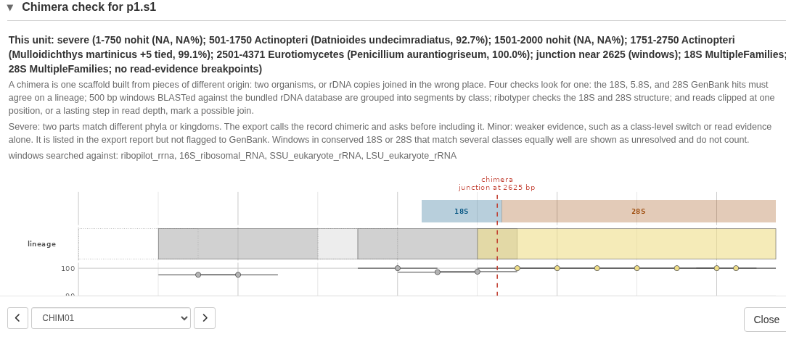

After it annotates a sample, RiboPilot runs a set of automatic quality checks and
raises a **flag** for anything that looks unusual. Flags are there to guide your
attention: they point out samples worth a closer look in the app's Annotation
Review step. They do not change your data, and a flag does not always mean
something is wrong. It just means "please check this".

You will see flags in three places in the app: the **Checks** column right after
the ID in the Assemble and Annotation Review tables, which sums up every check in
a few words; a count in the **Warnings** column; and a detailed **Curation
warnings** panel when you open a unit. Each flag links to the exact feature it
concerns, so you can jump straight to it.

# What the flags mean

| Flag | Applies to | What it means |
|---|---|---|
| `missing_18S`, `missing_5.8S`, `missing_28S` | sample | One of the three ribosomal genes was not found. |
| `missing_ITS1`, `missing_ITS2` | sample | A spacer was not recovered between its neighboring genes. |
| `out_of_order` | sample | The five features are not in the expected order (18S, ITS1, 5.8S, ITS2, 28S). |
| `overlap` | feature | Two features overlap when they should sit side by side. |
| `wrong_strand` | feature | A feature was found on the opposite strand from what is expected. |
| `length` | feature | A feature is shorter or longer than typical for your group. |
| `low_identity` | feature | A conserved gene is less similar to reference sequences than expected (could signal an assembly problem or a genuinely unusual sample). |
| `contaminant` | sample | The closest published match belongs to an unrelated group, which can indicate contamination. |

The last two checks (`low_identity` and `contaminant`) rely on looking up a
reference match on NCBI during assembly. If that lookup was unavailable at the
time, those two checks are simply skipped and the others still apply.

# The Checks column

The Checks column puts every check on one line, worst first, in a color that
matches the worst finding. On the Assemble table it covers the sample's kept
scaffolds; on the Annotation Review table, one unit. "warnings" means one of the
flags above, on the unit or on one of its features.

| Checks says | Color | What happens |
|---|---|---|
| off target, contaminant, severe chimera, ITSx chimeric | red | Lock and the Export window ask first, until the unit is marked Reviewed. |
| minor chimera, uncertain screen, ITSx, warnings | amber | Worth a look; nothing asks. |
| ok | green | The GenBank screen matched your sample's lineage, and nothing is flagged. |
| no reference | grey | Nothing is flagged, but the screen had no usable GenBank match to judge by. |

# How scaffolds are kept or dropped (auto-triage)

Flags above point at something worth a look; they never remove data. Separately,
once a scaffold has been annotated and screened against GenBank, RiboPilot also
proposes a keep, drop or flag call for the scaffold itself, in the Assemble step.
You can review and override every call by hand, and your own decisions are
never silently overwritten (more on that below).

The proposal rests on two evidence channels that are independent of one
another: **annotation**, from barrnap and ITSx run locally on the assembly, and
the **GenBank screen**, the best reference match found remotely. RiboPilot
never drops a scaffold on one channel's silence: a rule can only drop once
both the annotation tools and the GenBank screen have actually reported on
the scaffold. By default, the only rule that drops is the one where both
channels independently say the scaffold is not nuclear rDNA. Three other
rules can be switched to Drop as well: two fire when annotation and the
GenBank screen *disagree* with each other, and one fires when the GenBank
screen's own consensus disagrees with the sample's identity. Turning any of
them on is a deliberate choice about which evidence you trust more for your
material, not more of the same corroboration; see the table below for
which is which.

RiboPilot checks a scaffold against eight named rules, in this order. The
first rule that matches decides the outcome; if none match, the scaffold is
kept. Four of the eight rules can ever drop a scaffold. The other four only
flag, because their evidence is a missing channel, taxonomic distance alone, or
a possible chimera, none of which is a safe basis for removing a scaffold by
itself.

| # | Rule | What it means | Can it drop? |
|---|---|---|---|
| 1 | Annotation has not run | Neither annotation tool has reported on this scaffold yet. | No, flag only |
| 2 | GenBank screen has not run | No usable core_nt hit is recorded, so the scaffold cannot be judged against GenBank. | No, flag only |
| 3 | No annotations, non-rDNA hit | Annotation found no rRNA or ITS feature, and the best GenBank match is not a nuclear rDNA record. | Yes, dropped by default |
| 4 | No annotations but rDNA hit | Annotation found no rRNA or ITS feature, though the best GenBank match is a nuclear rDNA record. | Optional; flagged by default |
| 5 | Has annotations but non-rDNA hit | The scaffold has a feature model, but its best GenBank match is not a nuclear rDNA record. | Optional; flagged by default |
| 6 | GenBank taxonomy disagrees with the sample | The scaffold's BLAST hits agree on a taxon that is not on this sample's lineage. | Optional; flagged by default |
| 7 | Disagrees with sibling scaffolds | This scaffold's top hit disagrees with the majority of this sample's other scaffolds. | No, flag only |
| 8 | Chimeric assembly (severe) | Parts of this scaffold match organisms from different phyla or kingdoms. | No, flag only |

Rule 2 also covers a case that looks different but is judged the same way: a
scaffold whose only GenBank matches are whole-genome or chromosome-level
assemblies. Such a record does not say what the aligned region actually is, so
RiboPilot reports the scaffold as unjudged rather than guessing that it is not
nuclear rDNA.

Rule 6 is a separate check from the rest of the table: it asks whether the
scaffold's GenBank hits agree on a taxon, and whether that taxon sits on your
sample's own lineage. This is the check that catches a fungal, bacterial or
plant contaminant riding along with a metazoan sample. It compares only
against your sample's own lineage, at phylum rank, so it cannot separate two
metazoans in the same phylum: a human on a fish sample passes, because both
are Chordata, while a copepod on that same sample is caught. A `no_reference`
result is a normal state
for an offline project or a sparse clade, not a problem in itself: it means
the screen had nothing usable to compare against, not that something is
wrong. The verdict is also shown as a Screen column in a sample's scaffold table
(click its ID in the Assemble step) and in the Annotation Review table, and an
off-target verdict turns the Checks cell red.

Each rule can be turned off if it does not suit your data. Switching every
rule off at once makes Apply a no-op: it changes nothing, rather than
marking every remaining scaffold "keep" on the strength of no active checks.
Rules 4, 5 and 6
can be turned up to Drop if you want RiboPilot to act on them automatically
rather than just flag them for you to review. This setting lives with the
project, not with any one run, so the app and the pipeline never disagree
about what a rule is set to do.

Rule 7 deserves a special note: a low-identity hit at a large taxonomic
distance is the normal state for an under-studied group, not proof of
contamination, which is exactly the case RiboPilot exists to serve. For that
reason, disagreement with sibling scaffolds can only ever flag, never drop.

# Chimeras: scaffolds made of two pieces

A chimera is one scaffold joined from two pieces that do not belong together:
rDNA from two organisms (for example a fish and a contaminating mold), or two
different copies of the repeat from one genome.

RiboPilot looks for a chimera in four ways:

- **Gene by gene.** The 18S, 5.8S, and 28S genes each get their own best
  GenBank matches, and these should agree on one lineage.
- **Along the scaffold.** Overlapping 500 bp windows, one every 250 bp, are
  matched against the local rDNA panel, and neighboring windows that match the
  same class are joined into segments. Two neighboring segments of similar
  length from different classes suggest a join.
- **Gene structure.** The ribotyper tool checks that the 18S and 28S each look
  like one whole gene. ITSx's own chimera call adds a little weight.
- **Reads.** Many reads that stop at the same point, or a lasting step in read
  depth, can mark a join.

Each unit gets one of three levels, shown in the **Chimera** column of the
Annotation Review table and in the **Checks** column:

| Level | What it means | Triage | Export |
|---|---|---|---|
| severe | Two parts match different phyla or kingdoms, each at 90 percent identity or more. | Rule 8 flags the scaffold. | The `submission_risk` column says `chimeric(...)`, and Lock and the Export window ask first until the unit is marked Reviewed. |
| minor | Weaker evidence: a switch between classes, genes that agree only at a high rank, a ribotyper warning, or read evidence alone. | No rule fires. | Listed in the `chimera_warning` column of the summary CSV. It is not a submission risk, and neither Lock nor the Export window asks. |
| clean | Nothing found. | No rule fires. | Nothing. |

In the practice project, CHIM01 is severe: its first part matches ray-finned
fishes and its 28S matches a *Penicillium* mold, and the plot marks the join
near 2,625 bp:

RiboPilot already sets aside the usual false alarms. Windows in conserved
stretches of 18S or 28S, where many groups match equally well, are shown as
"unresolved" and do not count. Depth changes inside sequence that repeats
elsewhere on the scaffold, or right at a gene boundary, are ignored, and so are
reads that stop near the ends of the scaffold. A weak signal can still give a
minor call. The first scaffold of SRR33849683, for example, is minor because its
genes agree only at phylum level, though every window that can be placed
matches a ray-finned fish:

To judge a flag, open the **Chimera check** panel, and hover over the unit's
badge in the **Chimera** column to read the evidence behind the call. A real
chimera shows a clean switch from one lineage to another at one point, often
with a depth change there too. A switch that sits inside a conserved stretch of
18S or 28S, to a group that is not far from yours, is usually a false alarm. If
in doubt, copy the scaffold with **Copy FASTA** and BLAST each side at NCBI.

# Several scaffolds from one organism: the Variant column

None of the rules above fires on this, and that is deliberate. When a sample
yields more than one scaffold that the GenBank screen calls on-target, both
agree with your sample's lineage at phylum level. That rules out many
contaminants but not all: a human on a fish sample is also a chordate. BLAST
each variant's ITS before you lock one. RiboPilot
compares them and tells you which of two situations you are looking at, in a
Variant column in the Assemble step's scaffold table.

An **isomer** means the scaffolds are the same molecule assembled two ways:
their conserved anchors are the same sequence, and they differ only outside
them. Often that is spacer copy number, because the rDNA repeat's intergenic
spacer contains subrepeats and an assembly graph can traverse a different
number of them on different passes. It is not always: when two isomers have the
same total length the difference cannot be copy number, so RiboPilot reports the
measured length difference and lets you see which case you have. The
comparison looks only at the 18S, 5.8S, and 28S genes. Two isomers can still
differ in ITS1 or ITS2, and if they do, the one you lock is the ITS that GenBank
receives, so compare their ITS before you choose.

A **paralog** means the sample genuinely carries several different rDNA copies.
This is real, documented biology in Octocorallia, Scyphozoa and other groups,
not a defect and not a sign that anything went wrong. Here the choice does
matter, because which scaffold you lock is what GenBank receives. The column is
rendered as information rather than as a warning, and export records the fact
without blocking anything: a paralogous scaffold still exports.

Three details worth knowing. The comparison uses only the conserved anchors
(18S, 5.8S and 28S), because the spacers vary in both situations and so cannot
tell them apart. RiboPilot does not annotate the intergenic spacer as a feature,
so any statement about spacer copy number is inferred from the unannotated
remainder rather than measured directly. And two scaffolds are only compared on
the anchors they **both** carry, and only when enough of each one aligns: a
scaffold whose 28S is a short fragment is reported as not comparable rather than
declared identical to a complete one. The measured anchor identity is always
shown, so you can see the number the label came from rather than only the label.

# Your own decisions stick

If you keep or drop a scaffold by hand, that decision is recorded as yours,
and a later automatic re-run will not overwrite it, even if the rules above
would now propose something different. Re-triaging only touches scaffolds it
decided itself, unless you explicitly ask it to reconsider your calls too.

# Depth is shown, not decided

The scaffold table shows each scaffold's median per-position read depth and a
small sparkline of depth along its length, but depth never decides a keep,
drop or flag call. Reads are mapped to one path at a time, and reads that
could sit in more than one place in that path are set aside. So depth dips
where the sequence repeats inside the path, for example over repeats in the
spacer between units, and those dips are expected. The number is worth a look;
it is not sound enough to decide anything on its own.

# How the checks are tuned per group

Some checks, especially the expected lengths, depend on the group of organisms.
RiboPilot ships five settings, and picks one from each sample's lineage:

- **Generic animal**: deliberately wide length ranges that suit a broad range
  of animals. Used for any group without its own setting.
- **Ray-finned fishes**: tighter, fish-specific ranges for the ribosomal genes,
  with the spacers kept wide because they vary even between close relatives.
- **Sea stars** (Asteroidea), **true jellyfish** (Scyphozoa), and
  **octocorals** (Octocorallia): tighter gene ranges, and lower identity
  thresholds, because GenBank holds few close relatives for these groups.

For reference, the generic animal length ranges are:

| Feature | Typical length (bases) |
|---|---|
| 18S | 1600 - 2100 |
| 5.8S | 140 - 180 |
| 28S | 2000 - 6000 (the recovered portion varies with sequencing depth) |
| ITS1 | 120 - 1600 |
| ITS2 | 120 - 1600 |

A `length` flag simply means a feature fell outside these ranges. That is common
and often fine, especially for the fast-evolving spacers; it is a prompt to look,
not a verdict.

# Adding tuning for a new group

If you work on a group that would benefit from its own length ranges, that can be
added. This is a small change to RiboPilot's settings rather than new analysis
code. If you are comfortable with R you can add it yourself (see `rrna_params()`
in the source), but you are also very welcome to
[open an issue](https://github.com/dmacguigan/RiboPilot/issues) describing your
group, and we can help set it up. In the meantime, the generic animal setting
works for any group; it is just more lenient.
