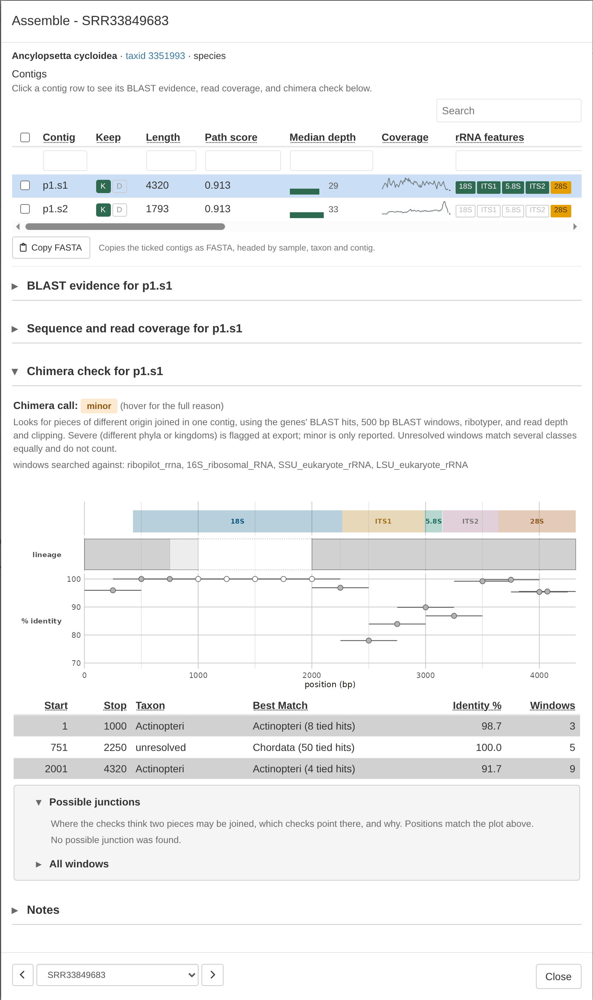

After RiboPilot annotates a contig (see
[Get started](RiboPilot.html#samples-contigs-and-records)), it runs a
set of automatic quality checks and
raises a **curation warning** for anything that looks unusual. Warnings do not change your 
assemblies or annotations, they simply flag something that may need your
attention.

You can find warnings in three places:

- the **Checks** column of the Assemble and Annotation Review tables, which sums up
  every check in a few words
- the **Warnings** column of Annotation Review, which counts the warnings on the
  contig as a whole
- the **Curation warnings** panel of a contig's window, which lists the contig's
  warnings and, below them, each feature that has a warning

# What the warnings mean

| Warning | Source | What it means | What to do |
|---|---|---|---|
| `missing_18S`, `missing_5.8S`, `missing_28S` | contig | One of the three rRNA genes was not found. | Expected when the contig contains only part of the nuclear rDNA complex. Otherwise look at **Sequence and read coverage** for a break. |
| `missing_ITS1`, `missing_ITS2` | contig | A spacer was not found between its two genes. | Usually follows a missing gene. If both genes are there, check the boundaries in **Edit active feature boundaries**. |
| `out_of_order` | contig | The features are not in the order 18S, ITS1, 5.8S, ITS2, 28S. | Possible assembly error. Export marks it `misassembly`. Check the feature map and read coverage before you submit it. |
| `overlap` | contig and feature | A feature overlaps the one before it. | Move the boundary in **Edit active feature boundaries**. The export marks it `misassembly`. |
| `gap` | contig and feature | An annotation gap between two features. Gaps of 5 bases or fewer are closed when the contig is annotated, so a new contig only gets `gap` for a larger one. | Check the boundaries, and extend the gene or spacer if the gap is part of it. |
| `wrong_strand` | contig and feature | A feature lies on the opposite strand from the rest. | Likely a misassembly or a wrong call. Check the feature model. |
| `length` | feature | The feature is shorter or longer than expected (tables below). | Common for the spacers, and often fine. Check that the boundaries look right. |
| `truncated` | feature | Less than 90 percent of the gene's rRNA model was recovered. | Nothing: the export writes the gene as partial. |
| `low_identity` | feature | The gene falls below a minimum sequence similarity threshold (tables below), and the reference covers at least half of the gene. | An assembly error, or a group with few other rRNA references. Look at the **Reference alignment**. |
| `contaminant` | contig | The contig BLAST best hit is from a different phylum than your sample. | Check the contig before you lock it: it may be another organism's rDNA. Lock and the Export window ask about it until you mark it Reviewed. |
| `contaminant_unchecked` | contig | The contamination check could not run: the BLAST screen has no usable hit for the contig, or your sample's lineage is unknown. | If NCBI could not be reached, run the sample again once it can (see [Troubleshooting](Troubleshooting.html)). If the sample has no taxon, set one in the Taxonomy step. |
| `not_nuclear_rdna` | contig | The BLAST screen's best hit is not a nuclear rDNA record, for example a mitochondrial or bacterial rRNA. | The contig may not be nuclear rDNA. Check its features and hits before you keep it. |
| `no_clade_ruleset` | contig | Your sample's group has no ruleset of its own, so the generic animal ranges were used. | Nothing. See [How the checks are tuned per group](#how-the-checks-are-tuned-per-group). |

Two more columns have results from additional checks. **ITSx Warnings** reports what standard ITSx
check finds for the contig (see [the final ITSx check](GenBank-Submission.html#check-before-you-submit)).
For example
`itsx_chimeric`, `itsx_no_5.8S`, or `itsx_boundary_shift(...)`. The **Chimera** column reports the
chimera check's level, see [Chimeras](#chimeras-contigs-made-of-two-pieces).

The contamination checks need a BLAST screen result. When a contig has none, for
example because NCBI could not be reached, RiboPilot does not skip the check: it
raises `contaminant_unchecked`, and triage flags the contig "BLAST screen has not
run".

`low_identity` needs the references sequences downloaded from NCBI. When they could
not be downloaded, the identity check is skipped with no warning, so a gene without
`low_identity` has not always been checked.

# The Checks column

The Checks column puts every check on one line, worst first, in a color that
matches the worst finding. On the Assemble table it summarizes all of the sample's kept
contigs.

| Checks says | Color | What happens |
|---|---|---|
| off target, contaminant, severe chimera, ITSx chimeric | red | Lock and the Export window ask first, until the contig is marked Reviewed. |
| minor chimera, uncertain screen, ITSx, warnings, feature flags | amber | Worth a look, but nothing asks when you Lock or Export. |
| ok | green | The best BLAST matches are in your sample's phylum, and nothing is flagged. |
| no reference | grey | Nothing is flagged, but the BLAST screen had no usable match to judge by. |

# What the BLAST screen searches

Contig BLAST search results are used in the Screen column, the contamination warnings above, the
triage rules below, and the chimera check.

By default each contig is searched against the **bundled rDNA database** inside the
container: about 600,000 animal nuclear rDNA records from GenBank, plus NCBI's
16S, eukaryote small subunit, and eukaryote large subunit rRNA sets, so that a
bacterial, fungal, or plant contig still finds its match. Contig that
match nothing in that database are searched against the NCBI nucleotide database (core_nt),
over the internet.

To change how the BLAST search works, open a sample's **BLAST Options** in the Assemble module and pick a
**Search** choice: "Bundled database only" never goes to NCBI, and "NCBI only
(core_nt)" skips the bundled database. The BLAST Options window also names the
version of the bundled database.

The line under the contig name in the **BLAST evidence** panel (click a
sample's ID in the Assemble step, "Best match in ...") says which database
gave the contig's best match. In Annotation
Review, the **Hit Source** column (in the **BLAST** column group) says which
database named the contig's best rDNA reference: "bundled", "NCBI", or "seed file"
(the assembly's own seed database, which is only a hint).

For a methods section, see [Citing RiboPilot](Citing.html).

# How contigs are kept or dropped (auto-triage)

Warnings never remove data. Separately, once a contig has been annotated and
screened, RiboPilot proposes keep, drop, or undecided for it in the Assemble
step, by checking the eight rules below in order. The first rule that matches
decides; if none match, the contig is kept. By default only one rule drops a
contig: the one where annotation and the BLAST screen both say it is not
nuclear rDNA. Every other rule flags: the contig stays undecided, and the **Why** column of
the sample's contig table gives the reason. You can override any call by hand
with **K** and **D**, and RiboPilot never overwrites your own decisions.

| # | Rule | What it means | Can it drop? |
|---|---|---|---|
| 1 | Annotation has not run | Neither annotation tool has reported on this contig yet. | No, flag only |
| 2 | BLAST screen has not run | No usable BLAST hit is recorded, or the only matches are whole-genome assemblies, so the contig cannot be judged. | No, flag only |
| 3 | No annotations, non-rDNA hit | Annotation found no rRNA or ITS feature, and the best GenBank match is not a nuclear rDNA record. | Yes, dropped by default |
| 4 | No annotations but rDNA hit | Annotation found no rRNA or ITS feature, though the best GenBank match is a nuclear rDNA record. | Optional; flagged by default |
| 5 | Has annotations but non-rDNA hit | The contig has a feature model, but its best GenBank match is not a nuclear rDNA record. | Optional; flagged by default |
| 6 | GenBank taxonomy disagrees with the sample | The contig's BLAST hits agree on a taxon that is not on this sample's lineage. | Optional; flagged by default |
| 7 | Disagrees with sibling contigs | This contig's top hit disagrees with the majority of this sample's other contigs. A hint, not proof. | No, flag only |
| 8 | Chimeric assembly (severe) | Parts of this contig match organisms from different phyla or kingdoms. | No, flag only |

The taxonomy rule compares the contig's BLAST hits with your sample's lineage
at phylum rank. It catches a fungal, bacterial, or plant contaminant, but
cannot separate two animals in the same phylum: a human on a fish sample
passes, because both are chordates. The verdict also shows in the Screen column
of a sample's contig table and of the Annotation Review table, and an
off-target verdict turns the Checks cell red.

To change what a rule does, tick samples in the Assemble step and press
**Triage**. The Triage window sets each rule to Off, Flag, or Drop (Drop only
where the rule allows it), shows how many contigs each rule would decide, and
applies to the ticked samples when you press **Apply**.

# Chimeras: contigs made of two pieces

A chimera is one contig joined from two pieces that do not belong together:
rDNA from two organisms (for example a fish and a contaminating mold), or two
different copies of the repeat from one genome.

RiboPilot looks for a chimera in four ways:

- **Gene by gene.** The 18S, 5.8S, and 28S genes each get their own best
  GenBank matches, and these should agree on one lineage.
- **Along the contig.** Overlapping 500 bp windows, one every 250 bp, are
  matched against the bundled rDNA database, and neighboring windows that match the
  same class are joined into segments. Two neighboring segments of similar
  length from different classes suggest a join.
- **Gene structure.** The ribotyper tool checks that the 18S and 28S each look
  like one whole gene. ITSx's own chimera call adds a little weight.
- **Reads.** Many reads that stop at the same point, or a lasting step in read
  depth, can mark a join.

Each contig gets one of three levels, shown in the **Chimera** column of the
Annotation Review table and in the **Checks** column:

| Level | What it means | Triage | Export |
|---|---|---|---|
| severe | Two parts match different phyla or kingdoms, each at 90 percent identity or more. | The chimera rule flags the contig. | The `submission_risk` column says `chimeric(...)`, and Lock and the Export window ask first until the contig is marked Reviewed. |
| minor | Weaker evidence: a switch between classes, genes that agree only at a high rank, a ribotyper warning, or read evidence alone. | No rule fires. | Listed in the `chimera_warning` column of the summary CSV. It is not a submission risk, and neither Lock nor the Export window asks. |
| clean | Nothing found. | No rule fires. | Nothing. |

In the test project, CHIM01 is severe: its first part matches ray-finned
fishes and its 28S matches a *Penicillium* mold, and the plot marks the join
near 2,625 bp:

RiboPilot already sets aside the usual false alarms. Windows in conserved
stretches of 18S or 28S, where many groups match equally well, are shown as
"unresolved" and do not count. Depth changes inside sequence that repeats
elsewhere on the contig, or right at a gene boundary, are ignored, and so are
reads that stop near the ends of the contig. A weak signal can still give a
minor call. The first contig of SRR33849683, for example, is minor because its
genes agree only at phylum level, though every window that can be placed
matches a ray-finned fish:

To judge a flag, open the **Chimera check** panel, and hover over the contig's
badge in the **Chimera** column to read the evidence behind the call. A real
chimera shows a clean switch from one lineage to another at one point, often
with a depth change there too. A switch that sits inside a conserved stretch of
18S or 28S, to a group that is not far from yours, is usually a false alarm. If
in doubt, copy the contig with **Copy FASTA** and BLAST each side at NCBI.

# Several contigs from one organism: the Variant column

When a sample gives more than one contig that the BLAST screen calls on target,
no triage rule fires: all of them agree with your sample's lineage at phylum
level. RiboPilot compares them on the 18S, 5.8S, and 28S genes they share, and
labels them in the **Variant** column of the Assemble step's contig table. Too
little shared gene sequence gives "not comparable". A contaminant from the same
phylum also passes the screen, so BLAST each variant's ITS before you lock one.

An **isomer** is RiboPilot's label for contigs that are the same rDNA copy
assembled two ways: the genes are identical and the contigs differ only outside
them, often in the number of spacer
subrepeats. Isomers can still differ in ITS1 or ITS2, and the one you lock is
what GenBank receives, so compare their ITS before you choose.

A **paralog** means the genes of the contigs differ. That can be real
variation within one genome (known in octocorals and jellyfish), but also a
second organism from the same phylum or a pseudogene. Which contig you lock is
what GenBank receives, so choose with care; export records the label and blocks
nothing.

# Your own decisions stick

If you keep or drop a contig by hand, that decision is recorded as yours,
and a later automatic re-run will not overwrite it, even if the rules above
would now propose something different. Re-triaging only touches contigs it
decided itself, unless you tick **Also re-decide contigs I set by hand** in the Triage window.
They also survive assembling the sample again, as long as the contig comes
back with the same sequence; a contig whose sequence changed starts undecided.

# Depth is shown, not decided

The contig table shows each contig's median read depth and a small sparkline
of depth along its length, but depth never decides a keep or drop call. Dips
are expected where the sequence repeats inside the contig.

# How the checks are tuned per group

The expected lengths and identity floors depend on the group of organisms.
RiboPilot ships five rulesets, and picks one from each sample's lineage:

| Ruleset | Used for samples in |
|---|---|
| `actinopterygii` | ray-finned fishes |
| `asteroidea` | sea stars |
| `scyphozoa` | true jellyfish |
| `octocorallia` | octocorals |
| `metazoa_generic` | any other group; the contig gets the `no_clade_ruleset` note |

To use another one, pick it as **Clade ruleset** in the sample's **Curate
Options** (Assemble step). Leaving `metazoa_generic` there lets RiboPilot choose
from the lineage.

Expected lengths, in bases. A `length` warning means a feature fell outside its
range, which is common and often fine for the spacers:

| Feature | Generic animal | Ray-finned fishes | Sea stars, jellyfish, octocorals |
|---|---|---|---|
| 18S | 1600 to 2100 | 1750 to 1950 | 1700 to 1900 |
| 5.8S | 140 to 180 | 140 to 175 | 150 to 170 |
| 28S | 2000 to 6000 | 2500 to 5000 | 2000 to 6000 |
| ITS1 | 120 to 1600 | 150 to 1200 | 120 to 1200 |
| ITS2 | 120 to 1600 | 150 to 1200 | 120 to 1200 |

Identity floors, in percent. Below these a gene gets `low_identity`:

| Gene | Generic animal | Ray-finned fishes | Sea stars, jellyfish, octocorals |
|---|---|---|---|
| 18S | 95 | 97 | 93 |
| 5.8S | 93 | 95 | 90 |
| 28S | 80 | 85 | 78 |

The floors are lower for sea stars, jellyfish, and octocorals because GenBank
holds few close relatives for them. All of these are working values, not
published standards: a `length` or `low_identity` warning is a prompt to look,
not a verdict. In every ruleset, a gene is `truncated` when
less than 90 percent of its rRNA model was recovered, and identity is judged only
when the reference covers at least half of the gene.

Want ranges for your own group? [Open an issue](https://github.com/dmacguigan/RiboPilot/issues)
describing it. Until then, the generic animal ruleset works for any group; it
is just more lenient.
