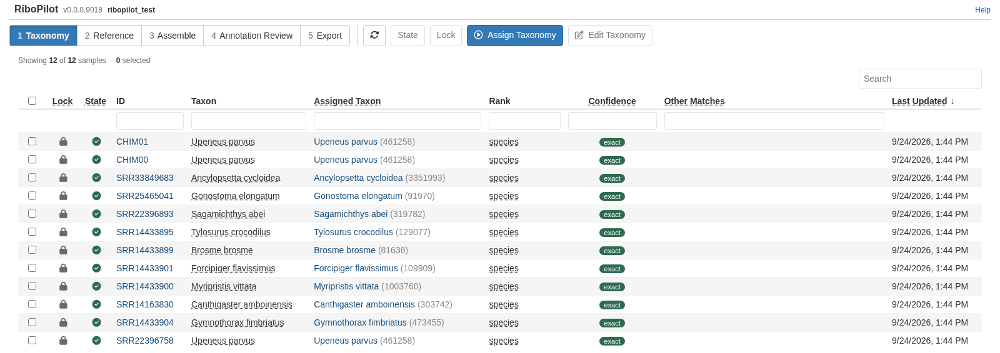
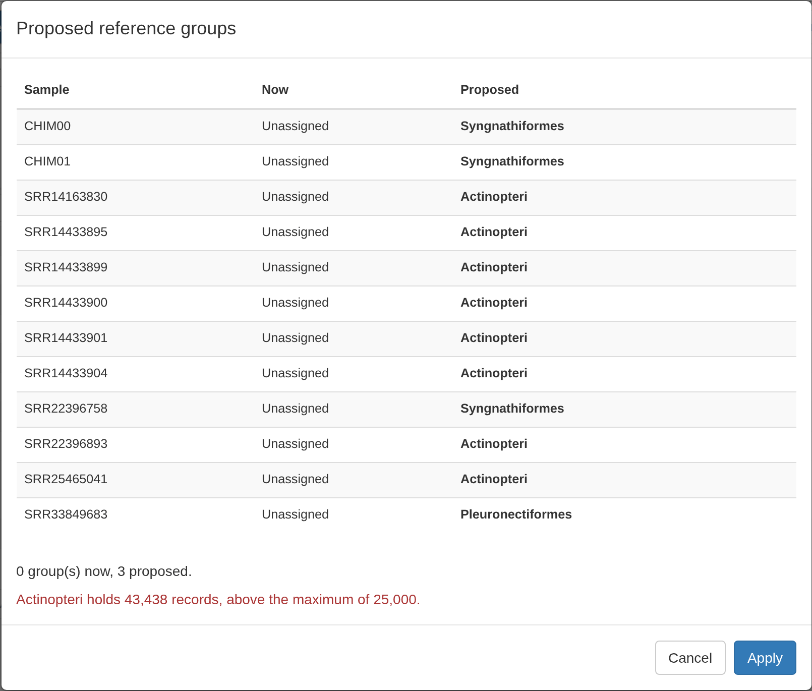
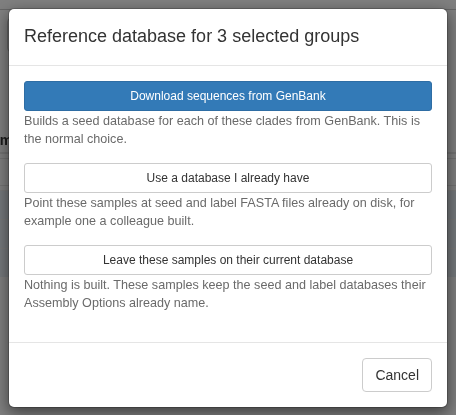
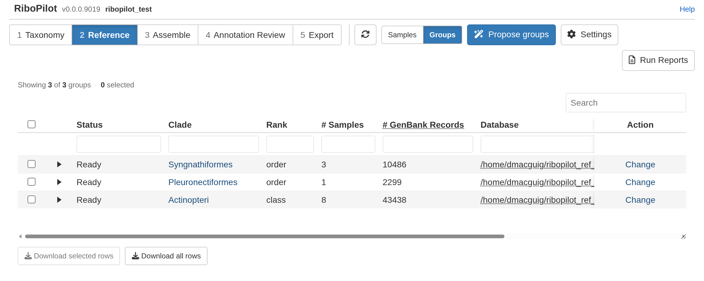
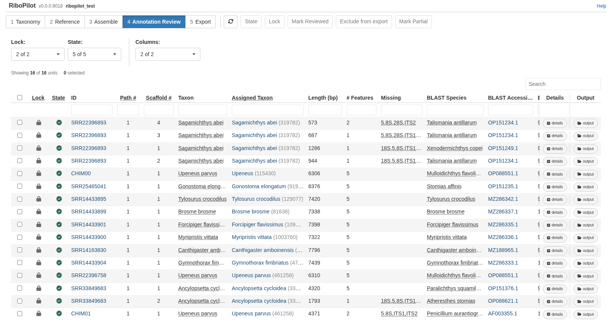
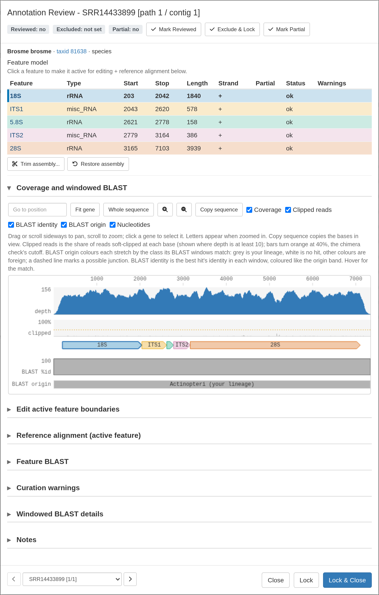
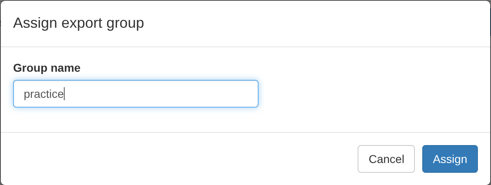
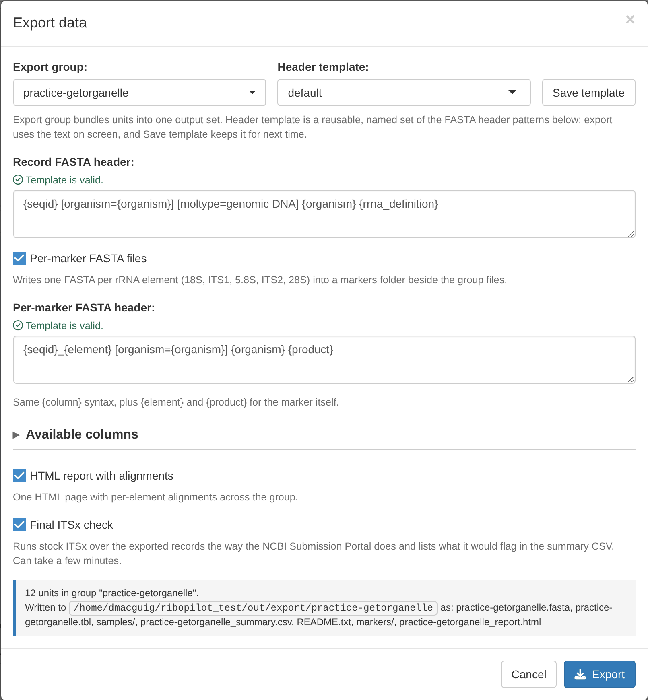
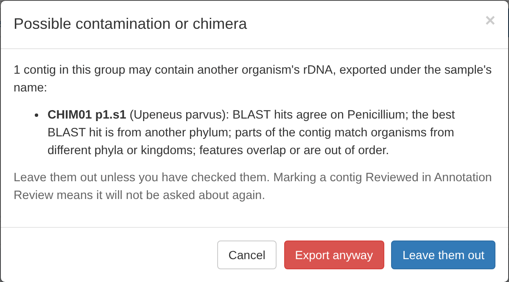
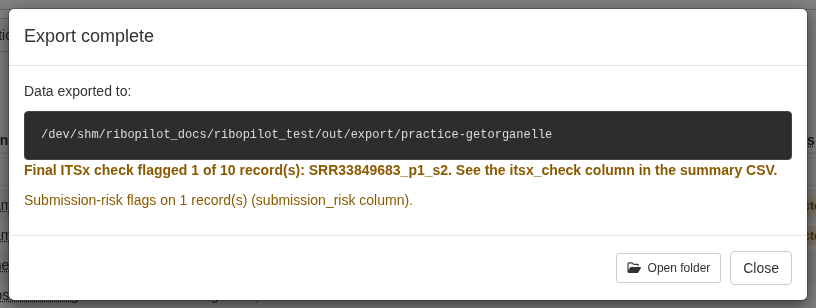

RiboPilot takes genome-skim reads to a GenBank-ready record of the nuclear
ribosomal repeat (nrDNA). You type two or three short commands in R; everything
else happens in a point-and-click app in your web browser.

If you use [MitoPilot](https://github.com/Smithsonian/MitoPilot), this will feel
familiar: the app has the same layout, it takes the same mapping file, and it
can run on the same samples.

This guide walks through the practice project, a set of 12 samples that ships
with RiboPilot: 10 fish genome skims and 2 synthetic samples made to test the
checks. Do it once before you start on your own data. If you have not installed
RiboPilot yet, start with [Installation](Installation.html).

# Samples, scaffolds, and records

A sample is one row of your mapping file. Assembling a sample can give more than
one path (another way to join the same reads), and each path can hold one or
more scaffolds. Each scaffold you keep becomes one unit in the Annotation Review
step, and one record in your GenBank export. A sample with one record is named
by its ID. A sample with more than one record gets names like
`SRR33849683_p1_s2` (path 1, scaffold 2).

# Create the practice project

In R, run:

```r
RiboPilot::new_test_project(path = "~/ribopilot_test")
```

This downloads small read files that hold only each sample's rDNA reads (a few
MB per sample) and sets up the project. The analysis runs in Docker by default,
so there is nothing else to choose. The first run later downloads the RiboPilot
container image once (about 2.6 GB).

While RiboPilot is in private preview, this download needs a GitHub token; see
[Installation](Installation.html). You may also see two warnings that the default
fish reference database is not reachable. That is expected: RiboPilot does not ship
a reference database, and the Reference step below builds the ones the practice
project needs.

The downloaded image can hold older code than the RiboPilot you installed,
since its version number does not change during development; that can make a
run fail in its R steps. See
[Upgrading RiboPilot](Installation.html#upgrading-ribopilot) for building an
image from current code.

The 10 fish are real genome skims from GenBank's Sequence Read Archive. CHIM00
and CHIM01 are synthetic: CHIM00 is a clean copy of one fish's rDNA, and CHIM01
joins that fish's 18S to the 28S of a *Penicillium* mold. Both are labeled
*Upeneus parvus*, the fish their reads came from. CHIM01 is there so you can
see the checks catch a mixed-up record. Do not submit CHIM00 or CHIM01 to
GenBank.

# Open the app

```r
RiboPilot::RiboPilot("~/ribopilot_test")
```

The app opens in your browser on the Taxonomy step. The toolbar shows the five
steps in order, and each step has its own table. Click a row to tick it, or
tick the box in the header to tick every row still shown. The **Lock** and
**State** filters, the search box, and the filter boxes under the column names
can hide rows from the table entirely; the header tick box ticks only the rows
still shown, and the toolbar buttons act only on ticked rows those filters
still show. Click a sample's ID, or its **details** button, to open its
details.

Two buttons appear in every step:

- **State** sets whether a row runs the next time you press **Update**. "Ready
  to run" means it will; "On hold" means it will not.
- **Lock** means "I am done with this step for these rows". Locked rows cannot
  have their options for that step changed, the next update does not re-run
  them, and they move on to the next step. You can unlock at any time.

The lock and state icons at the left of each row are buttons too: clicking a
row's lock icon locks or unlocks that row alone, and clicking its state icon
sets the state of that row alone, with the same questions the toolbar buttons
ask. Unlocking asks first; tick **Don't ask again this session** to skip that
question until you close the app.

::: {.alert .alert-warning}
**Keep this browser tab open while a run is going.** Closing the tab, reloading
the page, closing the run window, or pressing **Stop / Interrupt** stops the
run. RiboPilot stops it cleanly and keeps the work that finished. To carry on,
press **Update** again with **Resume previous run?** ticked. Only one run can go
at a time for a project, so you cannot start a new run until a stopped one has
finished cleaning up, which can take up to a minute. Keep the computer awake
too: a sleeping computer stops the run.
:::

# Step 1: Taxonomy

Press **Assign Taxonomy**. RiboPilot matches each Taxon in your mapping file to
the NCBI taxonomy, using a local copy. The first time, it downloads about 80 MB
and builds an index of about 0.5 GB inside the project, which takes a few
minutes. A message then counts the samples by how they matched, for example
"Checked 12 samples: 12 exact. Review and lock."

The Confidence column says how each name matched:

| Confidence | What it means | What to do |
|---|---|---|
| exact | The name matched one NCBI taxon. | Nothing. |
| fuzzy_species | No exact match, so a species of the same genus with a very similar name was picked. | Check the spelling. |
| fuzzy_genus | Only the genus matched. | Check the name, and pick the species if NCBI has it. |
| ambiguous | The name matches more than one organism; for example, the genus *Morus* is both a mulberry and a gannet. No taxon is set. | Pick the right one. The Other Matches column lists each candidate with its kingdom. |
| unresolved | No match. | Pick a taxon by hand. |
| manual | You picked the taxon by hand. | Nothing. |

To pick a taxon by hand, click the sample's ID (or tick its row and press **Edit
Taxonomy**), search for the name, and press **Assign**.

Then tick all rows and press **Lock**. Only samples whose taxonomy is locked go
on to the Assemble step and are assembled when you press **Update**. A sample
whose taxonomy is wrong would be checked against the wrong organism later. If
you lock a sample that has no taxon, RiboPilot asks you first.

All 12 practice samples match exactly. Once they are locked, every row shows a
closed lock:



# Step 2: Reference

To assemble a sample, RiboPilot compares its reads with known rDNA sequences
from related organisms, a "reference database". This step builds one database
per group of related samples, from GenBank, and reuses it across projects.

Press **Propose groups**. RiboPilot groups samples that can share a database,
using how many GenBank records each candidate group holds. For the practice
samples it proposes three groups. The red line warns that one of them,
Actinopteri (all ray-finned fishes), holds more records than the usual maximum:



Press **Apply**. Then switch to the **Groups** view, tick all three groups, and
click **Set up database** at the end of any ticked row. The window offers
**Download sequences from GenBank**, **Use a database I already have**, and
**Leave these samples on their current database**. With a single group ticked,
as in the picture, it also offers **Change which clade this group uses**:



Choose **Download sequences from GenBank**. The run window opens; press **Run
from App**. The choice applies to every ticked group, so one run builds all
three databases. Wait until every group's Status reads **Ready**:



In our test, the Syngnathiformes database (about 10,500 GenBank records) took
under 3 minutes and Pleuronectiformes (about 2,300 records) under 1 minute.
Actinopteri holds about 43,000 records, so its download takes much longer.

For your own samples, do this step before you assemble: RiboPilot does not ship a
reference database, so every group, fishes included, needs one.
[Reference databases](Reference-Databases.html) explains the other choices.

# Step 3: Assemble

## Run the pipeline

Press **Update**. The run window says how many samples will run and shows the
Nextflow command:


**Resume previous run?** reuses work that finished in an earlier run, so a
stopped or failed run picks up where it left off. Leave it ticked.

Press **Run from App**. Progress shows in the window, one line per step:


One run does everything for each sample: it cleans the reads, assembles the
rDNA, picks and scores the scaffolds, compares them with GenBank, maps the reads
back for depth, finds the five features, runs the quality checks, and proposes
which scaffolds to keep. There is no separate annotation run. The practice run
took about 16 minutes on a Linux workstation with 16 CPU cores and 61 GB of
memory.

When the run ends, the app says how it went. A clean run says "Run finished
with no failures." Otherwise it shows a report that names every sample that
failed and why. In the practice project one sample fails on purpose:


If a step of the pipeline stops with an error, the report also names the
sample, the step, the error code, and the likely cause. **Copy report** copies
it so you can send it to us. The [Troubleshooting](Troubleshooting.html) page
explains how to read it.

## Read the table

The Assemble table has one row per sample:


The columns to look at first:

- **State**: a green check means the sample finished; a red triangle means it
  failed. Hover over the icon to see what it means.
- **Lock**: open until you lock the sample.
- **Checks**: what the quality checks found on the sample's kept scaffolds,
  in words and in color. Red means Lock and Export will ask about it until
  the unit is marked Reviewed: off target (the BLAST screen matched an
  organism outside your sample's lineage), contaminant, severe chimera, or ITSx
  chimeric. Amber is worth a look: a minor chimera, an uncertain screen,
  ITSx flags, or curation warnings on the unit or its features. Green "ok" means the screen matched your
  organism and nothing was flagged; grey "no reference" means the screen had
  nothing to compare with.
- **# Paths**, **# Units**, and **# Kept**: how many assembly paths and
  scaffolds the sample gave, and how many scaffolds are kept. 0 kept means
  there is nothing to annotate.
- **ITSx Warnings**: how many of the sample's scaffolds stock ITSx flags. ITSx
  is the check NCBI runs on rRNA and ITS submissions.
- **Notes**: what the pipeline noted about the sample, for example why it
  failed.
- **User notes**: your own notes on the sample, typed in the **Notes** box at
  the bottom of its details window.

The **Columns** menu above the table shows or hides the **Stats** and
**Options** column groups.

Click a sample's ID to open its details. The window lists the sample's
scaffolds, each with **K** (keep) and **D** (drop) buttons and a Screen verdict
from the BLAST screen. Below the list are three panels for the scaffold
you click: **BLAST evidence**, **Read coverage**, and **Chimera check**. For
CHIM01, the BLAST evidence shows that the best match is a *Penicillium* mold,
which shares nothing with *Upeneus parvus*:


Its **Chimera check** marks where the fish sequence meets the mold, near
2,625 bp:


RiboPilot proposes keep or drop for each scaffold (this is called triage), and
never overwrites a call you made by hand. The **Triage** button runs the
proposal again on the ticked samples, skipping any whose assembly is locked.
[Quality checks and flags](Curation-Flags.html) explains the rules.

In this step you mostly keep or drop scaffolds. Moving gene boundaries happens
in the Annotation Review step. **Trim** and **Restore** here act on every kept
scaffold of the ticked samples, as described in that step; like every edit
there, they apply at once, with no new run.

## Rescue a sample that failed

One practice sample is expected to fail: every piece that SRR22396893's reads
assembled into is shorter than the 500 bp minimum. Its State shows a red
triangle. Open it to read why, and what to try next:


To follow that advice:

1. Click that sample's **Assembly Options** cell.
2. Type a new name in **Parameter set name**, for example `baited`, and tick
   **Edit**.
3. Under **Assembler**, choose **SPAdes, baited to the seed DB**.
4. Press **Save**. The sample is set to Ready to run.
5. Press **Update**, then **Run from App**.


Use this only for samples that failed. A sample that already has a good scaffold
does not need it.

## Lock the samples you are happy with

Tick them and press **Lock**. Locked samples appear in the Annotation Review
step. If a kept scaffold of a ticked sample has a red Checks finding, Lock names
it and asks first. For this practice run, lock all 12: when Lock asks about
CHIM01, press **Lock anyway**, so you can see the Export step catch it too.

::: {.alert .alert-info}
**What you should see.** CHIM00 is clean. CHIM01 is flagged in red: the BLAST
screen names *Penicillium*, and the chimera check calls it severe, with the join
near 2,625 bp. SRR22396893 fails, then assembles with the baited assembler.
SRR33849683 gives two scaffolds, so it becomes two records; its first scaffold
gets a minor chimera call, a weaker signal worth a look.
:::

# Step 4: Annotation Review

Each kept scaffold of a locked sample is one row, or unit:



The **Checks** column sums up each unit's checks as in the Assemble step. It sits
right after the ID, or after **Path #** and **Scaffold #** when a sample has more
than one unit, as in the practice project. The Warnings, ITSx Warnings, Screen, and
Chimera columns further right hold the details; the **Columns** menu shows or
hides them under **Check details**.

Click a unit's ID to open it. The window shows the feature model (18S, ITS1,
5.8S, ITS2, 28S), **Read coverage** with colored feature bands, **Edit active
feature boundaries**, the **Reference alignment**, **Curation warnings**, the
**Chimera check**, and **Notes**. Your notes also show in the table's **User
notes** column:



Three marks record what you decided about a unit. Use the toolbar buttons for
the ticked units, or the buttons at the top of a unit's window:

| Button | What it records | What it does to the export |
|---|---|---|
| **Mark Reviewed** | You checked this unit. | Lock and the Export window no longer ask about its contamination or chimera flags. |
| **Exclude from export** | This unit should not be submitted. | The unit is left out of every export, and the Export window says so. **Include in export** undoes it. |
| **Mark Partial** | The unit does not hold a complete repeat. The Partial column reads "no" otherwise, so filter it with "no" to list only complete units. | `{completeness}` reads "partial sequence". Gene ends are marked partial on their own (untrimmed scaffold ends, truncated genes, trims into a gene); the 5' and 3' buttons in the unit window override that per feature. |

**Lock** locks the unit and keeps the window open; **Lock & Close** locks it and
closes the window. Neither marks it Reviewed. If the unit has a red Checks
finding and is not marked Reviewed, both ask first, as **Lock** in the toolbar
does.

A locked unit is read only. To change its boundaries, trim it, restore it, or
change its marks, unlock it first. Only units that are locked here, and whose
sample is locked in the Assemble step, can be exported. Only one assembly path
can be locked per sample: paths are alternative reconstructions of the same
rDNA repeat, and a sample exports one.

To trim many units at once, tick them and press **Trim** in the toolbar. Choose
**Match gene ends** to keep only the span from 18S to 28S, or **Gene
ends + flank** to keep a few extra bases on each side. Only units
with all five features (18S, ITS1, 5.8S, ITS2, and 28S) are trimmed; the window
lists the others and why, such as a missing feature or a lock, before you
confirm. In the Assemble step, samples with a locked assembly are skipped, and
while a run is going, units still queued in it are skipped. **Restore** next to it undoes the trim on the ticked units, as
**Restore assembly** does in a unit's window.

Changes here apply at once: a trim or a boundary edit re-checks the unit right
away. Press **Update** in the Assemble step again only after you change an
option set, or set a State to Ready to run.

[Quality checks and flags](Curation-Flags.html) explains what each warning
means.

# Step 5: Export

Tick the units and press **Assign Group**, then type a group name. The name
becomes a folder name, so use only letters, digits, dot, dash, and underscore,
and start with a letter, digit, or underscore.



A GenBank submission records one assembly method, so if the group mixes
assemblers, RiboPilot offers to split it by assembler. In the practice project
the rescued sample was assembled with SPAdes, so a group named `practice` splits
into `practice-getorganelle` and `practice-bait`.

Press **Export Data**, then choose the group, the header template, and which
extra files to write:



Before it writes anything, the Export window lists every unit that the
BLAST screen or the chimera check flagged, and that you have not marked
Reviewed. It offers **Leave them out**, **Export anyway**, or **Cancel**, and
**Leave them out** is the default. In the practice project, CHIM01 is listed:



The export ends with a summary. If any exported record still carries a
submission-risk flag, the summary names it and why, above the result of the
final ITSx check; it is green only when nothing was flagged. In the practice
project CHIM01 was left out, so the summary only shows the final ITSx check,
which flags one record:



Each export group gets its own folder:

```
out/export/<group>/
    <group>.fasta           every record, one file (this is what you upload)
    <group>.tbl             feature tables (table2asn route only)
    <group>_summary.csv     one row per record, with the submission_risk column
    <group>_report.html     review report with feature maps and alignments
    <group>_itsx_check.csv  what stock ITSx says about each record
    README.txt              how to submit
    samples/                one .fasta and .tbl per record
    markers/                one folder per marker: 18S, ITS1, 58S, ITS2, 28S, ITS
    itsx_check/             raw ITSx output behind the check
```

Exporting a group again replaces its folder, and the app asks you first. Before
you upload, read [Preparing a GenBank submission](GenBank-Submission.html).

# Next: your own samples

[Your own project](Your-Own-Project.html) shows how to write a mapping file and
set up a project for your samples. If you work on a computing cluster, read
[Running on a cluster](Clusters.html); if something goes wrong, see
[Troubleshooting](Troubleshooting.html).
