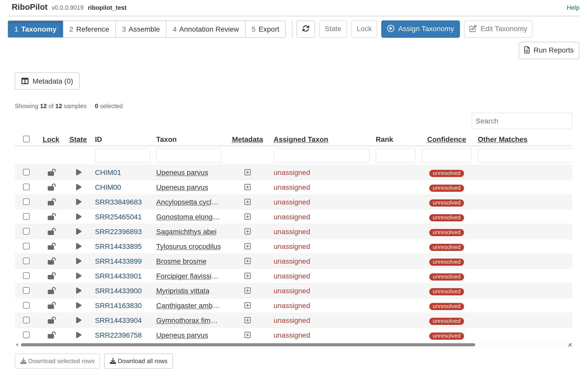

RiboPilot takes genome-skim reads and assembles a GenBank-ready record of the nuclear
ribosomal DNA repeat (rDNA). Starting a project requires only a few R commands, everything
else happens in a R Shiny app.

If you use [MitoPilot](https://github.com/Smithsonian/MitoPilot), this will feel
familiar. RiboPilot has a similar layout, it takes the same mapping file, and it
can run on the same samples. However, RiboPilot uses the `Taxon`
column in the map file throughout the pipeline. Try to provide the species ID whenever possible,
although higher level taxonomic groups should work too. See [Your own project](Your-Own-Project.html#the-mapping-file).

This guide walks through the test project, a set of 12 samples that ships
with RiboPilot: 10 fish genome skims and 2 synthetic samples made to test the
checks. Do it once before you start on your own data. If you have not installed
RiboPilot yet, start with [Installation](Installation.html).

::: {.alert .alert-hydra}
[HYDRA]{.hydra-tag} **Are you a Smithsonian user?** Boxes like this one flag
the places where the Smithsonian Hydra cluster differs from a workstation.
Before you start, get an R session on Hydra and install Nextflow. The steps are
the same as for MitoPilot: see
[Get an R session on Hydra](https://smithsonian.github.io/MitoPilot/articles/NMNH-Hydra.html#get-an-r-session-on-hydra) and
[Install Nextflow](https://smithsonian.github.io/MitoPilot/articles/NMNH-Hydra.html#install-nextflow) in the MitoPilot guide.
[Running on a cluster](Clusters.html) explains how RiboPilot uses a cluster in
general.
:::

# What your computer needs

The test project (12 samples) took about 18 minutes on a Linux workstation
with 16 CPU cores and 61 GB of memory. RiboPilot caps every task at your
computer's CPUs and memory, so a small computer runs more slowly rather than
failing. For disk space, see [Installation](Installation.html#before-you-start).

# Samples, contigs, and records

A sample is one row of your mapping file. Assembling a sample can give more than
one path (another way to join the same reads), and each path can hold one or
more contigs. Each contig you keep becomes one record in your GenBank export.
The app calls a kept contig a unit in the Annotation Review and Export steps. A sample with one record is named
by its ID. A sample with more than one record gets names like
`SRR33849683_p1_s2` (path 1, contig 2). Export files call the contig number
`scaffold`.

# Create the test project

In R, run:

```r
RiboPilot::new_test_project(path = "~/ribopilot_test")
```

This downloads small read files that hold only each sample's rDNA reads (a few
MB per sample) and sets up the project. The analysis runs in Docker by default,
so there is nothing else to choose. The first run later downloads the RiboPilot
container image once (about 2.6 GB).

::: {.alert .alert-hydra}
[HYDRA]{.hydra-tag} **Project setup.** Pass `executor = "NMNH_Hydra"`, so the
work goes to compute nodes and runs in Singularity instead of Docker:

```r
RiboPilot::new_test_project(
  path = "/pool/public/genomics/<USER>/RiboPilot/test_project",
  executor = "NMNH_Hydra"
)
```

Put projects under `/pool` or `/scratch`. Home folders are far too small. By
default Singularity's download cache and the reference folder also sit in your
home folder; [Disk space, caches, and offline use](Caches-and-Offline.html)
shows how to move them.
:::

While RiboPilot is in private preview, this download needs a GitHub token; see
[Installation](Installation.html). You may also see two warnings that the default
fish reference database is not reachable. That is expected: RiboPilot does not ship
a reference database, and the [Reference step](Test-Project-Reference.html) builds the ones the test
project needs.

The 10 fish are real genome skims from NCBI's Sequence Read Archive. CHIM00
and CHIM01 are synthetic: CHIM00 is a clean copy of one fish's rDNA, and CHIM01
joins that fish's 18S to the 28S of a *Penicillium* mold. Both are labeled
*Upeneus parvus*, the fish their reads came from. CHIM01 is there so you can
see the checks catch a mixed-up record. Do not submit CHIM00 or CHIM01 to
GenBank.

# Open the app

```r
RiboPilot::RiboPilot("~/ribopilot_test")
```

The app opens in your browser on the Taxonomy step. The toolbar shows the five
steps in order, and each step has its own table. Click a row to tick it, or
tick the box in the header to tick every row still shown. The **Lock** and
**State** filters, the search box, and the filter boxes under the column names
can hide rows from the table entirely; the header tick box ticks only the rows
still shown, and the toolbar buttons act only on ticked rows those filters
still show. Click a sample's ID, or its **details** button, to open its
details. **Download selected rows** and **Download all rows** under each table
save it as a CSV file.



Two buttons appear in every step:

- **State** sets whether a row runs the next time you press **Update**. The
  pipeline sets states itself; use the button to override one. There are five:

<table class="state-table">
<thead>
<tr><th>State</th><th>Meaning</th></tr>
</thead>
<tbody>
<tr><td><i class="fa fa-hourglass state-icon"></i> On hold</td><td>Skipped by the next Update until you set it to Ready to run</td></tr>
<tr><td><i class="fa fa-play state-icon"></i> Ready to run</td><td>Queued: the next Update will process it</td></tr>
<tr><td><i class="fa fa-circle-half-stroke state-icon"></i> In progress</td><td>Being processed by the running pipeline</td></tr>
<tr><td><i class="fa fa-circle-check state-icon"></i> Success</td><td>Finished without errors</td></tr>
<tr><td><i class="fa fa-triangle-exclamation state-icon"></i> Failed</td><td>Open the sample's details to see why and what to try next</td></tr>
</tbody>
</table>

- **Lock** means "I am done with this step for these rows". Locked rows cannot
  have their options for that step changed, the next update does not re-run
  them, and they move on to the next step. You can unlock at any time.

The lock and state icons at the left of each row are buttons too: clicking a
row's lock icon locks or unlocks that row alone, and clicking its state icon
sets the state of that row alone, with the same questions the toolbar buttons
ask. Unlocking asks first; tick **Don't ask again this session** to skip that
question until you close the app.

::: {.alert .alert-warning}
**Keep this browser tab open while a run is going.** Closing the tab, reloading
the page, closing the run window, or pressing **Stop** stops the
run. RiboPilot stops it cleanly and keeps the work that finished. To carry on,
press **Update** again with **Resume previous run?** ticked. Only one run can go
at a time for a project, so you cannot start a new run until a stopped one has
finished cleaning up, which can take up to a minute. Keep the computer awake
too: a sleeping computer stops the run.
:::

::: {.alert .alert-hydra}
[HYDRA]{.hydra-tag} **Runs go to the queue.** Open the app from RStudio Server
with the same command. The run window offers **Submit as job** instead of
**Run from App**, and a submitted job keeps going after you close the browser.
See [On the NMNH Hydra cluster](Clusters.html#on-the-nmnh-hydra-cluster).
:::

# Test project walkthrough

The app has five steps. Each page below walks through one of them with the
test project. Do them in order:

<div class="step-nav no-rule">
<a href="Test-Project-Taxonomy.html">1. Taxonomy</a>
<a href="Test-Project-Reference.html">2. Reference</a>
<a href="Test-Project-Assemble.html">3. Assemble</a>
<a href="Test-Project-Annotate.html">4. Annotation Review</a>
<a href="Test-Project-Export.html">5. Export</a>
</div>

# Where to go next

After the walkthrough, [Your own project](Your-Own-Project.html) shows how to
write a mapping file and set up a project for your samples. If you work on a
computing cluster, read [Running on a cluster](Clusters.html); if something
goes wrong, see [Troubleshooting](Troubleshooting.html).
