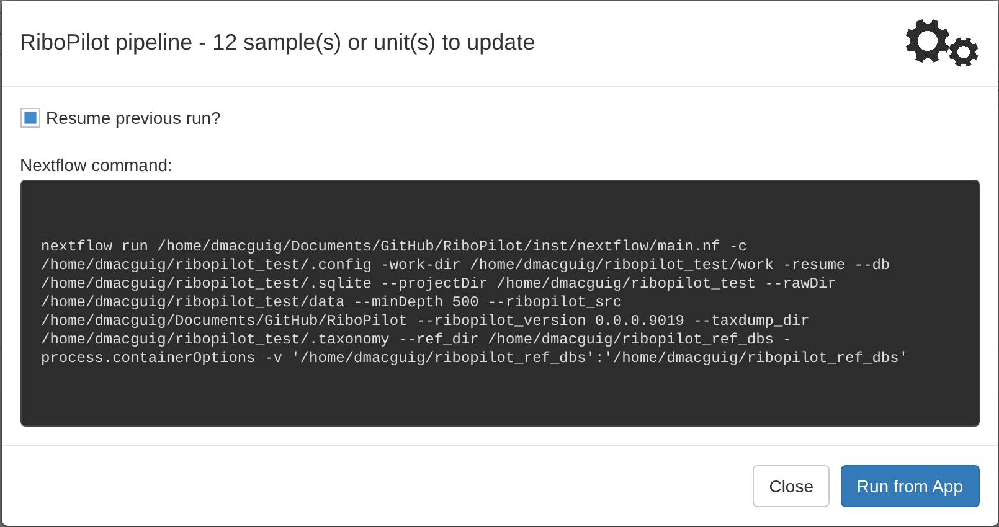
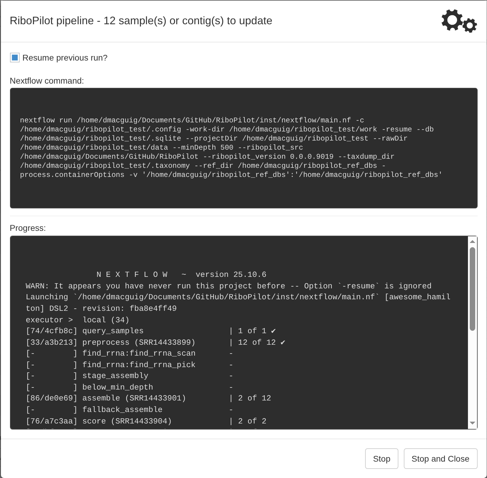
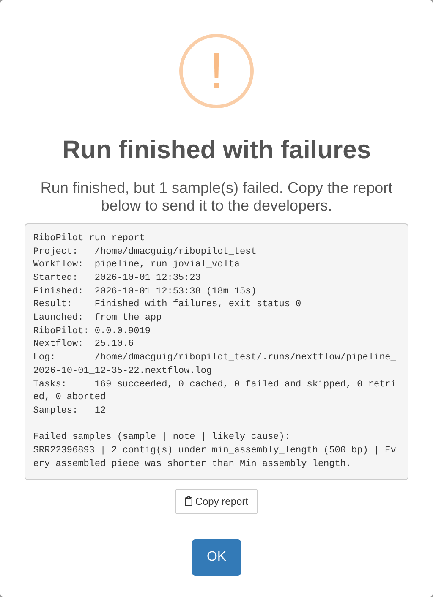
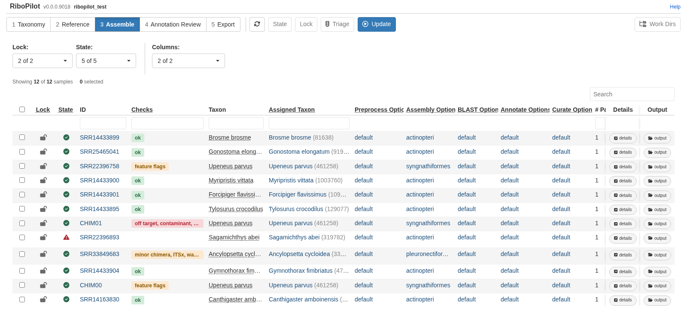
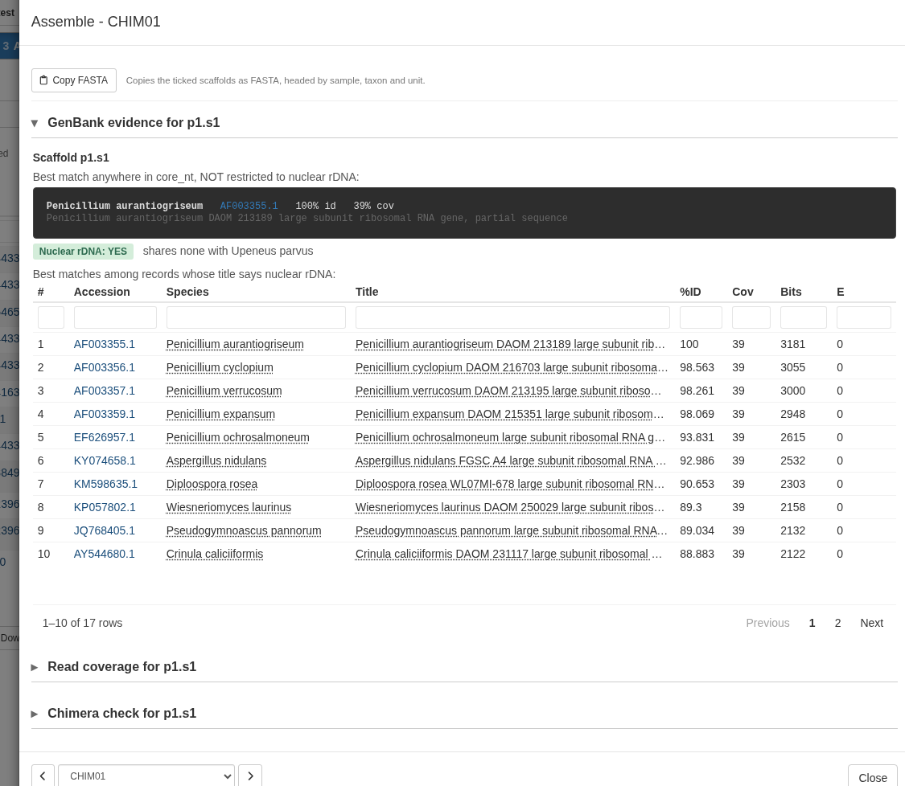
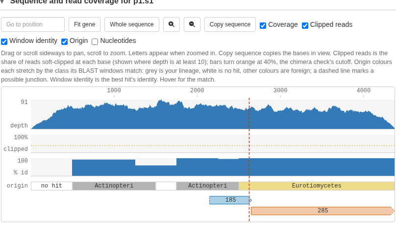
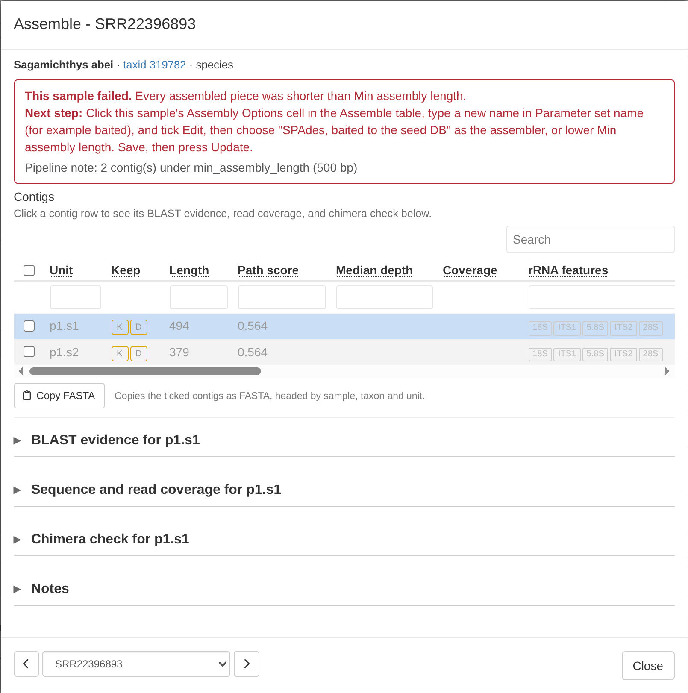
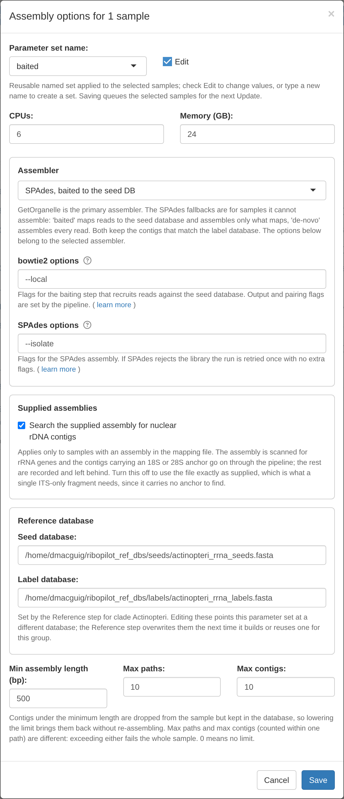

Test project:
<a href="Test-Project-Taxonomy.html">1. Taxonomy</a>
<a href="Test-Project-Reference.html">2. Reference</a>
3. Assemble
<a href="Test-Project-Annotate.html">4. Annotation Review</a>
<a href="Test-Project-Export.html">5. Export</a>

# Run the pipeline

Press **Update**. The run window says how many samples will run and shows the
Nextflow command:

**Resume previous run?** reuses work that finished in an earlier run, so a
stopped or failed run picks up where it left off. Leave it ticked.

Press **Run from App**. Progress shows in the window, one line per step:

::: {.alert .alert-warning}
**Keep this browser tab open and the computer awake while the run goes.**
Closing the tab or pressing **Stop** stops the run; see
[Stopping and resuming a run](Troubleshooting.html#stopping-and-resuming-a-run).
:::

::: {.alert .alert-hydra}
[HYDRA]{.hydra-tag} **Submit as job.** Press **Submit as job** in place of
**Run from App**; see [Submit a run as a job](Clusters.html#submit-a-run-as-a-job).
:::

One run does everything for each sample: it cleans the reads, assembles the
rDNA, picks and scores the contigs, compares them with GenBank, maps the reads
back for depth, finds the five features, runs the quality checks, and proposes
which contigs to keep. There is no separate annotation run. The test run
takes about 20 minutes.

When the run ends, the app says how it went. A clean run says "Run finished
with no failures." Otherwise it shows a report that names every sample that
failed and why. In the test project one sample fails on purpose:

If a step of the pipeline stops with an error, the report also names the
sample, the step, the error code, and the likely cause. **Copy report** copies
it so you can send it to us. The [Troubleshooting](Troubleshooting.html) page
explains how to read it.

# Read the table

The Assemble table has one row per sample:

The columns to look at first:

- **State**: a green check means the sample finished; a red triangle means it
  failed. Hover over the icon to see what it means.
- **Lock**: open until you lock the sample.
- **Checks**: what the quality checks found on the sample's kept contigs.
  Red means Lock and Export will ask about it first, amber is worth a look,
  green is ok, and grey means there was nothing to compare with. See
  [The Checks column](Curation-Flags.html#the-checks-column).
- **# Paths**, **# Contigs**, and **# Kept**: how many assembly paths and
  contigs the sample gave, and how many contigs are kept. 0 kept means
  there is nothing to annotate.
- **ITSx Warnings**: how many of the sample's contigs stock ITSx flags; see
  [the final ITSx check](GenBank-Submission.html#check-before-you-submit).
- **Notes**: what the pipeline noted about the sample, for example why it
  failed.
- **User Notes**: your own notes on the sample, typed in the **Notes** box at
  the bottom of its details window.

The **Columns** menu above the table shows or hides the **Stats** and
**Options** column groups.

Click a sample's ID to open its details. The window lists the sample's
contigs, each with **K** (keep) and **D** (drop) buttons and a Screen verdict
from the BLAST screen. Below the list are three panels for the contig
you click: **BLAST evidence**, **Sequence and read coverage**, and **Chimera check**. For
CHIM01, the BLAST evidence shows that the best match is a *Penicillium* mold,
which shares nothing with *Upeneus parvus*:

Its **Chimera check** marks where the fish sequence meets the mold, near
2,625 bp:

RiboPilot proposes keep or drop for each contig (this is called triage), and
never overwrites a call you made by hand. The **Triage** button runs the
proposal again on the ticked samples, skipping any whose assembly is locked.
[Quality checks and flags](Curation-Flags.html) explains the rules.

In this step you mostly keep or drop contigs. Moving gene boundaries happens
in the Annotation Review step.

# Rescue a sample that failed

One test sample is expected to fail: every contig that SRR22396893's reads
assembled into is shorter than the 500 bp minimum. Its State shows a red
triangle. Open it to read why, and what to try next:

To follow that advice:

1. Click that sample's **Assembly Options** cell.
2. Type a new name in **Parameter set name**, for example `baited`, and tick
   **Edit**.
3. Under **Assembler**, choose **SPAdes, baited to the seed DB**.
4. Press **Save**. The sample is set to Ready to run.
5. Press **Update**, then **Run from App**.

::: {.alert .alert-hydra}
[HYDRA]{.hydra-tag} **CPUs and memory are per-job requests.** On Hydra the
**CPUs** and **Memory (GB)** in an options window become each job's request to
the scheduler. A request of more than 8 GB per CPU is flagged as a high-memory
job automatically. See the
[Hydra wiki](https://confluence.si.edu/spaces/HPC/pages/163152285/Compute+Nodes)
for the compute nodes on offer.
:::

Use this only for samples that failed. A sample that already has a good contig
does not need it. [Choosing an assembly method](Assembly-Methods.html)
compares the three assemblers.

# Lock the samples you are happy with

Tick them and press **Lock**. Locked samples appear in the Annotation Review
step. If a kept contig of a ticked sample has a red Checks finding, Lock names
it and asks first. For this test run, lock all 12: when Lock asks about
CHIM01, press **Lock anyway**, so you can see the Export step catch it too.

::: {.alert .alert-info}
**What you should see.** CHIM00 is clean. CHIM01 is flagged in red: the BLAST
screen names *Penicillium*, and the chimera check calls it severe, with the join
near 2,625 bp. SRR22396893 fails, then assembles with the baited assembler.
SRR33849683 gives two contigs, so it becomes two records; its first contig
gets a minor chimera call, a weaker signal worth a look.
:::

<a href="Test-Project-Annotate.html">Next: Annotation Review &rarr;</a>

