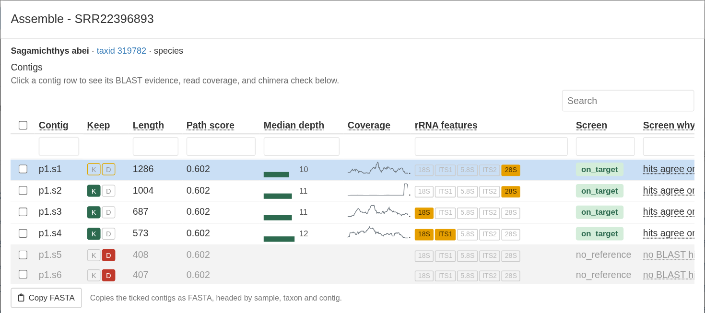

Test project:
<a href="Test-Project-Taxonomy.html">1. Taxonomy</a>
<a href="Test-Project-Reference.html">2. Reference</a>
3. Assemble
<a href="Test-Project-Annotate.html">4. Annotation Review</a>
<a href="Test-Project-Export.html">5. Export</a>

# Run the pipeline

To start the pipeline, press **Update**. The run window says how many samples will run and shows the
Nextflow command:

**Resume previous run?** reuses work so that a
stopped or failed run picks up where it left off. Leave it ticked.

Press **Run from App**. Progress shows in the window, one line per step:

::: {.alert .alert-warning}
**Keep this browser tab open and the computer awake while running the pipeline.**
Closing the tab or pressing **Stop** stops the run; see
[Stopping and resuming a run](Troubleshooting.html#stopping-and-resuming-a-run).
:::

::: {.alert .alert-hydra}
[HYDRA]{.hydra-tag} **Submit as job.** Press **Submit as job** in place of
**Run from App**; see [Submit a run as a job](Clusters.html#submit-a-run-as-a-job).
:::

One pipeline run does everything for each sample: it cleans the reads, assembles the
rDNA, picks and scores the contigs, compares them with GenBank, maps the reads
back for depth, annotates the five features, runs the quality checks, and proposes
which contigs to keep. There is no separate annotation run. The test run
takes about 20 minutes.

When the run ends, the app reports how it went. A clean run says "Run finished
with no failures." Otherwise it shows a report that names every sample that
failed and why. In the test project one sample fails on purpose:

If a step of the pipeline stops with an error, the report also names the
sample, the step, the error code, and the likely cause. **Copy report** copies
it so you can easily share it with the developers for assistance. The [Troubleshooting](Troubleshooting.html) page
explains how to interpret the report.

You can examine these reports later by clicking the **Run Reports** button in the top right
corner of the app.

# Examine the results

The Assemble table has one row per sample:

The columns to look at first:

- **State**: a green check means the sample finished; a red triangle means it
  failed. Hover over the icon to see what it means.
- **Lock**: open until you lock the sample.
- **Checks**: summary of all quality checks for the sample's kept contigs.
  Red means Lock and Export will ask about it first, amber is worth a look,
  green is ok, and grey means there was nothing to compare with. See
  [The Checks column](Curation-Flags.html#the-checks-column).
- **# Paths**, **# Contigs**, and **# Kept**: how many assembly paths and
  contigs the assembly produced, and how many contigs are kept. 0 kept contigs means
  there is nothing to export.
- **ITSx Warnings**: shows any issues reported by the ITSx check; see
  [the final ITSx check](GenBank-Submission.html#check-before-you-submit).
- **Notes**: what the pipeline noted about the sample, for example why it
  failed.
- **User Notes**: your own notes on the sample, typed in the **Notes** box at
  the bottom of its details window.

Click a sample's ID to open its details. The window lists the sample's
contigs, each with **K** (keep) and **D** (drop) buttons, as well as other 
information like coverage, features annotated, and the verdict
from the BLAST screen. Below the list are three panels for the highlighted contig:
**BLAST evidence**, **Sequence and read coverage**, and **Chimera check**. 

CHIM01 is an artificial chimeric contig, crated by joining sequence data from
*Penicillium* mold and the fish species *Upeneus parvus*.
The BLAST evidence shows that the best overall match is a *Penicillium* mold:

But the the **Chimera check** panel shows more detail. You can see where the
fish sequence was spliced with the mold sequence, near 2,625 bp:

RiboPilot proposes keep or drop for each contig (a process called triage), and
never overwrites a call you made by hand. The **Triage** button runs the
proposal again on the ticked samples, skipping any whose assembly is locked.
[Quality checks and flags](Curation-Flags.html) explains the triage rules.

In the Assemble step, you mostly choose which contigs to keep or drop contigs.
Trimming contigs and adjusting gene boundaries happens in the Annotation Review step.

# Rescue a sample that failed

One test sample is expected to fail: every contig assembled for SRR22396893
is shorter than the default 500 bp minimum. Its State shows a red
triangle. Open it to read why, and what to try next:

To follow that advice:

1. Click that sample's **Assembly Options** cell.
2. Type a new name in **Parameter set name**, for example `baited`, and tick
   **Edit**.
3. Under **Assembler**, choose **SPAdes, baited to the seed DB**.
4. Press **Save**. The sample is set to Ready to run.
5. Press **Update**, then **Run from App**.

::: {.alert .alert-hydra}
[HYDRA]{.hydra-tag} **CPUs and memory are per-job requests.** On Hydra the
**CPUs** and **Memory (GB)** in an options window become each job's request to
the scheduler. A request of more than 8 GB per CPU is flagged as a high-memory
job automatically. See the
[Hydra wiki](https://confluence.si.edu/spaces/HPC/pages/163152285/Compute+Nodes)
for the compute nodes on offer.
:::

When the run finishes, open SRR22396893's details. Baited SPAdes recovers
four contigs over 500 bp, but none spans the whole 18S-to-28S region.
The two shorter contigs are set to Drop. Read depth for all of the contigs
is low, which is likely why the we cannot assemble a larger contig.

For more information about assemblers in RiboPilot, see [Choosing an assembly method](Assembly-Methods.html)

# Lock the samples when you are done reviewing

Select one or more samples and press **Lock**. Locked samples now appear in the Annotation Review
step. For this test run, lock all 12 passing samples. When Lock asks about
CHIM01, press **Lock anyway**, so you can see the Export step catch it too.

<a href="Test-Project-Annotate.html">Next: Annotation Review &rarr;</a>

