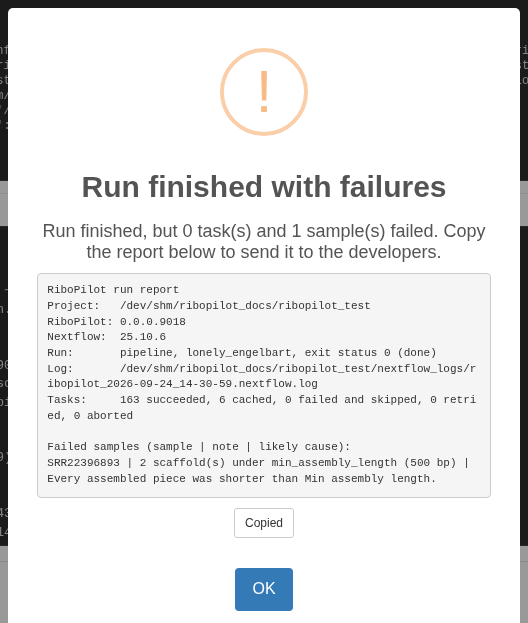

# When a run fails: read the report

When a run ends with a failure, the app shows a report instead of the usual
"Run finished with no failures." The title says how the run ended: "Run
finished with failures" (the run finished, but some samples or steps failed),
"Run failed" (the run itself stopped with an error), or "Run stopped". Press
**Copy report** to copy the report, for example to send it to us:



RiboPilot also saves the report in the project's `nextflow_logs` folder, next to
the run's Nextflow log. Here is the report from the practice project:

```
RiboPilot run report
Project:   ~/ribopilot_test
RiboPilot: 0.0.0.9018
Nextflow:  25.10.6
Run:       pipeline, lonely_engelbart, exit status 0 (done)
Log:       ~/ribopilot_test/nextflow_logs/ribopilot_2026-09-24_14-30-59.nextflow.log
Tasks:     163 succeeded, 6 cached, 0 failed and skipped, 0 retried, 0 aborted

Failed samples (sample | note | likely cause):
SRR22396893 | 2 scaffold(s) under min_assembly_length (500 bp) | Every assembled piece was shorter than Min assembly length.
```

What each part means:

- **Run** and **Log**: the run's name, how Nextflow exited, and where its full
  log is.
- **Tasks**: how many pipeline steps ran, were reused from an earlier run,
  failed, were retried, or were stopped.
- **Failed tasks**, when a step stopped with an error: one line per failed
  step, with the sample ID, the step (the pipeline step's name; see the table
  below), the error code (the raw number the step exited with, for example
  140), the likely cause, the last line of the step's error output, and its
  working folder.
- **Failed samples**: samples that finished without a usable assembly, with the
  pipeline's note and the likely cause.

Samples that failed do not stop the others. Most steps skip a failed sample and
carry on, so a run can finish with some samples done and a few failed.

The step names you may see, and what each step does:

| Step | What it does |
|---|---|
| `query_samples` | Reads the list of samples to run from the project. |
| `preprocess` | Cleans and trims the reads. |
| `below_min_depth` | Marks samples with too few reads to assemble. |
| `find_rrna`, `stage_assembly` | Search an assembly you supplied for rDNA contigs. |
| `assemble` | Assembles the rDNA with GetOrganelle. |
| `fallback_assemble` | Assembles with SPAdes (baited or de-novo). |
| `score` | Scores the scaffolds and picks a path. |
| `blast_genbank` | Runs the BLAST screen: searches each scaffold in the bundled rDNA database, and at NCBI when that finds nothing. |
| `blast_ref_fetch`, `blast_ref_align` | Download reference sequences and align to them. |
| `coverage` | Maps the reads back for depth. |
| `annotate_tools`, `reconcile` | Find the five features. |
| `curate`, `screen`, `chimera` | Run the quality checks, the Screen verdict, and the chimera check. |
| `triage` | Proposes which scaffolds to keep. |

# Error codes

These are the codes the report explains, with what they usually mean:

| Code | What it usually means | What to do |
|---|---|---|
| 104, 247 | The step likely ran out of memory. | Raise **Memory (GB)** in that step's options for the sample, for example in **Assembly Options**. |
| 125 | The container could not start: the image is missing, or a folder could not be mounted. | Check that Docker or Singularity works, and that the project's image can be downloaded. |
| 126 | A command could not be run (permission denied). | Check the permissions of the project folder and the reads. |
| 127 | A command was not found: a tool is missing from the container or the PATH. | Usually the conda executor. Use Docker or Singularity. |
| 130 | The step was interrupted. | Press **Update** with **Resume previous run?** ticked. |
| 134 | The tool aborted, often because it ran out of memory. | Raise **Memory (GB)**. |
| 137 | The step was killed: it ran out of memory, or the system stopped it. | Raise **Memory (GB)**. On a cluster, it can also be a time limit: raise `walltime` in your profile. |
| 139 | The tool crashed (segmentation fault), often because it ran out of memory. | Raise **Memory (GB)**. |
| 140 | The scheduler killed the job, usually because it went over its time or memory limit (SGE and LSF clusters). | More memory does not fix a time limit: raise `walltime` in your profile, or memory. |
| 143 | The step was stopped from outside, by the scheduler or by the system, often over its time or memory limit. | As for 140. |
| `-` | No exit code: the step was stopped before it finished. | Run again with **Resume previous run?** ticked. |
| any other | The tool stopped with an error. | Read the last error in the report, and the step's log (see below). |

The memory-hungry steps (`preprocess`, `assemble`, `fallback_assemble`,
`find_rrna_scan`, and `annotate_tools`) retry by themselves after codes 104, 134, 137, 139, 140, 143,
and 247, up to three times, with more memory each time. The report says how
often a step was tried.

# When a sample fails for another reason

Some failures are not an error code: too few reads, only short pieces
assembled, or no rRNA genes found. The Notes column says why, and the sample's
details window shows a red box with the reason and what to try next. To rescue
a sample whose assembly failed, see the rescue section of
[Get started](RiboPilot.html).

# Where to look

- The run report, and the Notes column of the Assemble table.
- The sample's details window (click its ID).
- **Work Dirs**, in the Assemble step: the pipeline's working folder for each
  step of the ticked sample, with the step's `.command.log` and
  `.command.err`.
- The Nextflow log of each run, in the project's `nextflow_logs` folder.

# Run a sample again

Select it, press **State**, choose **Ready to run**, then press **Update** with
**Resume previous run?** ticked. Work that already finished is reused.

# Stopping and resuming a run

Keep the browser tab open while a run is going. Closing the tab, reloading the
page, closing the run window, or pressing **Stop / Interrupt** stops the run.
RiboPilot stops it cleanly and keeps the work that finished. To carry on, press
**Update** again with **Resume previous run?** ticked. Keep the computer awake
too: a sleeping computer stops the run.

When you press **Stop / Interrupt**, the app says "Stopping the run: Nextflow is
stopping its tasks. This can take up to a minute." When it is done, a "Run
stopped" report appears. If Nextflow does not stop within a minute, RiboPilot
stops it by force, and the report says that some task containers may still be
running: check them before you start a new run.

Only one run can go at a time for a project, and a stopped run still counts
until its tasks have finished cleaning up. Pressing **Update** before then
gives a message that a run is already going (see below).

# Common messages

| Message | What it means | What to do |
|---|---|---|
| "No samples to show. A sample is listed once its taxonomy is locked in the Taxonomy step. ..." | The Assemble table lists only samples whose taxonomy is locked, and the Lock and State filters and the search box can hide the rest. | Lock the samples in the Taxonomy step, or reset the filters and clear the search box. |
| "Nothing to update": "No samples or annotation units are Ready to run. ..." | Nothing is queued. Locked or finished samples are skipped. | Set the State of the rows you want to Ready to run, then press **Update**. |
| "N reference group(s) are not built or skipped (...)." | Some reference groups have no database yet. The run goes ahead, and those samples use the database their options already name. | Build the databases in the Reference step first. |
| "Cannot run: N reference database file(s) named by the samples queued for assembly are missing or empty (...)." | A database the samples point at is gone. | Rebuild it in the Reference step, or point those samples at a database that exists. |
| "A pipeline run is already going for this project, or is still stopping its tasks (started ...)." | Another window, or a stopped run that is still cleaning up, holds the project. | Wait for it to finish, or stop it in the window that started it. |
| "The mapping file is missing column(s): ..." | The mapping file needs ID, Taxon, R1, and R2 (or Assembly). | See [Your own project](Your-Own-Project.html). |
| "IDs may use only letters, digits, dash (-), underscore (_), and colon (:) ..." or "IDs must be 18 characters or fewer." | An ID breaks the ID rules. | Rename it in the mapping file. |
| "Read files named in the mapping file were not found in ..." | A name in R1 or R2 does not match a file in `data_path`. | Check the spelling, and that names are relative to `data_path`. |
| "These paths have characters the pipeline cannot pass to Docker, Singularity, or Nextflow: ..." | A path has a space, a quote mark, or another special character. | Rename it to use only letters, digits, and `.`, `_`, `-`, and `/`. |
| "Group name ... cannot be used: it becomes a folder name ..." | An export group name has a space or another special character. | Use the name the message suggests. |
| `contaminant_unchecked`, or the triage flag "BLAST screen has not run" | The BLAST screen has no usable hit for the scaffold: nothing matched in the bundled rDNA database, and the search at NCBI matched nothing, failed, or was switched off; or the bundled database returned a hit whose lineage could not be resolved, so the scaffold was never sent on to NCBI. It also appears when the sample has no taxon. | If NCBI could not be reached, set the sample to Ready to run and press **Update** once it can: the scaffold is searched again. For a bundled-database hit with no usable lineage, choose "NCBI only (core_nt)" under **Search** in the sample's BLAST Options, then set it Ready to run and press **Update**. If the sample has no taxon, set one in the Taxonomy step. |
| "Nextflow ... is below the minimum supported version (24.10.0)." | Your Nextflow is too old. | Install Nextflow 24.10 through 25.10; see [Installation](Installation.html). |
| "Nextflow ... is newer than RiboPilot has verified ... Runs will be pinned to Nextflow 25.10.6 via NXF_VER." | RiboPilot runs a supported version instead, downloading it once. | Nothing, or install a supported version. |
| "Container image ... is not published on Docker Hub, so container executors will fail at image pull." | The project names an image Docker cannot download. | Check the `container` you passed to `new_project()`, and your network. |
| "Container version does not match RiboPilot" (when the app opens) | The project's `.config` names the RiboPilot image for another version, so runs use that image's code and tools. | Edit the `container` line in the project's `.config` to the image the message names (see [Upgrading](Installation.html#upgrading-ribopilot)). The app works either way. |
| A BLAST error with "GNUTLS" or "secure session" | Conda setups only: BLAST is too old to reach NCBI. | See [Installing tools without a container](Without-Containers.html). |

# Asking for help

Open an issue at https://github.com/dmacguigan/RiboPilot/issues. Paste the
copied run report, and add your RiboPilot version (`packageVersion("RiboPilot")`
in R), your Nextflow version (`nextflow -v`), and whether you use Docker,
Singularity, or a cluster profile. Check that nothing you paste contains your
NCBI API key.
